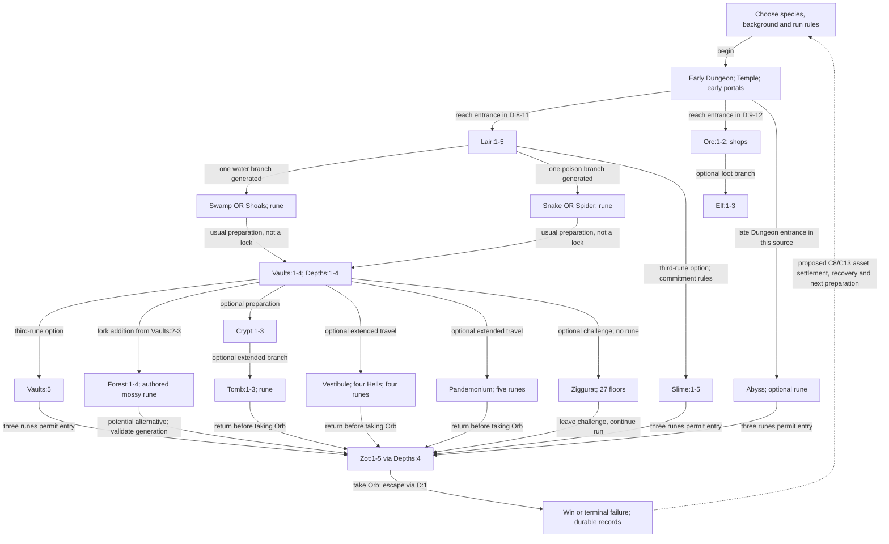

# DCSS content and progression map

Research snapshot: 18 October 2026. Scope: the traditional three-rune game, extended play, this fork's additions, cooperative expeditions, and play between runs.

The selected metagame direction is **persistent assets, equipment and company capabilities that materially change later runs**. The user rejected accomplishment-led progression. Actual returned gear, treasury capital, archived magic, funded starting training and field services now anchor the Company Campaign. The broader content map still identifies opportunities for cooperative encounters and branch-to-branch consequences.

Latest refinement: persistent assets require a **guild**. Scattered materials belong to their collecting players, who may voluntarily contribute them to buildings benefiting every member. Equipment title stays distinct from custody when co-op participants return, fall or leave separately.

This is a design map, not an implementation plan approved for execution. No gameplay code, saves or deployed services were changed for this research.

## Read the map

| View | What it answers |
| --- | --- |
| [Progression and place atlas](progression.md) | Where does a normal or extended run go? What is optional? What is different in this fork? |
| [Content systems, capabilities and gaps](systems.md) | Which mechanisms already exist, what roles does content play, and where are the underdeveloped combinations? |
| [Species, backgrounds and connected content slate](../design/content-slate/README.md) | How do five proposed species, four starting backgrounds and their spells, loot and encounters fit the existing dungeon? Chain Devil is the next species design focus. |
| [Co-op and metagame concepts](concepts.md) | What would new content actually make players choose, do, risk and change? |
| [Company assets and campaign](company-campaign/README.md) | How do real equipment, capital, training and services change fresh solo/co-op runs? |
| [Guild resources and buildings](company-campaign/guild-resources.md) | How do personal material finds fund shared facilities without surrendering private ownership? |
| [Building upgrade trees and costs](company-campaign/buildings.md) | What do eight building tracks, 23 funded upgrades and their prerequisites change in play? |
| [Equipment recipes](company-campaign/equipment-recipes.md) | What do 47 concrete production/research recipes cost and enable for co-op? |
| [Guild economy](company-campaign/guild-economy.md) | Which investments fit proposed early, normal-depth and extended return budgets? |
| [Inheritance, extraction and recovery](company-campaign/inheritance-extraction-recovery.md) | Who receives gear and materials when individual co-op heroes return, die, disconnect or leave the guild? |
| [Asset progression through extended](company-campaign/asset-progression.md) | How do early returns lead to formations, outposts, realm apparatus and deeper expeditions? |
| [Priorities and frontier probes](frontiers.md) | Which ideas are worth pursuing first, and what evidence would change that decision? |
| [Evidence and limitations](evidence.md) | Which claims are source-backed, which were observed here, and what remains untested? |
| [Native catalogue snapshot](catalogue-summary.json) | What did the local executable report, including counts, names of starting options, and its provenance? |
| [Complete native catalogue index](catalogue-index.md) | Which enemies, spells, species, backgrounds, gods, mutations, skills, branches, item types and legal starting combos are present in that export? |

## The progression spine

Solid arrows below are representative travel/progression relationships, not mandatory clear orders. The detailed atlas distinguishes physical entrances, recommended timing and actual locks. The fork's Forest is deliberately outside the traditional rune count.

The ordinary route is **Dungeon → Lair/Orc → two Lair-branch runes → prepare in Vaults/Depths → choose a third rune → Zot → escape**. Elf and Crypt are optional. Extended is an optional commitment made before the Orb escape, with a traditional ceiling of 15 runes. A five-rune run is a useful middle goal; 15 runes is not the only meaningful extension.

## Where to add depth at every stage

These are design judgments from the inventory, not measured player complaints. Existing danger, loot and tactical variety are substantial; the gaps concern different decisions and consequences.

| Stage | Existing decision density | Opportunity to develop | Concrete candidate |
| --- | --- | --- | --- |
| Before a run | Very broad builds; comparatively little persistent preparation | Issue actual company equipment, funded training, archived magic and supplies | C8 Hall asset management; C13 Company Campaign |
| D:1-7 | Fragile survival, identification, early god choice | Small readable cooperative decisions before builds mature | C2 Signal Vaults; no new onboarding menu |
| Lair/Orc | Growth, shops, resistance preparation, first route selection | Resource allocation and optional preparation that change a later encounter | C3 Expedition Projects |
| First two runes | Strong regional combat identities | Different ways to approach the same rune encounter | C4 Branch Operations |
| Vaults/Depths | Mature build, mixed threats, gear refinement | Multiple objectives, rescue and paired enemies that alter one another | C5 Linked Encounters; C6 Recovery Objectives |
| Third rune | Distinct branch risks and commitments | More legible, balanced alternatives; qualify the fork's Forest before adding more | Forest audit; C1 route goals |
| Zot | Final loadout and encounter execution | Party positioning and split tasks without requiring a healer or fixed composition | C5 variants; C7 Orb Relay |
| Orb escape | A reversal from exploration to extraction | Deliberate extraction roles, fair credit and a clear party end condition | C7 Orb Relay |
| Extended | Severe attrition, resistances, boss/realm knowledge | Horizontal expedition changes after XL27, distinct realm objectives | C10 Infernal Operations; C11 Planar Expeditions |
| Ziggurats | Extreme crowd-control and endurance builds | Optional alternate objectives so only one optimized build is not the whole mode | C12 Trial Circuits |
| Between runs | Knowledge, ghosts, records, tournaments, statistics | Preserve actual equipment, develop production/training, allocate field stock and recover losses | C8/C13 asset campaign; C1/C9 optional supporting tools |

## The connected design space

| Dimension | Well occupied | Promising extension | Boundary to preserve or decide |
| --- | --- | --- | --- |
| Actors | One hero; multiple authenticated party heroes in the fork | Support, scouting, carrying, interruption and recovery as encounter contributions | Multiplayer ownership stays personal; no compulsory role composition |
| Space | Floors, branches, line of sight, terrain, noise, timed portals | Connected encounter wings; optional split routes; rendezvous | Independent floors do not share a naturally advancing clock |
| Time | Actions, speed, floor clocks, timers, gem deadlines | Objective windows, staged commitments, choose when to abandon | Use game time with an explicit scope; no real-time attendance pressure |
| Resources | HP, MP, piety, consumables, XP, gold, inventory, position | Visible allocation of a finite run resource among different future uses | New resource only if existing resources cannot express the choice |
| Information | Identification, map memory, native perception, reference information | Incomplete reconnaissance as a tactical problem; spoiler-aware personal discovery | Necessary rules remain readable; shared memory is not shared live vision |
| History | Run progression, ghosts, morgues, persistent IDs and records | History changes the next selected challenge or campaign configuration | Records do not currently establish an entitlement or a world-state mutation |
| Failure | Death, escape, downed state and revival in this fork | Recoverable objective losses and campaign setbacks | Do not make dying or disconnecting the optimal reward strategy |

## Recommended direction

1. **Start with C8/C13: personal materials, contributed guild Armory and separate returns.** Fund one shared building voluntarily and move actual useful property into a fresh party while peers continue the original expedition. Preserve title and one custody chain. Stronger early loadouts are an intended reward.
2. **Add permanent library knowledge and funded starting training.** They create reliable build changes that survive equipment loss. Respect native memorization/equipment rules and record actual company preparation.
3. **Connect cooperative equipment and one supplied Lair/Orc contact.** Reuse trade, native effects, perception and geometry to create formation, banking, resupply and asset-risk decisions. Keep multiple compositions and solo play viable.
4. **Explore recovery, realm apparatus and advanced deployment.** These extend the asset economy into late/extended content; characterize native loss, travel and start-state boundaries before multiplying variants.

The earlier recommendation to center mastery/identity and preserve company heroes' starting power was superseded by the user's direction. [The current Company Campaign](company-campaign/README.md) develops tangible mechanical inheritance. Assets can make earlier content easier, support newcomers and enable different co-op builds. Their native implementation, economy and loss policy remain to be assessed; no campaign gameplay has been implemented.

The next discriminating action is a returned-equipment loop: compare a company's earlier party with a fresh party using two actual returned items, then test interrupted/concurrent custody and a loss/recovery variation. The [current asset probes](company-campaign/contracts.md#discriminating-assessments) distinguish physical transfer, useful progression and unsupported metadata claims. The original [frontier inventory](frontiers.md) remains context for later encounter work.
