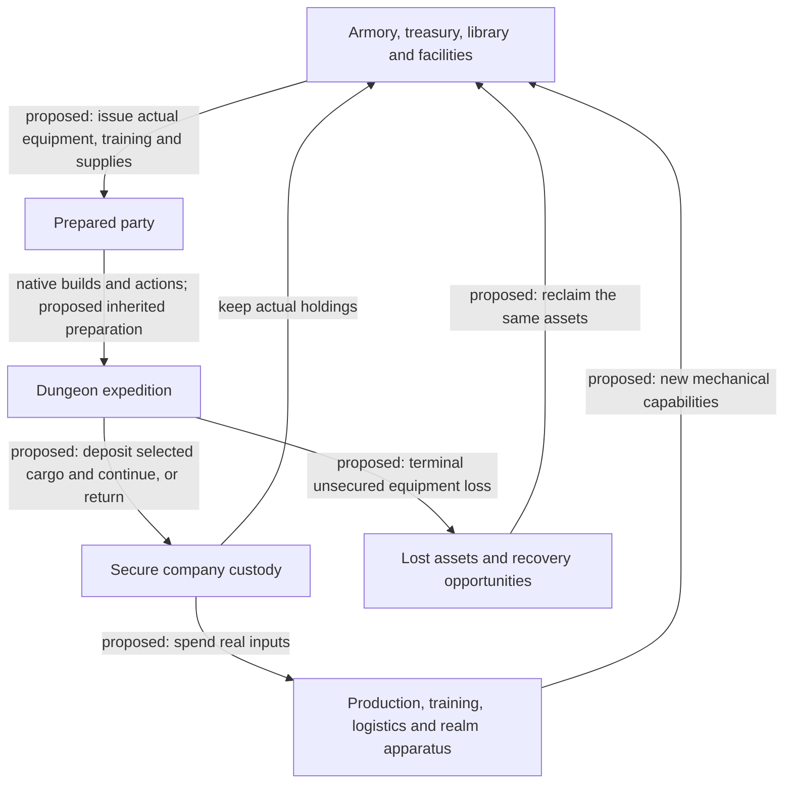

# Company Campaign: assets, equipment and shared capabilities

Current design direction, 18 October 2026. The user explicitly rejected accomplishment-led progression and asked for **tangible progression between runs that changes gameplay**. Persistent equipment, capital and company capabilities are now the foundation. Stronger future starts and usable mechanical advantages are intended outcomes.

Latest selected requirement: **persistent assets require a guild**. Players collect their own materials in expeditions and voluntarily contribute them to guild buildings that benefit every member. “Company” now means this persistent guild; the expedition party is a temporary roster. Personal ownership, guild ownership and current carrier are distinct.

This supersedes the earlier Charter Hall proposal based on distinctions, milestone banking and operation unlocks. [The prior draft](accomplishments-draft.md) preserves historical reasoning only. All new mechanics here remain proposed. No gameplay code, saves or deployed service were changed.

## The company is a resource the players build and use

**Collect personal materials and useful gear → secure them → contribute chosen resources to guild buildings or retain them → use shared facilities to prepare a stronger or different party.**

Finding a resistance ring, archiving a useful spell, funding a starting curriculum, establishing a resupply contact or bringing home a rare cooperative relic should change what the next party can attempt. An expedition can produce valuable company progress without an Orb victory.

## Design views

| View | What it develops |
| --- | --- |
| [Persistent assets and economy](assets.md) | Physical gear, treasury, Workshop, library, training, outposts, recovery and loss models |
| [Guild materials and buildings](guild-resources.md) | Personally owned finds, voluntary deposits/pledges, shared construction, membership and tangible building benefits |
| [Building upgrade trees](buildings.md) | Eight tracks, 23 funded nodes, exact incremental costs, prerequisites and gameplay benefits |
| [Equipment and service recipes](equipment-recipes.md) | 47 concrete production/research recipes, legal outputs, ownership and cooperative/realm scope |
| [Guild economy and worked budgets](guild-economy.md) | Proposed finite yields, full prerequisite totals, alternative co-op investments and contribution sensitivity |
| [Inheritance, extraction and recovery](inheritance-extraction-recovery.md) | Exact ownership, separate hero returns, downing/final loss, survivor salvage, disconnects and guild departures |
| [Asset progression and co-op content](asset-progression.md) | Concrete early-through-extended progression, existing cooperative item leads, realm apparatus and worked company history |
| [Contracts and evidence](contracts.md) | Source-backed mechanisms, custody, item transfer, withdrawal, research, concurrency and decisive tests |

## Tangible inheritance

| Durable layer | What changes in play |
| --- | --- |
| Physical holdings | New heroes can use actual stored weapons, armour, rings, supplies and evokers; rare items must be allocated among active expeditions |
| Permanent capability | Funded training improves starting preparation; archived spells support reliable build plans; known recipes produce useful legal equipment |
| Field infrastructure | Supplied contacts enable deposits and planned resupply; recovery and realm apparatus can support new routes and actions |
| Living heroes | Existing native saves remain resumable independently of planning another company expedition |

If the company owns a powerful sword, the baseline hypothesis is that it can issue that actual sword. Its enchantment and properties are useful again. Native anatomy, slots, hands, armour burden, skills and item restrictions still matter. There is no default single-heirloom slot, cosmetic replica rule or universal enemy scaling to cancel the company's strength.

The reward is allowed to make earlier encounters easier. The design task is to give the stronger company worthwhile uses for its holdings: different builds, formations, deeper threats, rescue decisions and ambitious expeditions. If the opening becomes routine, earned advanced deployment is worth exploring as an explicit new start mode.

The current [numeric catalogue](guild-catalogue.json) makes this concrete: an Armory costs 8 timber + 6 metal + 4 stone; a Smithy costs a further 6 timber + 12 metal + 8 stone. A Drill yard costs 8 timber + 8 stone + 4 fibre and supplies a chosen fresh-hero curriculum with skill floors 3/2/1, later 5/3/2 and 8/5/3. These are initial design values, not measured balance. Manufacturing a support item, sending stock and using a realm tool each spends separate real inputs.

## The Hall becomes expedition management

Show available, issued and lost equipment with owner labels; personal materials and guild stock; facility/recipe costs; stored builds; field stock; and the current party's loadout. Put **Launch / Resume** directly beside that context. Show what a project still needs and let members contribute there. A member's private wallet is never silently available to guild officers.

“Charters” can remain as convenient player-selected expedition orders—retrieve a lost staff, establish a contact, collect needed supplies. They no longer grant progression simply because a prescribed task was checked off. Bringing home the staff or establishing the service is the benefit. Legitimate useful returns count even when they were not on a mission list.

Routine filters and equipment previews apply immediately; presets resolve against available stock and show conflicts in place. Asset settlement does not need a separate reward-claim step. Donation of ownership, consuming a valuable recipe input and committing a rare loan retain a consequential confirmation.

## A concrete sequence

A pair secures an enchanted polearm, a resistance ring and useful field spell knowledge. At a safe contact they can bank the polearm or keep using it for a rune attempt. Banking removes it from that run and secures future use; keeping it preserves current strength while exposing it to loss.

After the needed guild facilities are built, the next party can issue the polearm to a newcomer and let a veteran prepare a caster around archived magic. Chosen resource contributions can fund better initial training or a resistance/escape consignment deeper in the dungeon. Those choices change both the opening and the first-rune plan. Shared native gold requires its separate allocation policy before becoming spendable guild capital.

Later, a cooperative shield or staff lets the company deliberately assemble a formation around its effects. If a terminal loss strands that equipment, the next party has a concrete reason to attempt recovery: it wants its useful assets back. Successful deeper expeditions can fund realm-specific protection, a return apparatus and stronger logistics.

## Failure models remain a choice

The starting hypothesis to assess is permanent facilities/knowledge, secure home stock, exposed field property and bounded recovery of eligible equipment after terminal loss. Consumed supplies stay consumed. Full loss and automatic insured return are meaningful alternatives, detailed in [assets](assets.md).

A downed teammate is not a terminally lost hero. Cross-run recovery cannot duplicate gear still present in a continuing expedition. A public item record is not an importable inventory. Those are custody boundaries, not reasons to avoid tangible progression.

## First useful assessment

Start with **personal material collection, one guild Armory project, a safe return service and a small set of actual item types**. Show that voluntary contributions construct a facility for every member, one hero can return while peers continue, a fresh party can deploy real secured gear, and two simultaneous expeditions cannot borrow the same physical instance. Then add permanent library knowledge and one funded starting-training package.

The first follow-on is a supplied Lair/Orc contact plus an existing cooperative item. Realm apparatus, more elaborate recovery sites and forward deployment are ambitious extensions once actual asset transfer works.

The open questions are loss severity, material yields/costs, frequency of secure contacts, training values, advanced-start policy and loan permissions. The next comparison should follow the same valued loadout and personally owned material shares through partial return, a changed co-op composition, and loss/recovery. Independent extraction is a new native lifecycle requirement; current global terminal behavior does not establish it. No native implementation or playtest was conducted by this design pass.
