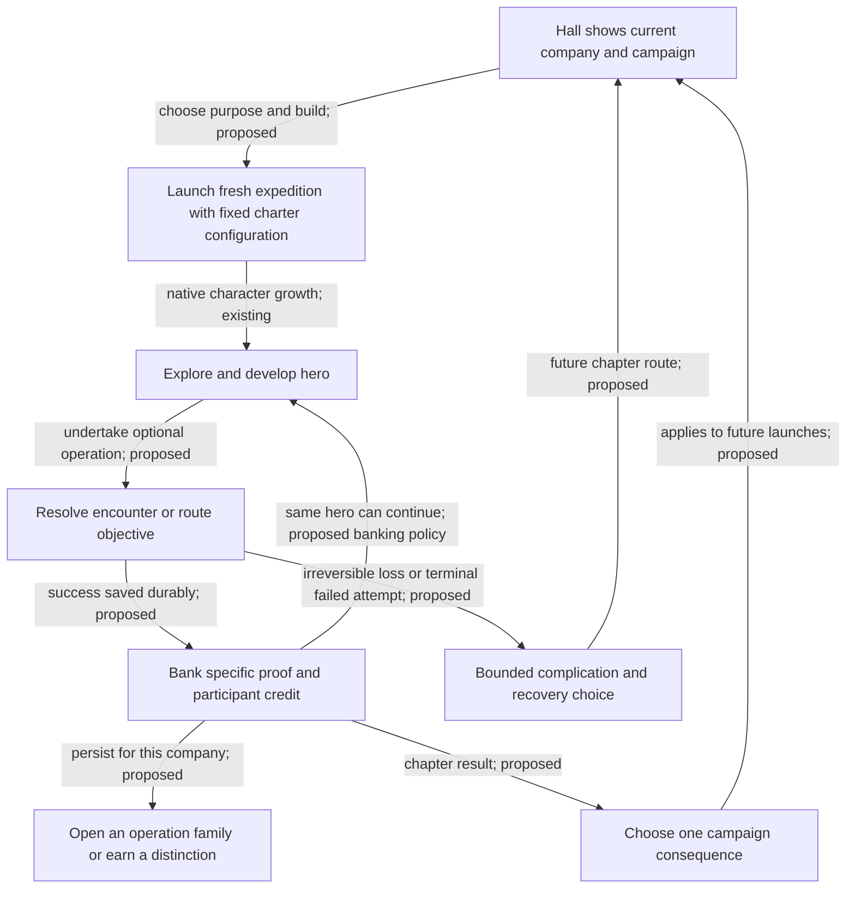

> Superseded design exploration. The user rejected accomplishment-led progression and requested persistent assets, equipment and company capabilities that materially change gameplay. See the [current design](README.md). This file preserves prior reasoning only.

# Charter Hall and Company Campaign

Design deepening, 18 October 2026. Extends C8 Charter Hall and C13 Company Campaign from the [content map](../README.md). Everything new here is a proposal; no campaign system or gameplay content has been implemented by this work.

**The company should accumulate ways to organize an expedition, places with a shared history, and unfinished commitments. Each new hero supplies a different way to carry those plans through the dungeon.** That gives early play lasting purpose and makes extended play change more than the final score.

## Read this design

| Document | Purpose |
| --- | --- |
| This document | Persistent progression, company discoveries, campaign choices and the player workflow |
| [Charters and the full campaign path](charters.md) | Concrete solo/co-op content from D:3 through the Hells, Pan, Tomb and Ziggurats; worked multi-run campaign |
| [Rules, reusable contracts and probes](accomplishments-contracts-draft.md) | Banking, credit, concurrent runs, failures, source boundaries and the smallest useful validation |

## Three connected layers of progression

| Layer | Owner and lifetime | What advances | What it changes |
| --- | --- | --- | --- |
| Hero | Native expedition/save | XL, skills, gear, religion, spells, runes, current position | What this character can do now |
| Company | Persistent group; also works for a single player | Discoveries, distinctions, charter library, named histories and unlocked operation families | Which kinds of expeditions the group can choose |
| Campaign | One bounded story belonging to a company | Chapters, chosen consequences, one unresolved complication and finale | The configuration and purpose of the next campaign expedition |

A **charter** is an optional, explicit expedition objective with a completion rule and a company consequence. The **Hall** is where a group chooses and reviews charters. A **campaign** connects selected charters so that results change future choices. Company membership and an active party are different: an expedition still has one to four native heroes under the existing solo/multiplayer policies; a larger company's members can participate in different expeditions.

Company development has two axes. **Reach** recognizes how deep its expeditions have succeeded. **Practice** records the different decisions the group has demonstrated: surveying, coordinated control, allocation, recovery and extraction. An expert group can establish reach quickly; an early-game group can develop practice and meaningful campaign history without first winning Crawl.

Reach and practice are records of particular accomplishments, not XP bars. Repeating an easy charter does not fill a meter toward the next rank.

## The main loop

The crucial rule is **bank the accomplishment when it becomes durably true**. Restoring a beacon in D:5 can complete its charter while that hero continues toward Lair. An Orb-escape charter resolves only after a valid terminal escape. Later death preserves a beacon already restored; it does not turn that event into an Orb victory.

Saving and returning tomorrow is still the same native run. A new campaign configuration applies to a fresh expedition, never by rewriting already generated floors in a running save. Players can save a successful early-charter hero, continue it, or start another expedition under the next chapter. They do not need to die or leave the dungeon to receive recognition.

## What the company actually gains

Four forms of persistence reinforce one another:

1. **Discoveries open authored operations.** A route-chart recovered early can make a future two-wing operation selectable. A Hell operation can reveal an altered early-Dungeon encounter in a later run. These are new situations and actions, not just labels on a badge.
2. **Campaign commitments change the next chapter.** A recovered workshop can serve an approach-planning chapter or a recovery chapter. The choice commits this campaign to one outcome; another campaign can explore the alternative.
3. **Distinctions recognize a method or reach.** First rune, coordinated interruption, three-rune escape, an extended realm, or success with a different composition all preserve named expedition provenance.
4. **History gives objects and places continuity.** The Hall remembers the heroes who opened a route, the failed attempt that left a complication, and the expedition that resolved it. Item records can inspire a later relic hunt without transferring the item itself.

No universal company currency is needed for the first version. Discoveries are durable facts; campaign decisions allocate specific opportunities. “Three unrelated chores buy a map-room upgrade” would blur what the group learned or changed.

## Hall discoveries with playable consequences

These are thematic parts of the same Hall view, not buildings that require construction timers or separate navigation. The ledger, build presets, direct launch, history and accessibility tools are available immediately.

| Discovery / Hall area | Specific accomplishment that opens it | New choice on a future launch | What changes in play |
| --- | --- | --- | --- |
| Survey Table | Resolve an early beacon/route objective | Choose a Survey operation rather than the default campaign operation | Two approaches with different exposure, or a side wing that changes a later entry |
| Warden's Standard | Resolve a linked-threat objective | Choose a Concord operation | Enemy relationships can be interrupted by positioning, control or damage; companions/humans can cover different angles |
| Recovery Ledger | Secure an encounter's recovery opportunity; nobody must deliberately fall | Choose a Recovery operation | The group decides when to protect or consume a finite recovery opportunity under native recovery rules |
| Relic Archive | Complete an objective around a known historical item/site | Pursue that relic's authored legacy operation | A provenance-themed encounter with a known commitment and a current-run reward budget; no guaranteed copy of the old item |
| Pact Table | Complete an explicit patron-related operation | Select a patron-appropriate operation for a future campaign chapter | Different conduct, targets or interruption opportunities; no involuntary conversion or free piety |
| Trial Gate | Complete a charter that introduces its encounter family | Choose a bounded trial or preview an advanced variant | Short, separately recorded solo/co-op scenarios using the same verbs as deeper play |

Opening more areas expands choice. A launch still selects **one main charter operation**, with at most **one small opening encounter** when the campaign needs to show an earlier consequence. These proposed authoring budgets prevent a mature company from loading six new profitable objectives into every run. New variants should replace comparable vault/loot opportunities; actual difficulty and rewards require testing.

The ordinary Crawl route, species, backgrounds and gods remain available independently of Hall discoveries. The unlock applies to the company's authored operation library. Custom/practice play can expose those operations directly, with practice records clearly distinguished from campaign completions. Experienced players need not grind introductory chapters to enter native extended play or try an advanced scenario.

## Company reach and practice

Names below are proposed distinctions, not prerequisites imposed on ordinary play.

| Reach distinction | Evidence | What it suggests next |
| --- | --- | --- |
| Lantern Company | First durable early-operation completion | Another early method, Lair preparation or a first-rune goal |
| Runebearers | First valid rune attainment | A different generated S-branch, a third-rune route or a campaign preparation choice |
| Orbwardens | Valid three-or-more-rune Orb escape | A completed normal campaign, five-rune breadth, or an optional extended act |
| Worldwalkers | Valid Hell, Pan or Tomb accomplishment under the declared charter | A contrasting realm restriction or a planar operation |
| Deep Compact | Distinct completed operations in Hell, Pan and Tomb | A campaign epilogue, alternate solutions or an optional pinnacle trial |

An expert company's first eligible result can establish a deep reach distinction without replaying every earlier tier. Practice is recorded alongside reach: “surveyed,” “interrupted,” “recovered,” “extracted,” and their actual contexts. A solo player earns equivalent company development through solo solutions; a separate joint distinction records a solution involving multiple authenticated controllers. Damage totals do not determine company rank.

Do not display all native content as an unfinished checklist. Surface a few relevant opportunities, preserve the rest for browsing, and distinguish “not attempted,” “missing evidence” and “completed.”

## Campaign structure: a complete normal arc and an optional extended act

The proposed full example is **The Lantern Compact**. It can finish as a complete normal-game campaign; the company may later accept an extended act. A campaign is a finite chapter graph, not an endlessly escalating global server world.

- **Founding:** choose a short early objective or an appropriately deeper starting chapter. The first charter establishes the company's purpose and an initial discovery.
- **Preparation:** use the discovery to choose a concrete approach to a rune-stage problem. This establishes one campaign asset such as a restored waystation or a mapped approach.
- **Confrontation:** commit that asset to a specific Vaults/Depths operation. The result changes which finale configuration the campaign offers.
- **Normal finale:** escape with the Orb under the fixed finale charter. Completing it ends the normal arc and preserves its history; extended is optional.
- **Extended act:** fresh expeditions pursue contrasting Hell, Pan and Tomb operations. These establish a bounded realm condition for a final expedition or a dedicated trial, after which the campaign concludes.

A chapter can span several real sessions using the same save. A multi-stage charter may include linked milestones within one fresh native run when all dependencies are already fixed at launch. Do not demand a fresh hero for every small milestone. A campaign consequence that changes content requires a later launch; an already true personal/company milestone can be recognized in the current expedition.

The chapter order is a recommended story path. Authored campaign starting points can target first runes, an Orb attempt or extended directly. The record identifies the chosen starting point and chapters actually completed, so a shorter arc does not impersonate the full path.

## One campaign asset, two credible commitments

Suppose the company has restored **the Waystation**, a proposed campaign asset represented by a specific completion record.

| Commitment | Immediate campaign effect | Next expedition's main operation | Why a group might choose it |
| --- | --- | --- | --- |
| Equip a survey team | Commit the Waystation to charting an approach | An exposed side objective opens a different route through a linked-threat vault | Mobility/control builds want positional alternatives and accept the scouting risk |
| Establish a recovery post | Commit the Waystation to maintaining a recovery opportunity | A threatened supply point can support one recovery choice during the linked-threat vault | A fragile or inexperienced group wants a recoverable plan and accepts the cost of defending it |

The competing use of one specific asset makes the decision meaningful. Both operations retain danger and spend native resources. The design does not promise they are numerically equal. Their difference must remain visible in actual target, route, resource or retreat decisions.

This asset changes a selected campaign encounter. It does not become passive income, a free starting healing potion, or a switch that disables branch identity. Later discovering Hell restrictions should add new operations using those restrictions; it should not let every subsequent hero ignore them.

## Failure and recovery

A campaign records what actually happened. Objective success and later hero death are separate events. An irreversible operation failure or a terminal run ending before its committed objective may create **one named complication**; retrying does not stack that complication or mint compensation.

Example: failing to secure a route leaves **Contested Approach**. The next campaign choice is to undertake a recovery operation or continue with the explicitly described altered approach. Both paths remain playable with fresh ordinary heroes. The complication affects one selected encounter, and the company never loses its accumulated discoveries or unrelated records.

Recovery content is also available through practice/charter selection. Failure is not the exclusive way to unlock a profitable encounter. A restored state cannot be farmed repeatedly for a new permanent benefit. Death, quitting, disconnecting and a crash are different facts; only authoritative objective/run outcomes can resolve an attempt.

A campaign may be archived or restarted by its authorized steward with a consequential confirmation. Personal distinctions and the company's historical record remain. No offline decay, daily upkeep or attendance streak is required.

## How late-game progress reaches the next early game

Each advanced discovery can produce a bounded **opening encounter** in a later fresh campaign expedition. Its theme recalls the previous expedition, but its threats and solutions fit current low-level heroes.

- A Dis operation teaches how to break a linked defense. A later D:4 encounter uses two modest guards and cover to introduce the same decision.
- A Pan accord establishes a route relationship. A later early vault offers a familiar fork with a persistent sequential latch; a solo hero can operate it without simultaneous occupancy.
- A Tomb operation breaks a ritual relationship. Its later early-game counterpart uses a visible support source that can be interrupted with basic attacks or movement.

The company recognizes a language of encounters; the new hero still faces an appropriate early survival problem. Opening encounters are optional, bounded and limited to one in a selected campaign launch. There are no endgame enemies placed in D:3, compulsory victory laps through old easy chapters, or compulsory early objectives before an extended-capable hero can proceed.

This creates two-way continuity: **early practice prepares players for deeper cooperation, and deeper accomplishments add new variations to later early play.** [The charter matrix](charters.md) traces each direction.

## Social operation and fewer clicks

The Hall should be part of the existing expedition workflow. It shows the current company, the selected campaign/charter, the next concrete consequence, and **Launch / Resume**. Details, history and alternate charters are available in place. Reversible choices update immediately; a persistent asset commitment or campaign reset explains its effect before confirmation.

An expedition attaches to one company and one campaign configuration. Membership need not be exclusive across the entire account; the attached company receives this expedition's campaign result. Guests can join under the visible rules without joining the company. The party accepts the charter through the existing ready/launch step; no new ritual of votes is required before each local action.

An authorized steward selects persistent campaign consequences; ordinary members can propose the next charter. Record who committed an asset and what was chosen. The company does not acquire ownership of another member's private save or permission to control their hero. Offline members do not need to approve ordinary launches.

When returning from a run, show the specific accomplishment, who participated, the changed campaign option, and **Continue hero / Save & lobby**. If there is no consequential choice, credit automatically; do not require a separate “Claim reward” action. Resume returns to the same expedition and manifest.

## Optional mechanical inheritance

The baseline here gives the company real mechanical consequences through **selected content and campaign configuration**. It keeps starting hero power native. Two larger alternatives remain available for later assessment:

| Alternative | Concrete rule to test | Necessary boundary |
| --- | --- | --- |
| Campaign preparation | Select one earned, scenario-specific tool or approach in a future charter | One mutually exclusive selection, current-run expiry, explicit encounter/loot budget and separate campaign records |
| Curated heirlooms | Choose one authored starting sidegrade that replaces a specified starting-kit component | A capped curated table, no arbitrary historical randart transfer; a cap alone does not prove balance |

These alternatives should be compared with the content-choice baseline before implementation. The prior recommendation against silent permanent stat growth remains a design recommendation, not a user-approved prohibition on exploring other forms of progression.

## Recommended first slice

Develop one company, direct charter launch, durable mid-run completion, personal/team credit, one early Survey operation, one first-rune operation, and the Waystation's two campaign commitments. Add a linked midgame operation as the next bridge. Prove these produce different plans and survive saves before connecting Orb extraction or extended realm operations.

The central unresolved question is whether **opening a new operation and changing the next chapter feels like enough progression to make another early run exciting**. The smallest useful assessment is a worked sequence of an early success, one failed rune attempt, recovery with a newcomer, and a successful alternative route. The [contracts and probe set](accomplishments-contracts-draft.md) specify the boundaries.
