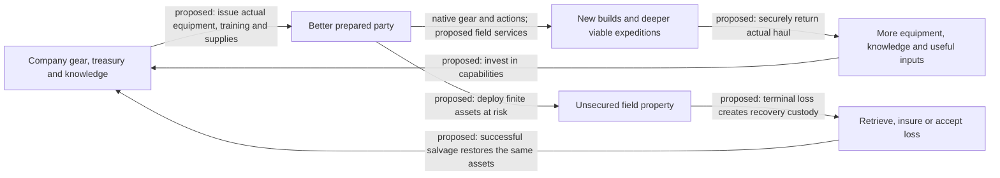

# Persistent assets and the company economy

[Current company design](README.md) · [Early-through-extended progression](asset-progression.md) · [Contracts and evidence](contracts.md)

All company mechanics in this document are proposals. Existing native item/effect mechanisms are identified explicitly. The selected direction is tangible mechanical inheritance: future heroes can start better equipped, know more magic and use services previous expeditions built.

The latest user direction makes a **guild necessary for persistent assets** and introduces scattered, personally owned materials. [Guild resources and buildings](guild-resources.md) governs construction and contributions; [inheritance, extraction and recovery](inheritance-extraction-recovery.md) governs ownership and separate co-op outcomes. Those focused policies supersede earlier gold-only and all-party-return assumptions.

The [23-node building trees](buildings.md), [47 production/research recipes](equipment-recipes.md) and [worked economy](guild-economy.md) provide the current concrete numerical proposal. Costs, manufacturing tiers, spell-access tiers, skill floors and realm-device values there refine the general mechanisms below; they remain untested gameplay hypotheses.

## What persists, and what the player can do with it

| Asset | Acquisition and company ownership | Effect on a later expedition | Competing use / risk |
| --- | --- | --- | --- |
| Armory | Deposit actual recovered weapons, armour, jewellery, evokers and usable supplies; retain physical instance/quantity | Issue those actual items to fresh heroes; lend a rare item to a newcomer; assemble a formation around a support item | An issued item is unavailable to another run; losing it matters; native equipment/skill constraints still apply |
| Personal supplies and guild stores | Secure personally collected materials; voluntarily donate or pledge chosen quantities; keep unspent recovered consumables | Construct shared buildings, fund preparations, craft useful equipment or send field consignments | Private preparation competes with contribution; guild stock is spendable only after authorized transfer |
| Forge / Workshop | Construct with contributed materials; invest compatible recovered equipment, enchantments or devices into explicit recipes | Apply a known legal brand/ego recipe, improve stored equipment, manufacture a supported field device | Keep a useful source item or consume it to establish production; producing equipment spends real inputs |
| Company library | Secure field-acquired spell knowledge through research notes; copy it into company holdings | Future parties have archived spells available in their native spell library from the start | Knowledge persists, but native XL, spell levels, failure, MP and religion determine when it can be used; copying requires a real field acquisition |
| Training hall | Fund a permanent curriculum; recovered manuals can establish a focused course | Select improved starting skill preparation and practical techniques for a fresh hero | Training improves initial power; a focused package and actual facilities define the preparation, rather than limitless cumulative bonuses |
| Outposts and logistics | Establish an accessible branch-side site and allocate actual supplies to it | Deposit loot while continuing the run; receive a planned consignment; later consider forward deployment | What was shipped is no longer at home; an outpost does not provide unlimited stock or an instant escape from any fight |
| Recovery services | Equip company support with real rescue/return tools and, later, recovery infrastructure | Recover a valuable lost loadout; supply an existing native revival tool to an eligible party | Use a finite item/service now or retain it; a rescue may expose the surviving party and its haul |
| Relic works and realm apparatus | Bring back powerful gear, meaningful components or knowledge of a realm's mechanisms | Forge cooperative equipment, protect a limited use of a restricted resource, or establish a controllable planar return route | Expensive capital and deployed devices can be committed to one party; each capability has a concrete scope and lifecycle |

The guild begins with a basic ledger, secure first-return service and expedition management. Essential controls do not require construction. Actual functional buildings are funded with voluntary resource contributions; for example, the Armory enables inherited loadouts and the Forge enables production. Property awaiting the relevant building remains packed and secured. Expansion improves **equipment, training, production and field support**, rather than making the player buy interface convenience.

## Armory: physical equipment, immediately useful

A company that secures a +3 branded spear and a resistance ring can give both to its next hero. The spear keeps its native enchantment and brand. The ring keeps its actual properties. There is no proposed rule that turns either into a cosmetic heirloom or reduces it to an unrelated starter template.

Power is deliberately inherited. A mature armory makes early encounters easier and makes different openings viable. The remaining constraints are the ones that make equipment interesting: anatomy, equipment slots, hands, armour encumbrance, trained skill, resistance coverage, native item restrictions and the risk of taking a valuable company asset out again.

**Example loop:** a pair returns with an exceptional shield. On the next launch they can lend it to a new frontliner, keep it home while trying a fragile caster composition, or commit it to a deeper expedition. The first option improves that party's survival and formation; the second preserves capital but changes the build plan; the third risks the asset for greater opportunities. A successful return preserves the item for another expedition.

There is no need for an arbitrary single-heirloom slot as the default. A stocked company can equip multiple slots and supply multiple party members. Physical scarcity, skill compatibility and deployment exposure create meaningful allocation. A hard loadout limit is a separate balancing experiment only if the actual loop needs one.

### Company ownership and personal choice

- A player may found a one-member guild using the same persistent-asset system as a group guild.
- Each deployed physical instance has one location and one custody chain. The company cannot lend the same spear to two simultaneous expeditions.
- A player can keep a recovered item private, contribute it, or lend an eligible personal item under a stated return policy. Contribution changes ownership and retains a confirmation.
- Deposited company stock can be issued under the company's loan permissions. A guest can borrow for one expedition without gaining authority to empty storage.
- Returning ordinary loans is automatic at an appropriate settlement point. It does not require every player to mail items back individually.
- If a member leaves while carrying a loan, the loan remains tied to that active save/expedition. Membership changes neither duplicate the asset nor teleport it out of a living hero's hands.

## Personal materials, shared construction and gold

Scattered timber, metal, stone, hide/fibre, reagents and arcane crystal are proposed material categories. Each has specific building/crafting uses. They belong to their collecting player until explicitly gifted, donated or consumed in a funded project. Materials use a dedicated pouch and finite native placements; repetitive harvesting clicks and endlessly replenishing nodes are not required.

A member can donate into guild stock or pledge a chosen amount to a named building. Uncommitted pledges can be withdrawn; consumed construction inputs become guild-owned infrastructure. Completed buildings benefit every member, including newcomers and members who contributed nothing. Personal materials can instead finance a personal craft. See the [construction policy](guild-resources.md#construction-uses-your-chosen-contributions).

Native party gold is currently shared. A future gold treasury needs a declared ownership/allocation adapter before personal contributions can be claimed. The first construction loop can use the individually owned materials without relabeling shared gold as a host's private income. Any issued treasury gold and returned unused balance must remain conserved; return is not newly earned income.

Starter equipment and any starting endowment require provenance rules. Repeatedly creating and quitting heroes must not mint treasury money, facility inputs or sellable capital. Do not build a “collect every mundane drop and sell it” loop merely to finance progression. Actual found gold, desirable gear, books/knowledge and finite useful consumables already give expeditions several valuable outputs.

**Allocation episode:** metal and reagents could finance a personal preparation, be pledged toward a shared Forge, or restock a guild consignment. Each owner chooses their contribution. Shared projects make collective needs visible without granting the guild access to every private wallet.

## Workshop: turn a discovery into a production capability

The Workshop makes repeated progress more reliable. Finding a useful brand need not remain a one-run stroke of luck once the company can study and reproduce an appropriate recipe.

Proposed production loop:

1. Recover compatible equipment, a consumable enchantment or a meaningful device.
2. Decide whether to keep it for direct use or commit eligible inputs to a specific production capability.
3. Invest the recipe's declared materials and required actual inputs; any gold cost needs the explicit gold policy above.
4. Produce a defined legal output using a known recipe; its properties are visible before commitment.
5. Issue the result into a future expedition, where the relevant native rules apply.

For example, a recovered branded weapon could support learning an ordinary brand recipe. Keeping it equips the next party immediately; studying it can support manufacturing future compatible weapons at a resource cost. The recipe is a **new proposed mechanism**, not an automatic ability inferred from an item's name or description.

Start with explicit recipes for ordinary native brands/egos and field equipment. A recipe must name its compatible bases, consumed ingredients and output. Unrandarts' unique behavior requires authored treatment; a generic recipe should not clone arbitrary artifact properties.

Avoid a durability tax on every attack just to create a resource sink. Repair can matter for an explicitly damaged recovered asset or a device that was actually expended. A normal returned sword can remain the same normal returned sword.

## Library: permanent spell access, with native casting constraints

Archiving a useful spell changes every later caster run. A future hero's native spell library can include company knowledge immediately; as the hero gains XL and spell levels, it can learn that magic without having to rediscover its book. This is a substantial, persistent advantage.

The current native pickup path adds ordinary books' spells to the run's spell library; it does not simply leave every book as an ordinary carried inventory object. Therefore the proposed company research cargo must record authoritative **field-acquired knowledge** or create an explicit research folio. It cannot assume a book remains in the hero's backpack after native pickup.

Secure those notes at an eligible contact/return, then copy them into the company library. Copying the same spell twice does not multiply power or generate currency. Starting-background spells and company-imported spells are not new field research just because a fresh hero knows them.

Native memorization still checks species, XL, available spell levels, current knowledge and restrictions. MP, skill, spell failure, armour and god rules still matter. The company provides access; it does not cast a ninth-level spell for an unprepared new hero. The library can nevertheless support new starting builds and reliable planned transitions into support, control, damage or movement magic.

## Training: allow real improvement to fresh heroes

A funded curriculum can improve starting preparation. Proposed examples include better initial weapon training, a stronger defensive foundation, a focused spell-school start, Evocations preparation or an authored cooperative technique.

That improvement should cross a useful threshold: a stored weapon becomes practical sooner, an early spell becomes reliable, a supporter can contribute immediately, or a planned hybrid can begin with both parts working. This is more valuable than a permanent bonus with no visible effect on choices.

For the initial design, test a finite set of training packages backed by facility tiers. A fresh hero chooses a package, and higher tiers can improve its actual starting skill allocation. Establish values through native combat/build probes; this document does not invent a balanced XP budget. A later system could permit more allocation within a facility-defined budget if it remains understandable.

Permanent curricula should survive a failed expedition. An optional paid extra lesson or rare deployed tool may be consumable, but the company should not have to grind to repurchase all its basic competence after every wipe.

## Outposts: move assets while the hero keeps playing

The basic extraction problem is tangible: the party has found something the company wants, but continuing risks losing it.

Three service forms cover different decisions:

| Service | What actually moves | Player decision |
| --- | --- | --- |
| Secure deposit | Selected gear, tagged material shares or research leave run custody for their titled destinations | Bank the find and give up using it for the rest of the run, or keep using/carrying it |
| Planned consignment | Specific company stock moves into a declared outpost/expedition delivery | Prepare a later resistance/tool change, committing supplies another expedition cannot use |
| Hero extraction | One hero settles eligible carried cargo and retires from this expedition; peers remain | Leave with useful property or risk it for a rune, a boss or the Orb |

Secure deposit can coexist with an ongoing native save. It removes the source item rather than copying equipped gear. Hero extraction is a **new explicit per-participant outcome**, distinct from an Orb win. Whole-party closure follows only when the expedition lifecycle is resolved; one player's return does not settle absent teammates' property.

A first assessment should use one safe return service and test separate hero outcomes, including host departure. Cross-floor cargo delivery and forward starts remain later capabilities. Claiming a site means a service can appear in compatible future branch generation; it does not promise the same coordinates or a globally persistent native dungeon across seeds.

Forward deployment is worth exploring once a company repeatedly surpasses the opening: an earned base could support a declared Lair-stage start with an appropriate authored character/route state. It is a substantial new start mode, with separate records, not a hidden teleport or a claimed existing native capability.

## Recovery: loss should create decisions

There are three credible equipment-loss models:

| Model | What happens to deployed gear on terminal loss | Resulting play |
| --- | --- | --- |
| Full loss | Unsecured carried gear is gone | Strong commitment and preservation pressure; rebuilding can become repetitive |
| Recoverable loss | Eligible gear enters a named recovery site; only recovery or a defined final loss resolves it | Creates an expedition to reclaim something the company actually values; escrow and site lifecycle are new requirements |
| Automatic insured return | Eligible gear returns through a paid or limited policy | More stable build planning and lower recovery burden; less motive to undertake salvage content |

**Recommended starting hypothesis:** permanent facilities/curricula persist; securely stored equipment persists; unsecured deployed equipment is eligible for bounded recovery after a valid terminal loss. Do not assume this is the final user preference or that every stack should be salvageable.

Consumed potions, wand charges and expended supplies stay consumed. A downed living teammate is not a terminally lost hero. If surviving heroes still occupy the same run, native world/party ownership remains authoritative; a second expedition cannot recover a copy of their gear.

Recoverable loss needs a finite, persistent site assembled from the valid terminal state or an authored reconstruction. It cannot depend on a terminal native save remaining resumable. Site difficulty must allow a rebuilding company a credible recovery path; a late-game wipe must not force a bare company to defeat the same entire late-game encounter again before it can play.

## Cooperative assets already have promising native counterparts

Source contains descriptions and effect implementations for Aegis of Fellowship, Conduit Staff, Twin-Soul resonance, Dawnforged/Duskweaver resonance, an aegis standard, an astral beacon and cooperative consumables. These are **source-backed leads**, not freshly validated acquisition/balance claims.

This matters because persistence could let a company deliberately assemble a party around an actual cooperative item rather than hope it appears during that particular run. The shield or standard can make formation and protection central; a staff can support a caster group; a pair of compatible relics can make their bearers care about proximity and separation.

Production/acquisition of a matching item is a separate contract. A resonance helper does not prove that both members of a pair can naturally generate. Canonical unique-item rules also require handling imported equipment explicitly. [The evidence and probes](contracts.md) keep those boundaries visible.

## Useful growth and its feedback

The success loop is intentional: the company becomes stronger. The design problem is to give that strength worthwhile uses—broader builds, new formations, deeper threats, services and ambitious expeditions—while keeping losses recoverable enough that progress feels durable.

Avoid automatically increasing every early enemy's stats with company strength. That would erase the payoff. Watch instead for exhausted early decisions, runaway supply production, mandatory repetitive farming, and a few support effects that dominate every composition. Address the specific mechanism observed.
