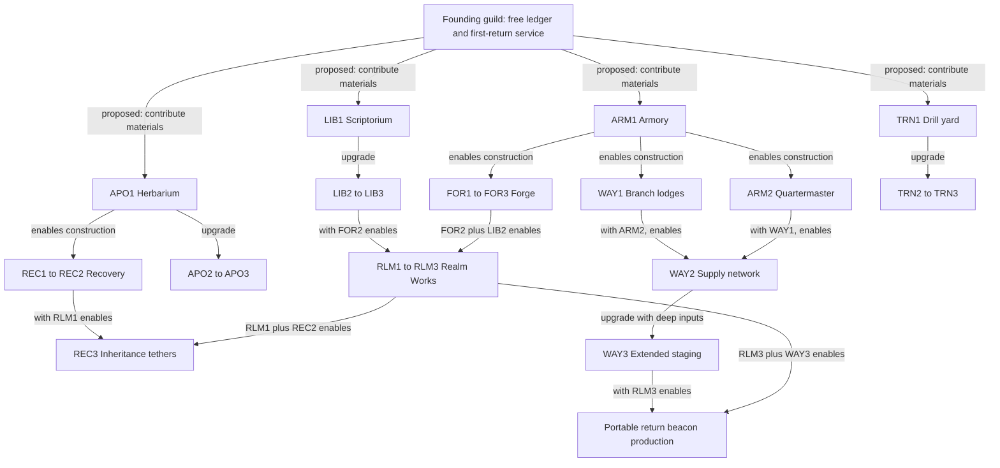

# Guild buildings and upgrade trees

[Campaign](README.md) · [Materials and ownership](guild-resources.md) · [Equipment recipes](equipment-recipes.md) · [Economy and worked budgets](guild-economy.md) · [Numeric catalogue](guild-catalogue.json)

Authored design proposal, 18 October 2026. These are concrete first-pass costs and effects for assessment, not implemented recipes, measured yields or balanced native gameplay. The user-selected foundations remain guild-required persistence, individually owned resources, voluntary contributions and buildings benefiting every member.

## Rules shared by every tree

**T = timber; M = metal; S = stone; F = hide/fibre; R = reagents; C = arcane crystal. IR = infernal regulator; PC = planar core; RS = ritual seal.** A cost such as 8T + 6M + 4S consumes exactly those quantities. All facility prices are incremental: upgrading FOR1 to FOR2 pays FOR2's listed price in addition to the already built FOR1. Prerequisite branches add their real costs; the economy document includes complete prerequisite totals.

A founding guild receives a ledger, personal secure custody and basic entrance-side return. There is no purchased interface, membership cap or obligatory Hall-level gate. Players choose resource pledges; funded authorized construction completes immediately, without a timer. Each project creates a permanent guild-owned building/tier. No routine rent, degradation or wipe repair applies.

All members gain facility eligibility, including newcomers and zero-contribution members. Costs are fixed per guild project and do not scale when friends join. Personal and guild-funded crafts use the same recipes but declare different output owners. A facility unlock is reusable; every physical output, shipment and activation still consumes its stated inputs.

Branches are additive options, not mutually exclusive specializations. A guild may eventually build everything. It need not complete each branch to enter later native content; ordinary Crawl routes remain governed by their own requirements. Returned equipment can exceed the guild's manufacturing tier.

Every edge above is proposed dependency policy. [The catalogue](guild-catalogue.json) lists exact prerequisites, including FOR3/APO3 requiring LIB2 and RLM3 requiring WAY2. The eight building tracks contain 23 funded nodes.

## Armory

| Upgrade | Requires | Incremental materials | Concrete gameplay benefit |
| --- | --- | --- | --- |
| ARM1: Armory | Founding guild | 8T + 6M + 4S | Issue actual secured equipment into fresh heroes, across all native-compatible slots and item classes whose transfer adapter is supported. Personal lending and guild loans retain title. |
| ARM2: Quartermaster's annex | ARM1 | 16T + 14M + 10S + 6F + 2C | Pre-position an actual alternate loadout or support chest at a compatible field service before launch. Recipients can rearm there under native equipment/action rules; requires WAY1 for branch-side delivery. |

ARM1 permits full compatible inheritance; higher tiers never impose a one-heirloom rule, weaken returned items or restrict a legitimately returned artifact to late use. ARM2 adds an actual field reserve. A party can keep a second resistance outfit in a shipped chest rather than carry it from D:1. Its gear is reserved and absent from home while shipped; opening the chest is not a fresh copy. Branch-side delivery needs WAY1. Buildings do not buy inventory filters or extra UI convenience.

## Forge

| Upgrade | Requires | Incremental materials | Concrete gameplay benefit |
| --- | --- | --- | --- |
| FOR1: Smithy | ARM1 | 6T + 12M + 8S | Craft ordinary starting bases and raise compatible weapons/armour to +2, subject to a lower native maximum. Study eligible ordinary patterns. |
| FOR2: Runic forge | FOR1 | 10T + 24M + 16S + 6R + 4C | Craft heavier bases, apply studied elemental brands/resistance egos, improve ordinary weapons to +5 and armour to min(+4, native maximum), and produce supported cooperative devices. |
| FOR3: Masterworks foundry | FOR2, LIB2 | 16T + 40M + 24S + 12R + 16C | Improve ordinary weapons to native +9 and armour to its native maximum; produce studied resistance rings, holy-wrath work and an astral beacon. No generic unrand duplication. |

FOR1 can outfit a newcomer and produce stronger ordinary starts. FOR2 supports a repeatable resistance plan, shield users and deliberate group devices. FOR3 lets a wealthy guild manufacture serious equipment without replacing the value of found artifacts. Enchantment prices rise by resulting enchantment band; existing stronger finds remain usable from ARM1. Brands/egos require a studied pattern and a legal unbranded/unegoed ordinary base. No universal artifact reroll or unique-item cloning is included.

## Library

| Upgrade | Requires | Incremental materials | Concrete gameplay benefit |
| --- | --- | --- | --- |
| LIB1: Scriptorium | Founding guild | 10T + 4F + 4R + 2C | Archive valid field-acquired spell research; expose archived level 1-3 spells to future members' run libraries and support basic pattern study. |
| LIB2: Arcane archive | LIB1 | 16T + 8S + 12R + 10C | Expose archived level 1-6 spells and enable phase-swap/rallying scroll production, advanced device patterns and FOR3. |
| LIB3: Grand library | LIB2 | 24T + 16S + 20R + 28C | Expose all archived legal spell levels and enable shared-vigour scroll production. Native XL, spell levels, MP, failure and religion still apply. |

A recovered high-level spell can be archived before the guild can issue it, preserving the discovery. Each individual spell is archived once for its level in reagents plus ceiling(level / 3) crystal: a level-3 spell costs 3R + 1C; level 6 costs 6R + 2C; level 9 costs 9R + 3C. Secured research must come from real field acquisition and be voluntarily contributed by its owner. Native ordinary book pickup becomes knowledge rather than an assumed physical book in a backpack. No random research roll or duplicate-spell currency is awarded.

## Training Hall

| Upgrade | Requires | Incremental materials | Concrete gameplay benefit |
| --- | --- | --- | --- |
| TRN1: Drill yard | Founding guild | 8T + 8S + 4F | Each fresh hero chooses one permanent curriculum: selected primary/secondary/tertiary skill floors 3/2/1. |
| TRN2: Company academy | TRN1 | 14T + 8M + 16S + 8F + 4R | Upgrade the chosen curriculum to skill floors 5/3/2; enable aegis-standard and rallying preparations with their other facilities. |
| TRN3: War college | TRN2 | 20T + 16M + 28S + 12F + 8R + 8C | Upgrade the chosen curriculum to skill floors 8/5/3, making inherited heavier equipment and planned hybrids practical earlier. |

A curriculum raises selected skills to the stated floors; it never lowers a stronger background skill or refunds the difference for reassignment. One curriculum applies at fresh creation, with no repeated per-run training fee, stacking lessons, XL increase or mid-run respec. Apply sufficient native skill points to reach the legal target for that species, recording company-supplied preparation separately. Suggested packages: Vanguard = chosen weapon / Fighting / Shields; Skirmisher = chosen weapon / Dodging / Fighting; Arcanist = chosen school / Spellcasting / Dodging; Engineer = Evocations / Dodging / Fighting; Hybrid = chosen weapon / chosen school / Fighting. All choices must be distinct, legal and useful to the hero; an incompatible package can be changed before launch. The exact floors are strong, authored balance hypotheses.

## Apothecary

| Upgrade | Requires | Incremental materials | Concrete gameplay benefit |
| --- | --- | --- | --- |
| APO1: Herbarium | Founding guild | 6T + 4F + 6R | Produce finite curing/heal-wounds supplies from personally or guild-funded inputs; guild-wide recipe access. |
| APO2: Company apothecary | APO1 | 10T + 6S + 8F + 16R + 4C | Produce resistance and empathy potions, supporting shared survival and planned branch preparation. |
| APO3: Alchemical conservatory | APO2, LIB2 | 16T + 12S + 12F + 28R + 12C | Produce soul ambrosia and, with LIB3, shared-vigour scrolls. Powerful finite party recovery competes for rare inputs. |

A building unlocks manufacture for every member; it does not refill each member with free potions on every launch. Basic healing competes with later construction for reagents. Empathy enables a party to plan healing distribution and damage exposure using its native effect. Soul ambrosia has an expensive ritual input because manufacturing repeatable revival is a substantial capability. Native potion restrictions remain unless an explicit realm module changes the relevant check.

## Waystations

| Upgrade | Requires | Incremental materials | Concrete gameplay benefit |
| --- | --- | --- | --- |
| WAY1: Branch lodges | ARM1 | 12T + 6M + 10S + 4F | Enable safe deposit and individual extraction contacts in compatible Lair/Orc entrance generation; accept ARM2 pre-positioned actual stock. |
| WAY2: Supply network | WAY1, ARM2 | 20T + 12M + 18S + 8F + 6C | Add compatible S-branch/Elf/Vaults/Depths entrance contacts and dispatch new declared consignments after launch. Delivery commits at eligible service use, without an offline travel timer. |
| WAY3: Expedition staging network | WAY2 | 28T + 20M + 24S + 12F + 8R + 20C + 1PC | Enable authored extended staging contacts and portable-return-beacon logistics; access does not change native branch entry or make an occupied service safe. |

The guild starts with an entrance-side secure-return service for initial construction. WAY1 extends reach to compatible Lair/Orc entrance contacts, WAY2 to rune/Elf/Vaults/Depths staging entrances, and WAY3 to authored extended staging sites such as Vestibule, Pan arrival or Tomb approach. These are generation/service proposals, not guarantees that every native entrance is safe or can be revisited. Once generated, the service does not require routine recapture. A contact has no free stock: pre-positioned or dispatched equipment must leave its actual source. A shipment uses LG01 packaging and the exact cargo. After launch, WAY2 supports authorizing dispatch and completing delivery at valid service use; no wall-clock freight simulation is required. Deposit and extraction settle independently for each hero.

## Recovery Lodge

| Upgrade | Requires | Incremental materials | Concrete gameplay benefit |
| --- | --- | --- | --- |
| REC1: Recovery lodge | APO1 | 8T + 6S + 8F + 6R | Dispatch salvage into a valid closed-expedition recovery site and, with LIB1, produce soul-recall scrolls. Native ordinary revival remains available independently. |
| REC2: Field recovery office | REC1 | 14T + 6M + 10S + 12F + 12R + 8C | Produce sealed caskets protecting up to 40 tagged material units for salvage and, with FOR3, an astral beacon. Protected cargo remains exposed until actually recovered. |
| REC3: Soul anchor infirmary | REC2, RLM1 | 20T + 12M + 18S + 16F + 20R + 16C + 1RS | Produce finite inheritance tethers: bind an eligible real equipment instance for automatic return only after its source expedition finally closes. |

REC1 turns a closed expedition's actual unresolved custody into a reclaimable salvage target. It does not withhold existing native revival from a player who lacks the building. REC2 caskets protect material shares for later salvage, without securing them at home. REC3 tethers are optional finite insurance for individual equipment instances, purchased with scarce inputs. Facilities never resurrect a finally fallen or extracted incarnation. During a continuing expedition, surviving heroes recover the real field bag; cross-run salvage waits until source closure. Personal and issuing-guild titles survive every recovery step.

## Realm Works

| Upgrade | Requires | Incremental materials | Concrete gameplay benefit |
| --- | --- | --- | --- |
| RLM1: Ward workshop | FOR2, LIB2 | 12T + 20M + 16S + 12R + 16C | Produce single-scroll heat seals and single-potion thermal ampoules for scoped Gehenna/Cocytus exceptions before a first Hell clear. |
| RLM2: Infernal laboratory | RLM1 | 18T + 28M + 20S + 20R + 28C + 1IR | Produce charged corrosion frames and ritual wards with explicit same-floor support auras; protection is finite and non-stacking. |
| RLM3: Planar observatory | RLM2, WAY2 | 24T + 36M + 28S + 28R + 40C + 1PC + 1RS | Produce/recharge anchored return beacons; WAY3 supplies the field logistics required to deploy them for separate hero or cargo departures. |

RLM1 is intentionally constructible before a Hell clear; it requires common deep materials rather than a rune or proof of victory. Its finite item wrappers create a dependable exception for one chosen resource use. RLM2 creates short, same-floor formation support against a particular realm modifier. RLM3 creates a new return route after an exposed setup. Native restriction changes, auras, portable services and participant extraction are unproven adapters; the recipe names do not establish those powers.

## Timing, failure and membership

Construction changes eligibility immediately, then takes effect at a legitimate supply boundary. Training affects fresh heroes only. Archived spell issuance occurs at fresh launch for this first design. A building upgrade neither injects equipment into an active hero nor restores used charges; a supported shipment must move actual stock. A new field contact appears through compatible generation or an explicit service installation, not by rewriting an already explored floor invisibly.

Buildings survive failed expeditions and member departure. Members retain their unspent personal resources; donations and completed infrastructure stay with the guild. Leaving or being kicked stops new services and loans while preserving the current hero's lawful skills, equipment custody and personal title. Existing loans and recovered bags settle to their original destinations. Mixed-guild parties do not merge banks or stack building packages onto the same live hero.

## What the trees add to co-op

- **Preparation:** an established guild can lend real armour and train a newcomer for it while another member prepares magic or Evocations.
- **Formation:** manufactured standards/conduits and short realm wards make proximity, separation and protecting a bearer real choices.
- **Logistics:** one hero returns construction material while others continue; another party can use settled guild equipment after durable return.
- **Rescue:** a teammate can retrieve someone else's tagged materials and the guild's actual staff, then finance a shared improvement through voluntary contributions.
- **Extended ambition:** choose between more damage/protection, finite revival, salvage insurance and a new return capability. Spending the same crystal on one prevents spending it on the others.

A two-person group can specialize, a four-person group needs more finite equipment, and a solo player can build a one-member guild. Ally-dependent native devices retain their eligibility rather than fabricating another combat seat. Universal facilities still supply real solo benefits.

## Next discriminating comparisons

Compare ARM1 + FOR1 against ARM1 + TRN1 for the same new party: reliable equipment versus immediate competence with found gear. Compare FOR2 with WAY1 + REC1: offensive/protective production versus banking and rescue. Compare one astral beacon with several finite recall/phase-swap supplies while preserving native scope and charge state. Compare realm seals, a short group ward and a return beacon on the same extended route. Record changed builds/actions, secured material and replacement burden; a failed adapter setup is not evidence that a building benefit is undesirable.

Source boundaries and decisive lifecycle tests remain in [contracts](contracts.md). No new building or effect was executed in the native game during this design pass.
