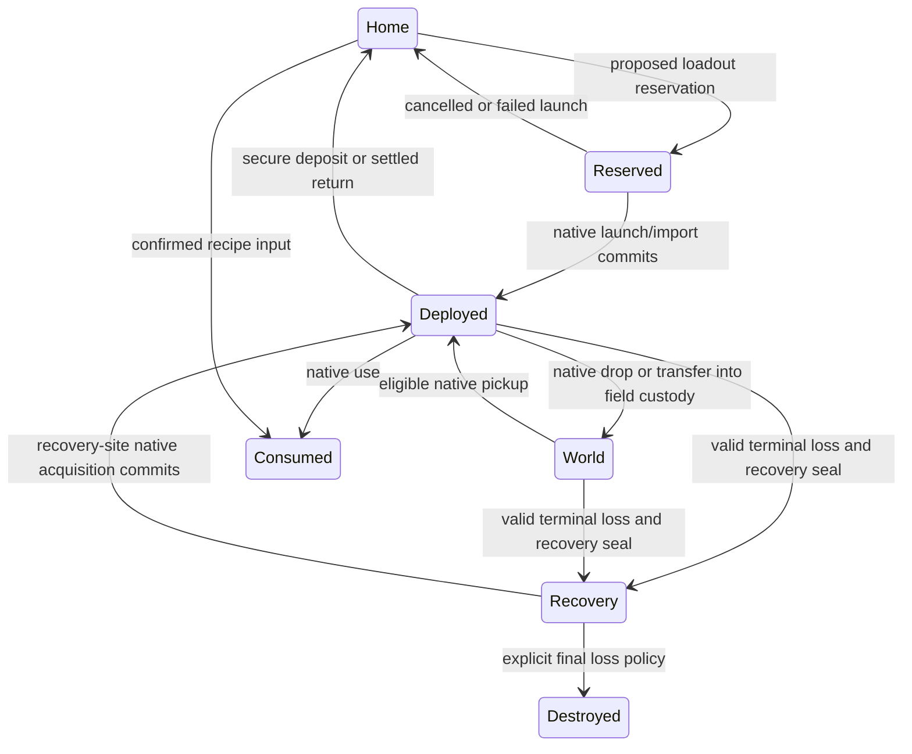

# Asset contracts, native evidence and decisive tests

[Current design](README.md) · [Assets](assets.md) · [Progression](asset-progression.md)

[Guild resources and construction](guild-resources.md) · [Separate extraction and recovery policies](inheritance-extraction-recovery.md)

This replaces the accomplishment-completion contract as the selected campaign foundation. Company mechanics remain proposed. Source inspection and document checks do not establish runtime asset transfer, balance or a deployed campaign.

## Source-backed starting points

| Capability | Source inspected | Actual scope / limit |
| --- | --- | --- |
| Persistent identities | [game-record.cc](../../../crawl-ref/source/game-record.cc), [game-record.h](../../../crawl-ref/source/game-record.h) | Helpers allocate game/hero/item UUIDs without consuming seeded gameplay RNG. `observe_item` publishes identified randarts, not a complete company inventory |
| Native item persistence | `marshallItem` / `unmarshallItem` in [tags.cc](../../../crawl-ref/source/tags.cc) | Stores item type, properties and native fields inside a versioned save context. Raw foreign position/link state cannot simply become a new run's placement |
| Inventory transfer | [party-trade.cc](../../../crawl-ref/source/party-trade.cc), `merge_items_into_inv` in [items.cc](../../../crawl-ref/source/items.cc), [inventory-transfer.h](../../../crawl-ref/source/inventory-transfer.h) | Native within-run transfer handles eligibility and placement. The merge helper explicitly does not remove the source; caller owns cleanup. No cross-run atomic transfer follows automatically |
| Special pickup classes | `_get_book` and `merge_items_into_inv` in [items.cc](../../../crawl-ref/source/items.cc) | Ordinary books add library knowledge; gold, runes, gems and Orb have special semantics. A generic “put any item in a bank” adapter is insufficient |
| Spell learning | `_learn_spell_checks` / `library_add_spells` in [spl-book.cc](../../../crawl-ref/source/spl-book.cc) | Native memorization checks species, XL, spell levels, availability and capacity. Company library access can reuse those checks |
| Equipment compatibility | [equipment-profile.cc](../../../crawl-ref/source/equipment-profile.cc), [player-equip.cc](../../../crawl-ref/source/player-equip.cc), [item-prop.cc](../../../crawl-ref/source/item-prop.cc) | Reuse native anatomy/form/religion, wield/wear and item/brand rules; do not maintain a second UI-only equipment system |
| Cooperative item/effect leads | [dat/descript/unrand.txt](../../../crawl-ref/source/dat/descript/unrand.txt), [art-func.h](../../../crawl-ref/source/art-func.h), [party.cc](../../../crawl-ref/source/party.cc), [spl-cast.cc](../../../crawl-ref/source/spl-cast.cc), [evoke.cc](../../../crawl-ref/source/evoke.cc) | Named shield/staff/resonance/support effects have implementations. Generation, pairing, scope and balance still require native probes |
| Different revival scopes | `scroll_soul_recall` in [party.cc](../../../crawl-ref/source/party.cc), use checks in [evoke.cc](../../../crawl-ref/source/evoke.cc) | Current recall revives downed party slots across floors, or otherwise recalls separated living peers. Astral beacon eligibility requires a visible living same-floor ally or downed ghost. A common same-floor assumption is insufficient |
| Native realm modifiers | [item-name.cc](../../../crawl-ref/source/item-name.cc), [player.cc](../../../crawl-ref/source/player.cc), [branch-data.h](../../../crawl-ref/source/branch-data.h) | Gehenna blocks scroll reading, Cocytus blocks potions, Dis adds fixed 8 corrosion, Tartarus halves Will. Hells have no-items generation flags. Wrappers, limited auras and finite material installations are new adapters |
| XP evoker state | `evoker_plus`, `evoker_charges`, `expend_xp_evoker` in [item-prop.cc](../../../crawl-ref/source/item-prop.cc); `_merge_evokers` in [items.cc](../../../crawl-ref/source/items.cc) | Enchantment and XP recharge debt use hero properties by evoker type. Copying only an `item_def` does not preserve all usable state; multiple pickups may improve an existing evoker |
| Unique-item generation | `find_okay_unrandart`, `get_unique_item_status` in [artefact.cc](../../../crawl-ref/source/artefact.cc), [makeitem.cc](../../../crawl-ref/source/makeitem.cc) | Native per-run uniqueness and generation eligibility apply. Imported unrands and matching pairs require a declared policy |
| Saves, identities, outcomes | [save-library.md](../../save-library.md), [game_library.py](../../../crawl-ref/source/webserver/webtiles/game_library.py), [end.cc](../../../crawl-ref/source/end.cc), [stats-json.cc](../../../crawl-ref/source/stats-json.cc) | Native save/terminal and public-record semantics exist. Terminal package cleanup means recovery cannot assume the old expedition remains resumable |
| Per-hero terminal gap | `delete_files`, `screen_end_game`, `game_ended` in [end.cc](../../../crawl-ref/source/end.cc); `stats_append_final_snapshots` in [stats-json.cc](../../../crawl-ref/source/stats-json.cc) | End paths delete the save/end the process. Final snapshots apply the active outcome to other non-downed slots, marking downed peers dead. This is not independent hero extraction |
| Recoverable downing | Fatal-damage party path in [ouch.cc](../../../crawl-ref/source/ouch.cc); [party-session.cc](../../../crawl-ref/source/party-session.cc) | Downed state/last stand and moving ghosts exist; they do not prove a detached terminal actor or exported equipment bag. Floor scheduling needs explicit participant lifecycle integration |
| Party ownership and clocks | [multiplayer-mechanics.md](../../multiplayer-mechanics.md), [party_control.py](../../../crawl-ref/source/webserver/webtiles/party_control.py) | Fixed authenticated human ownership, personal vision and floor-local simulation; no extra NPC combat seat, global clock or forced hero transfer is implied |

The scoped inspection did not establish a reusable cross-run asset bank, a full native export/import contract, secure field deposit, campaign withdrawal, research cargo, forward start or recovery-site persistence. Those are **unproven primitives**, not missing UI switches.

## The central invariant: one custody chain

An asset's source, owner and current holder are separate facts. One physical instance cannot be available in the Hall, deployed to a hero and waiting at a recovery site simultaneously.

Proposed custody states:

The diagram is proposed policy. A native same-run drop or trade may move current custody without changing company ownership. A partially moved stack needs quantity/lineage accounting; assigning one whole-stack UUID to both halves would be invalid. Wands and XP evokers also require state beyond an undifferentiated quantity.

The smallest sound shared mechanism is a typed ownership/custody ledger plus a native transfer adapter. Hall storage, loans, consignments, recipe consumption and recovery all use it. Item-specific state and native rules belong in cohesive adapters, not special branches in the generic ledger.

Owner, borrower, carrier and facility eligibility are separate fields. The owner is a player account or guild, not just the current hero slot or host process account. A recovered bag can contain several owners' tagged shares. Guild loans route to their issuing guild; rescued personal property routes to its owner even if that person is dead, offline or no longer a member. Current snapshot host-account metadata alone cannot establish all participants' property title.

## What an export/import must preserve

- Stable asset identity, provenance and company/personal ownership.
- Exact type, enchantments, brands/egos, artifact properties and relevant native flags.
- Remaining quantity/charges and a declared policy for class-specific auxiliary state.
- Known/unknown state without revealing hidden properties through a public record or unauthorized preview.
- Equipment compatibility and placement in the target hero's native inventory.
- Supported content/save versions; obsolete items need explicit migration or preserved quarantine rather than silent replacement.
- Native uniqueness/registration state for imported unrands; loading the item must not allow an unintended duplicate to spawn in that run.

Public randart descriptions are insufficient. A trusted native export must supply complete validated state; the browser cannot submit arbitrary item properties to manufacture gear. Normalize run-local links/positions without erasing identity or valid properties.

For the first slice, support a few ordinary weapons, armour and jewellery. Add stacks/wands with quantity tests, then randarts, special evokers and unrands as their dependency contracts are proven. This is an implementation sequence, not a proposal to reduce the eventual armory to plain starter replicas.

Two separate unrand questions must remain distinct: preventing two copies of the **same asset**, and deciding whether the company may possess two legitimately acquired instances of the **same named archetype**. Enforce instance custody immediately. Choose the campaign-wide archetype/paired-item acquisition policy explicitly; a native resonance helper does not answer it.

## Transfers must survive uncertain delivery

Proposed transaction sequence:

1. Validate the authenticated actor, source custody, target compatibility, quantity and service eligibility.
2. Reserve the exact asset or amount under a stable transaction ID.
3. Commit native removal/import and persist the relevant native state with a recoverable transaction record.
4. Finalize ledger custody only from that authoritative commit.
5. On reconnect/restart, reconcile the same transaction; never replay an unknown result as a new transfer.

The native save and server ledger are not automatically one database transaction. The adapter needs an explicit recoverable protocol. A passing metadata mock is insufficient: test both sides of interruption with real native inventory/save state.

Returning items to the Hall while leaving copies equipped in an active save is a duplication bug. Reserving a loan without completing launch must not make it permanently unavailable. Two concurrent launchers cannot both receive the same reservation.

## Currency, knowledge and production

**Materials:** new typed resource quantities require finite native acquisition events, collector/beneficiary identity, provenance, current custody and exact transfers. Picking up another owner's sealed bag changes custody only. Starter items, wizard fixtures, load/re-entry and duplicate events must not mint material. Define the equal-share cache option once in the launch manifest; split a finite total rather than awarding the whole total to every hero.

**Construction:** unspent personal resources, donated guild stock and revocable project pledges are distinct balances. A funded build atomically consumes only authorized inputs and creates one guild-owned facility tier. Repeating the request or racing the last contributions cannot consume twice, produce two tiers or strand a cancelled pledge. Every current member receives facility eligibility without individual contribution thresholds. Mixed-funded item recipes declare output ownership before commitment.

**Membership:** pin each participant's progression guild at launch. New membership grants current facility eligibility; departure stops future grants while preserving personal holdings, current native starting skills and outstanding loan destinations. Late returns route to a durable departure account or issuing-guild claim. Kick/dissolution cannot silently delete another owner's property or rewrite active native combat state.

**Currency:** ledger amounts and actual native expenditures must agree. Native shared party gold is not an individually owned material balance. A treasury adapter must specify allocation and spending authority; the host cannot donate others' presumed shares. Returning withdrawn guild money restores an existing amount. Initial endowments, starter equipment, wizard fixtures and replayed events must not produce a start/quit profit loop.

**Knowledge:** company research comes from valid newly field-acquired knowledge and a successful secure transfer/copy. Native book pickup may already consume the book into a shared run library. Starting/background knowledge and company imports are not new field acquisitions. Duplicate copied spells grant no repeated currency. Company knowledge can be available from the next launch while native memorization checks remain in force.

**Training:** applying improved starting skills is intentional company-mode power. Reuse native skill/XP calculations and initial-state validation. Record the preparation actually supplied; do not portray a trained company start as an unchanged ordinary starting combo.

**Workshop:** recipes declare exact compatible inputs/outputs and consume source property once. A recipe failure must not destroy inputs without producing or recoverably reserving the output. Unrand-specific behavior needs authored rules. Free starter objects should not be an infinite source of valuable recipe inputs or sellable capital.

**Production time:** the baseline requires no offline timers. A supported recipe can complete through explicit investment immediately where appropriate. Wall-clock waiting is not a necessary cost for this design.

The current [building trees](buildings.md), [recipes](equipment-recipes.md) and [economy](guild-economy.md) use one [numeric catalogue](guild-catalogue.json). It contains 23 facility nodes and 47 production/research/service operations. This is design data, not an installed engine schema. Reuse a declarative cost/prerequisite/typed-effect mechanism; keep native item mutation, field generation, skill preparation, lifecycle and realm checks in explicit adapters. Source-backed output effects do not prove that their proposed manufacturing path exists.

Training floors 3/2/1, 5/3/2 and 8/5/3 are proposed per-curriculum targets, applied through legal native skill-point calculations at fresh creation only. Library tiers issue archived spells up to levels 3, 6 and all legal levels respectively. Neither grant is retroactively injected into an active hero when a building upgrades. Facility eligibility can change immediately without minting equipment, charges, skill points or an already-generated field service.

## Field services and native endings

Secure deposit, native save, per-hero extraction, expedition closure and Orb victory are different outcomes.

| Action | Native hero/run | Company result |
| --- | --- | --- |
| Save/resume | Same run and inventory state | No extraction implied |
| Native trade | Moves eligible items between living same-floor heroes under native rules | Company asset remains exposed in that expedition |
| Proposed secure deposit | Removes selected actual property from the run and allows play to continue | Ledger receives that same property once |
| Proposed hero extraction | Removes only this participant through a tested native lifecycle adapter | Settles that hero's eligible cargo by title; peers retain their live save and exposed property |
| Proposed expedition closure | No continuing/returnable participants under the declared lifecycle | Seals unresolved eligible recovery custody; preserves each participant's distinct result |
| Native terminal death | Existing death/downed/last-stand policy decides what actually ended | Only a valid terminal boundary can create cross-run recovery custody |
| Native Orb escape | Current whole-game ending requires a quest/outcome adapter for separate participants | No implied banking of absent cargo, false Orb wins for earlier material returns or erasure of unresolved peers |

A first safe service can require appropriate native safety/access and commit an action. It is not an instant off-floor escape from any combat. A supplied contact can hold specific preallocated goods; reloading or entering repeatedly cannot refill it for free.

Separate participant departure is required by the current design, including host/slot-zero extraction. Add explicit alive, downed, fallen and extracted states under stable hero/incarnation IDs; do not compact slots or treat browser absence as final loss. Detached participants must leave scheduling, shared XP, active effects, alive/last-stand checks and input routing. Finalization must not delete the ongoing party save, end the authoritative process, grant a reconnect into an extracted incarnation or let a host claim a peer's hero.

Downed-to-fallen retirement and extraction each require one native transition with authoritative item movement. A corpse/ghost visual alone cannot authorize creating a recovery bag. Clear queued commands for the departed incarnation. An extracted player may later launch a distinct expedition without duplicating old inventory or receiving old-run XP. Off-floor delivery, advanced deployment and return apparatus need further scoped adapters.

Forward starts need declared starting XL/skills, branch visitation and rune/travel/quest state; teleporting an XL1 hero down a few floors is not a complete advanced deployment system. Company-mode analytics should retain the actual start/preparation/assets. Existing ordinary PvE rating assumptions cannot silently be treated as calibrated for inherited power or withdrawals.

## Recovery and concurrency

Downing, temporary disconnection, terminal loss and deleting a save are different. A downed hero or an active surviving party still has native world ownership; no parallel run can recover a second version of its assets.

An explicit final per-hero fall can move eligible remaining cargo into one field bundle while survivors continue. Recover it in that source expedition; never spawn a cross-run copy at the same time. When the whole source expedition truly closes, eligible unresolved property can enter recovery escrow before package cleanup. A recovery site needs durable native-valid item state and a compatible encounter/placement description, or an explicit authored reconstruction. Preserve it independently of the terminal package. Do not expose hidden live-party terrain or item state through a recovery preview.

A recovery success transfers the same gear out of escrow. A failed recovery follows a declared finite policy; it does not clone another site with another copy. Recovery difficulty and its terminal-loss severity are design choices to playtest, not dictated by the ledger.

Multiple expeditions can share the company. Reserve physical holdings per expedition; reserve shipped stock for a particular contact; isolate each run's custody. Permanent curricula and knowledge may be reusable capabilities, but one physical device or consumable is finite. Company membership changes cannot withdraw gear from a living hero silently or give former members new withdrawal permissions.

## Reusable frontier

| Mechanism | General operation | DCSS-specific boundary |
| --- | --- | --- |
| Asset custody | Ownership, current location, quantities, reservations and consumed state | Native item identity/state, stacking, evoker data and unique generation |
| Durable transfer | Idempotent transaction, reservation, native commit, reconcile/recover | Save/inventory mutation and launcher/actor authority |
| Production/capability | Explicit inputs, output/capability and costs; atomic consumption | Brands/egos, manuals, spell libraries and starting-skill preparation |
| Guild construction | Personal balances, voluntary title transfer, revocable pledges, atomic facility tier and eligibility | Finite material placement, native acquisition and specific building benefits |
| Participant lifecycle | Per-participant state, stable identity, independent settlement and session detachment | Floor scheduling, XP, downing/last stand, process/save termination and Orb outcomes |
| Field service | Eligibility, allocated stock, recipients and finite use | Floors, access, action clocks, safety and travel/ending semantics |
| Recovery | Move terminal property into escrow and back through a valid acquisition | Death/downed distinction, package cleanup and recovery-site generation |

These extend the original P1-P7 map with P8 custody, P9 transfer, P10 participant lifecycle and P11 contributed construction. Build the demonstrated material/building and separate-return slice; avoid inventing a cross-game economic framework ahead of a tested native adapter.

## Discriminating assessments

No gameplay/model probes below were executed in this pass. Source was inspected and documentation consistency checked.

| Probe | Baseline and boundary cases | Observable acceptance / failure interpretation |
| --- | --- | --- |
| Same item, next run | Known native save/restore of an ordinary item; then deposit, return and fresh import of that item | Native properties and identity preserved, source copy absent; a display-only record round-trip does not pass |
| Interrupted/concurrent transfer | Repeat one transaction; crash before/after each native/ledger boundary; two launchers reserve one item | Exactly one usable instance and recoverable custody; environment startup failure is separate from protocol failure |
| Item-class dependencies | Ordinary weapon control; randart, split stack, partially charged wand, XP evoker, imported unrand | No recharge/quantity/property reset or unintended duplicate; failure narrows the supported class rather than disproving armory persistence |
| Research/training | Native field book/learning control; starting magic, copied spell, duplicate research, incompatible species/god and untrained/trained starts | Valid secured knowledge persists; no start/quit research faucet; actual initial skills and learning constraints are honest |
| Separate extraction and party fate | Three humans: first extracts, second downed then finally falls, third recovers/returns; repeat with host first, split floors, disconnect and save/restart | Distinct participant outcomes, original titled destinations, continuing party/save, no false Orb win, input/XP for retired hero or forced control transfer |
| Materials and construction | Pickup, tagged bag transport, optional equal split, pledge/cancel, last-contribution race, donation and personal craft competing for same input | Quantity conserved; personal title retained until chosen contribution; one funded building benefits zero-contribution/new members |
| Numeric catalogue | All prerequisites, acyclic trees, known material IDs, positive integer costs, complete recipe facility closure and example balances | Arithmetic/document consistency only; does not establish native crafting, acquisition or balanced prices |
| Manufacturing usefulness | Found-item native control; crafted spear/buckler, enchantment bands, incompatible ego, known/unknown pattern and personal/guild funding | Exact supported output and title; no illegal brand, free source duplication, overspent input or artifact reroll |
| Facility timing and recipient | New member, departing member, already active hero, new hero, newly upgraded building and generated/ungenerated service floor | All members eligible at proper supply boundary; no live skill injection, hidden service spawn or extra finite stock |
| Recall versus beacon | Native cross-floor recall and visible-ally beacon controls; then funded production, downed/fallen/extracted, unsafe destination and controller preferences | Accurate scope, stable item charge debt and participant eligibility; no reanimation of settled heroes or unexamined forced relocation |
| Membership and loans | Leave/kick before extraction, mixed guilds, late rescued bag, loaned item in ongoing run and personal stock transfer | Personal property protected; guild loan returns to issuer; current combat build intact; no stacked new-guild benefits or bank access |
| Tangible payoff | Same company's returned gear and funded preparation versus its earlier state; then a different co-op composition | Players equip/build/route differently and notice real power; no universal enemy adjustment cancels the gain |
| Economy and loss | Successful return, consumed supplies, recipe investment, start/quit loops, terminal loss and recovery | No minted capital/duplicated goods; permanent development survives; recovery has a credible path and meaningful exposure |
| Realm apparatus / deep start | Native relevant restriction/travel/start behavior as control, then one proposed counter/device | Its exact action and recipient scope work without silent global simulation; failure rejects that device implementation or scope, not tangible progression |

The first assessment should follow personal material shares into one shared Armory project, then two useful returned items into fresh loadouts. Use the [three-player partial-return sequence](inheritance-extraction-recovery.md#worked-three-player-expedition), interrupt/retry settlement, and repeat with a membership change. Add library/training next. Compare the same valuable item under full loss, bounded recovery and insurance before selecting severity.
