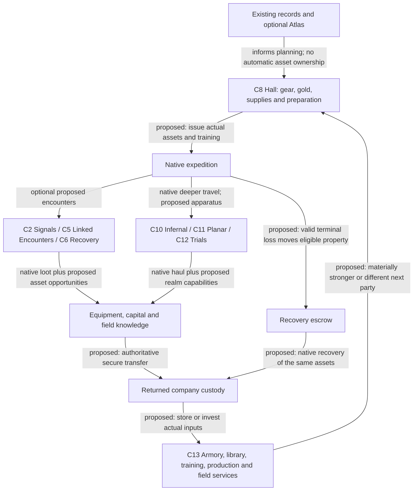

# Co-op, expedition and metagame systems

[Map index](README.md) · [Baseline atlas](progression.md) · [Capabilities](systems.md) · [Frontier tests](frontiers.md)

Current selection: the user rejected accomplishment-led progression. C8/C13 now develop persistent assets, equipment and company capabilities in the [current campaign design](company-campaign/README.md). C1/C9 and recognition-focused portions of other concepts remain optional research ideas, not the selected metagame foundation.

All concepts in this document are **proposed compositions**. Their missing mechanisms are **unproven primitives**. They are not implemented or balanced by this research. Capability IDs K1-K8 and primitive IDs P1-P11 refer to [systems](systems.md).

## How the selected layers fit

The company supplies actual equipment and capability. Expeditions use it, acquire valuable returns and expose physical property to loss. Secure return feeds company holdings and development; optional records support planning without acting as the primary reward.

A public item record alone cannot perform any of the proposed custody/transfer arrows.

## C1 — Expedition Atlas

**New decision:** choose a next attempt that develops a different skill or reaches a new stage, using the player's actual history rather than a blank character screen.

- **Episode and loop:** a player has repeatedly reached Lair with a melee build but never taken a rune. The Atlas recognizes the recorded milestone, offers “first rune with a different defensive plan” beside “first caster to Lair,” and links directly to a suitable launch preset. Their next attempt produces a new result, which changes the next offered goal.
- **Reasonable alternatives:** a novice may favor a near milestone; a veteran may favor an unwon species/background or a five-rune goal; a group may favor a shared branch experience rather than personal combo completion.
- **Scarcity/cost:** attention, run risk and the opportunity to attempt another goal. No mandatory currency, grind or completion percentage that implies every catalogue entry must be farmed.
- **Interactions/feedback:** existing records inform goal selection; visible milestone tiers give early deaths learning value; recommendations must show missing evidence and avoid turning descriptive win associations into causal advice.
- **Basis:** K7 records and K8 starting options. Read-only suggestions are a composition; persistent mastery completion requires P2. Party achievements also require P3.
- **Smallest useful form:** first Lair, first rune, three-rune escape, five-rune escape, selected extended rune, plus species/background breadth. Preserve native starting options. Completed goals recognize mastery; they do not unlock stronger starting stats.
- **Progression/exit/failure:** goals remain optional and replaceable before a run; accepting a goal is not a claim it was completed. A missing snapshot yields “unknown,” not failure. Spoiler settings can hide undiscovered route detail without hiding required mechanics.
- **Interaction burden:** one suggested goal on the existing new-expedition surface; one launch action. Return from a morgue with that context preserved.

## C2 — Signal Vaults

**New decision:** choose between concentrating force down a safe but exposed approach and dividing attention to interrupt an enemy advantage.

- **Episode and loop:** an early Dungeon vault has a lookout and an approach around a wall. Crossing the exposed lane lets the lookout alert a finite nearby pack; interrupting the lookout or taking the longer side approach avoids that concentration. A pair can distract and flank; a solo hero can do either sequentially. The changed enemy arrival pattern alters whether to advance or retreat.
- **Reasonable alternatives:** a durable fighter accepts the alarm and preserves consumables; a fragile caster takes the flank; two heroes split briefly but risk separation. No specific ranged attack or stealth threshold is required.
- **Scarcity/cost:** action time, position, safe retreat and any tool spent. Reinforcements are a finite predeclared budget; deliberately sounding the alarm cannot generate endless XP.
- **Interactions/feedback:** personal sight and shared terrain matter; noise and target priority have consequences. Friendly fire and support options create alternate plans rather than a mandatory combo.
- **Basis:** K1 geometry, enemies and noise; K3 personal actions/perception. Basic vault can use existing behavior. A bespoke alarm state or finite reinforcement trigger needs P1/P6 and must be labeled as new.
- **Smallest useful form:** one D:3-7 vault with two approaches and a clear retreat path. Extend with Lair animal calls, Orc signals, Vaults sentries and an extended variant; replace equivalent encounter budget rather than add mandatory floors.
- **Exit/failure:** bypass the vault, retreat after alarm or win the harder encounter. A failed interruption changes local pressure; it does not poison the entire run.
- **Main failure case:** the best strategy is always to lure everything to the same doorway. Test actual position and action choices against a standard vault control.

## C3 — Expedition Projects

**New decision:** allocate a finite preparation opportunity to the future problem the party expects to face, sacrificing another useful preparation.

- **Episode and loop:** a one-use abandoned workshop offers two visible repairs: restore a bridge device that provides a later vault's alternate entry, or produce a finite defensive supply for the current expedition. The party chooses the entry device, later encounters a more flexible attack route, and must solve recovery with its existing consumables.
- **Reasonable alternatives:** a weak-current-build solo hero chooses immediate survival; a group with adequate consumables chooses spatial flexibility; an uncertain route plan keeps the opportunity uncommitted until leaving, if the design permits that explicitly.
- **Scarcity/cost:** one intact facility charge is a **proposed environmental resource**, not an existing native currency. The initial design should first test whether a normal Gauntlet-style mutually exclusive path/reward can express the choice without adding that resource. Shops already make gold competitive; do not invent a second shop wallet.
- **Interactions/feedback:** future route and present inventory respond to the choice. Forecast exactly which later encounter can change, avoiding an unseen global difficulty director. Give no permanent account entitlement.
- **Basis:** K1 mutually exclusive authored paths and K2 run state; P1 carries a durable consequence and P6 ensures the recipient encounter exists or supplies a fair fallback.
- **Smallest useful form:** two choices affecting one later optional vault in the same branch. Advance to an Orc/Lair choice that affects an S-branch, then only consider expedition-wide planning.
- **Exit/failure:** optional to bypass; committed choice cannot be refunded by re-entering, reloading or changing hero. If the target encounter is absent, the choice must have a documented alternate use or not be offered.
- **Main failure case:** one reward dominates or every party waits to clear everything before choosing. The promise must change an approach, not just add another loot cache.

## C4 — Branch Operations

**New decision:** change a rune encounter's conditions through a risky optional operation, rather than merely collecting more power before fighting it.

- **Episode and loop:** in Shoals, the rune approach is covered by two lookout positions. Clearing an exposed beacon changes the approach into a less observed landing; taking the direct route preserves time and resources. Enemy positioning in the final approach changes in response, affecting the next target and retreat decision.
- **Reasonable alternatives:** a strong ranged group accepts the exposed fight; a slow solo build pays for safer geometry; a gem-speed attempt skips the operation. Neither path grants an extra mandatory character upgrade.
- **Scarcity/cost:** existing actions, HP/MP, consumables, gem deadline and encounter exposure. The operation is a different expenditure toward a known benefit; it is not an automatically beneficial side quest.
- **Interactions/feedback:** optional preparation competes with tempo and resource conservation. One operation has one bounded, displayed effect on the ending. A future variant may change water routes, sealed entrances or patrol composition, not add arbitrary universal enemy debuffs.
- **Basis:** K1/K2; needs P1 objective persistence, P6 compatible ending selection and possibly new entity behavior. Native Gauntlet choices and commitment branches are precedent, not proof of this composition.
- **Smallest useful form:** one S-branch ending with direct and operation-supported approaches. Later variants: Snake prison route, Spider brood support interruption, Swamp causeway, Forest path/ward choice. Each must preserve that branch's identity.
- **Exit/failure:** optional operation can be abandoned; spending resources does not guarantee success. Completing it records once and remains in effect after save/load and party changes.
- **Main failure case:** it becomes compulsory because it always makes the ending easier for negligible cost, lengthening every run. If most informed players choose the same path for the same reason, redesign before expanding.

## C5 — Linked Encounters

**New decision:** decide whether to eliminate an enemy, interrupt its relationship with another threat, or exploit the changed state created by doing either.

- **Episode and loop:** a warden protects a caster while they occupy connected positions. The party can separate them through movement/control or kill the warden first; doing so exposes the caster but starts a different, visibly telegraphed response. A solo hero chooses between kiting/separation and committing damage. The second enemy's changed behavior changes the next priority.
- **Reasonable alternatives:** burst damage races the protector; control breaks the link; a fragile duo uses two approaches; a strong solo build accepts the exposed phase.
- **Scarcity/cost:** position, action windows, MP and escape resources. A second human supplies another possible angle, not a guaranteed double-damage requirement.
- **Interactions/feedback:** already-authored Concordat Sanctum supplies paired named enemies, but those names alone do not implement linked boss states. Existing ally effects and enemy support patterns can inform a new explicit relationship.
- **Basis:** K1, K3 and K5. New link predicates/state/telegraphing use P1. Effects must use actual floor and recipient scope; test who cast a delayed projectile or cloud.
- **Smallest useful form:** one ordinary enemy pair with a simple proximity link and visible state. Reuse in Vaults, Forest, Zot and extended. Boss identities come after the interaction is sound.
- **Exit/failure:** retreat remains possible; loss of one enemy changes the survivor once. Rest/reload cannot restore a killed protector or duplicate phase rewards. No simultaneous wall-clock kills or fixed class checks.
- **Main failure case:** focus-fire one target is always optimal and the link is irrelevant, or more bodies remove every interesting choice through immediate burst.

## C6 — Recovery Objectives

**New decision:** spend position and a finite resource to recover a teammate now, or continue the encounter with reduced capacity and attempt recovery later.

- **Episode and loop:** a hero is downed during a middle-game objective. A surviving hero can use an existing valid revival tool after clearing space, or secure a local one-use recovery opportunity while the enemies still threaten it. Recovery restores choices but consumes an opportunity that could otherwise stabilize the expedition.
- **Reasonable alternatives:** a group close to victory keeps attacking; a group lacking an answer to the next enemy recovers its controller; a solo variant protects/retrieves an encounter resource rather than requiring a nonexistent teammate.
- **Scarcity/cost:** native action time, threat exposure and an existing finite revival resource. The local recovery opportunity is a proposal and should not duplicate all existing revival spells/scrolls.
- **Interactions/feedback:** health and roster capacity affect objective feasibility; restored players regain participation. Downed relocation and last-stand behavior must be characterized before designing a spatial rescue fiction around a corpse that may already have moved.
- **Basis:** K3/K6; P1 local opportunity state and P3 contribution evidence. Ordinary stairs do not supply automatic multiplayer revival.
- **Smallest useful form:** make existing recovery understandable and author an encounter where choosing when to use it matters. Add a new rescue action only after native behavior and player downtime justify it.
- **Exit/failure:** downing does not yield repeat rewards or cleanly reset enemy state. Disconnecting never counts as death or rescue. A solo participant always has a valid alternate objective.
- **Main failure case:** deliberate downing grants free travel/healing, or a player watches for most of the session while others make every meaningful decision.

## C7 — Orb Relay

**New decision:** organize an extraction around a vulnerable objective and safe routes, choosing between moving quickly together and separating to manage threats.

- **Episode and loop:** after taking the Orb, one hero advances while another screens an intersection and a third chooses whether to clear a possible return route or stay near the carrier. Losing contact narrows rescue options. The group must decide whether to regroup, spend an escape resource or accept a harder extraction condition.
- **Reasonable alternatives:** an inexperienced pair stays together; a prepared group risks advance scouting; a solo hero plays the native escape with an optional local route choice.
- **Scarcity/cost:** remaining escapes, current positions, threat and possible separation. Reward clean extraction through recognition, not another permanent stat increase.
- **Interactions/feedback:** the native Orb escape already changes pressure. A **physical carrier, handoff, drop/recovery and all-player extraction policy are new mechanics**, not proven by current shared run state. Start by observing present multiplayer Orb behavior.
- **Basis:** K2/K3/K4; needs P1, P3 and P5 for explicit objective/outcome policy. Cross-floor pressure needs P4; do not run a new timer silently on frozen floors.
- **Smallest useful form:** an optional extraction objective with clear existing terminal behavior and accurate credit, before implementing a transferable Orb. The ambitious form adds carrier/handoff and rescue rules in a distinct ruleset.
- **Exit/failure:** specify exactly whether the expedition ends when one hero escapes, all living heroes escape, or the party accepts a stated result. Consequential departure must explain its effect on peers. Reconnect and save/resume cannot lose the objective.
- **Main failure case:** one player unilaterally ends the run or a disconnected owner permanently blocks extraction.

## C8 — Charter Hall: assets and expedition preparation

**New decision:** allocate actual company equipment, supplies, training and field support to the next party, deciding what to invest, issue and risk.

Current refinement: the company is a guild. Personal material balances and guild stock are separately visible; members voluntarily fund buildings benefiting all members. One hero's return settles carried property by title while peers continue. See [construction](company-campaign/guild-resources.md) and [ownership/partial outcomes](company-campaign/inheritance-extraction-recovery.md).

- **Episode and loop:** an expedition returns a branded spear, resistance ring and field magic. A new party issues that equipment to a newcomer and prepares a caster around archived spells. Treasury capital can improve future starting training or fund a deep consignment. Successful return adds actual property; a terminal loss can expose gear to recovery.
- **Reasonable alternatives:** lend the best equipment to a fragile/new hero, deploy it on a deep attempt, preserve it while experimenting, or consume eligible inputs to establish useful production.
- **Scarcity/cost:** finite physical holdings, actual gold/supplies, native slots/skills and deployed assets at risk. The same item cannot equip two concurrent expeditions.
- **Interactions:** armory holdings change build/formation choices; training/library improve starts; Workshop and logistics change future supply. Stronger early play is an intended payoff.
- **Basis and missing primitives:** native item/equipment, trade, library and identity mechanisms are source-backed. Cross-run custody, complete state export/import, secure return and production are unproven P8/P9 adapters and proposed compositions.
- **Smallest useful form:** a shared armory/treasury, safe return and fresh-party issue of two actual useful items. Then add permanent knowledge, one starting-training package and a supplied contact.
- **Failure/exit:** company/personal ownership, loans, terminal loss and recovery need explicit policy. No start/quit capital faucet, copied active-save gear or client-authored item payloads.
- **Interaction burden:** equipment/build presets, available/issued/lost stock and Launch/Resume in one preparation flow. Consequential donations/consumption retain confirmation.

[Assets and economy](company-campaign/assets.md) and [native contracts](company-campaign/contracts.md) develop this concept. Prior accomplishment drafts are explicitly superseded.

## C9 — Shared Challenges and asynchronous relays

**New decision:** select a common bounded challenge, compare different solutions, and contribute to a group objective without requiring everyone online together.

- **Episode and loop:** a board offers a versioned early-rune challenge and an extended-realm challenge. One member records a valid first-rune result; another later attempts the same manifest with a different allowed build. Their different outcomes inform route discussion and shared recognition; the next board choice depends on which chapter remains interesting.
- **Reasonable alternatives:** direct comparison needs fixed build and party policy; exploration needs varied compositions; casual groups prefer non-ranked contributions over strict competitive attempts.
- **Scarcity/cost:** the attempted run and its risk. A challenge can remain available after its featured period, avoiding attendance pressure. Do not lock ordinary starting content behind participation.
- **Interactions/feedback:** seeds, content revisions and rules must be pinned. Solo and parties need separate baselines; different action orders can diverge RNG. A same-seed label does not prove identical experiences. Spoiler/practice policy must be explicit for ranked comparisons.
- **Basis:** K7/K8; P5 manifest, P2 completion and P3 credit. Asynchronous relay means separate runs contributing evidence, **not transferring control of another account's live hero**.
- **Smallest useful form:** one fixed manifest with a supported branch/rune predicate and direct launch. Later permit curated Sprint-like chapters, several time budgets and group completion across distinct roles/builds.
- **Exit/failure:** validate submissions without replaying a reward; incomplete attempts stay incomplete; wizard/QA runs do not count. A version change creates a distinct challenge record.
- **Main failure case:** leaderboards compare incompatible versions/modes, or macro/repetition exploits become the best way to accrue rewards.

## C10 — Infernal Operations

**New decision:** choose how to spend a limited preparation or operation opportunity against a particular Hell's distinctive restriction, accepting exposure elsewhere.

- **Episode and loop:** before a Gehenna operation, a party can attempt an exposed side objective to disable one encounter's support source, or preserve its consumables and take the normal route under Gehenna's scroll constraint. The changed encounter geometry/relationship determines whether the party pushes to the rune or exits to recover.
- **Reasonable alternatives:** a scroll-dependent build values the alternate approach; a potion-heavy build accepts direct combat; a group can divide same-floor tasks but sacrifices aura proximity and mutual rescue.
- **Scarcity/cost:** existing realm attrition, finite tools and action exposure. Do not add another generic corruption bar just because extended needs a new label.
- **Interactions/feedback:** realm rules remain relevant, and objective success modifies only a bounded encounter. A universal “turn off Hell” reward would erase identity and create a mandatory pre-clear chore.
- **Basis:** K1/K2/K5; P1/P6. Initial version uses same-floor effects; independent-floor operations inherit P4 uncertainty.
- **Smallest useful form:** one optional Hell-ending variant; compare against the existing finale. Later vary operation verbs by realm: positional isolation in Dis, recovery timing in Cocytus, interruption in Tartarus, approach planning in Gehenna.
- **Exit/failure:** visible optional goal, no fresh permanent player power, no unlimited respawn reward. It remains possible to take the original rune path and complete extended solo.
- **Main failure case:** objectives make Hells longer and easier without changing any in-combat decision.

## C11 — Planar Expeditions

**New decision:** choose whether to stay together, commit separate teams to different bounded tasks, or withdraw and abandon part of the expedition's ambition.

- **Episode and loop:** a Pan operation offers two optional seals within a realm sequence. The party may secure one together and take a normal exit, or commit to both for a distinct challenge completion. Completing a seal changes which later approach is available. Splitting reduces mutual support and affects the next rendezvous plan.
- **Reasonable alternatives:** a pair stays on one floor; a larger group divides if its subgroups can survive independently; solo completes a sequential variant. Extra people widen the strategy space instead of satisfying a minimum-player lock.
- **Scarcity/cost:** isolation, finite entry/exit commitments and consumables. The seal is proposed objective state, not another permanent currency.
- **Interactions/feedback:** K4 floors freeze without local action; therefore the first cross-floor version should use persistent completion/commitment state, **not a supposed simultaneous countdown**. New risk must come from explicitly defined actions or commits, not wall time or unobserved background simulation.
- **Basis:** K1/K2/K4; P1/P4/P6. Pan has special level lifecycle behavior, so normal-floor save support is not proof of correct Pan objective restoration.
- **Smallest useful form:** two wings on the same floor first. Add separate floors only after activation, source loss, unload/reload and exit semantics are proven. Distinct realm itineraries are a later content family.
- **Exit/failure:** clear abandonment action/result; no reward from re-entering completed seals. State retains ownership across disconnects and cannot lock an absent player's peers indefinitely.
- **Main failure case:** parking a hero on a frozen floor trivializes pressure, or cross-floor commits deadlock the run.

## C12 — Trial Circuits

**New decision:** choose a challenge objective and an appropriate build/commitment level instead of treating maximum monster density as the only pinnacle.

- **Episode and loop:** a player chooses an interruption-and-extraction trial rather than an endurance trial. Protecting a route and preserving movement resources matters more than clearing every creature. Their result enters that trial's history; the next attempt can explore a different solution rather than merely a higher damage number.
- **Reasonable alternatives:** an optimized area-damage build prefers endurance; a mobile/control build prefers extraction; a group chooses a mixed task trial with solo sequential alternatives.
- **Scarcity/cost:** finite encounter budget, tools, safe exit opportunities and optional further commitment. Reward is challenge recognition; do not make circuits mandatory equipment preparation for a normal win.
- **Interactions/feedback:** Sprint, Gauntlet, Arena and Ziggurat authoring are precedents. Changing the existing 27-floor Ziggurat is not required. Separate trial records prevent incompatible objectives from sharing a misleading score ladder.
- **Basis:** K1/K8; P1/P5/P6 and P2 for records. Timed variants must use a stated action clock and account for species/party behavior.
- **Smallest useful form:** one standalone authored trial. Later connect a few trials with leave/continue decisions, then assess whether alternate Ziggurat variants add enough to justify their integration.
- **Exit/failure:** defined terminal result and safe opportunities to leave between trials; no reloading to redraw rewards. Solo feasibility and composition variety remain design targets.
- **Main failure case:** an objective label masks the same optimal area-damage loop, or the circuit becomes a repeatable gear farm.

## C13 — Company Campaign: persistent development and field exposure

**New decision:** choose how to turn returned equipment, knowledge and capital into stronger future parties, useful company services and more ambitious expeditions.

Persistent assets require guild facilities. Individually collected materials can finance personal crafts or be contributed to shared buildings; a newcomer receives the same facility benefits. Separate extraction and survivor recovery make each secured material share and physical loan consequential. P10/P11 specify the added lifecycle and construction frontier.

- **Episode and loop:** early returns equip fresh heroes and fund training. Lair/Orc proceeds establish supplied contacts. Stored cooperative relics enable planned formations. Realm returns fund a defined protection/return device; later expeditions can use a capability the company previously lacked.
- **Reasonable alternatives:** keep a valuable weapon for direct use or study eligible inputs for production; finance a curriculum or a consignment; risk the rare support kit or preserve it; finance salvage or use reserves.
- **Scarcity/cost:** actual goods, gold, native compatibility and deployed exposure. Permanent facilities/knowledge can survive wipes while physical gear follows the selected loss/return policy.
- **Interactions:** company strength makes early play easier and expands builds. It should unlock worthwhile deeper decisions rather than be cancelled by universal enemy scaling. Shared lending lets a newcomer use company capability immediately.
- **Basis:** native state/identity, items, spell learning, cooperative effects and saves are components. P8 custody/P9 durable transfer, field services, research cargo, recovery and advanced deployment remain unproven new mechanisms.
- **Smallest useful form:** actual returned gear and treasury, then library/starting preparation, then one supplied contact and cooperative item. Realm apparatus and forward deployment are later assessments.
- **Failure/exit:** compare full loss, bounded recovery and insurance; a downed teammate is not terminally dead. Preserve one custody chain, spent supplies, honest native outcomes and separate saved runs.
- **Most important failure:** progress becomes bookkeeping or mandatory low-risk farming instead of useful new equipment/actions, or a rollback/duplicate transfer creates free capital.

[Current campaign design](company-campaign/README.md), [progression through extended](company-campaign/asset-progression.md) and [evidence/probes](company-campaign/contracts.md) are authoritative for this selected design direction.

## Current metaprogression selection

| Mechanism | Persistent benefit | Gameplay change / next assessment |
| --- | --- | --- |
| Actual equipment inheritance | Returned gear and supplies | Better starts and co-op allocation; prove native custody/import |
| Company development | Recipes, library, training and facilities | Reliable builds, improved starting skills and usable production/services |
| Field infrastructure | Supplied contacts, recovery and realm apparatus | Banking, consignment, rescue and new travel/protection decisions |
| Records and mastery | History and optional comparisons | Supporting context; not a required reward loop |
| Full persistent dungeon / advanced starts | Potentially greater world/deployment continuity | Larger frontier; source does not establish it from existing save packages |

The user selected tangible mechanical progression. Earlier recommendations to center badges/distinctions or keep company starting power unchanged are superseded. The exact loss severity, preparation values and field-service cadence remain design questions to compare.
