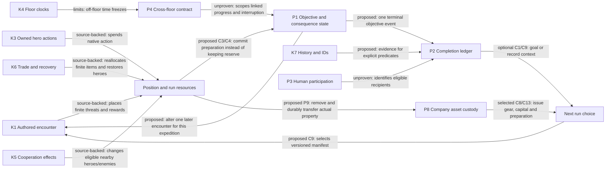

# Content systems, reusable capabilities and gaps

[Map index](README.md) · [Progression](progression.md) · [Concepts](concepts.md) · [Probes](frontiers.md)

## What counts as content

A useful content map includes the things a player can become, the situations they encounter, the ways they solve them, the reasons to continue, and what survives the run. A monster list alone misses most of that space.

The local executable reported 686 monster records, including 99 marked unique; 440 spell records, including 205 marked for players; 47 species records, including 38 starting species; 35 backgrounds; 1,299 legal starting combo identifiers; 27 god records; 218 mutations; 29 skills; 41 branch records; and 501 entries across 14 item categories. These are **catalogue counts**, not independently balanced, naturally generated or selectable content counts. For example, draconian transformations are species records but not starting choices. Brand and ego categories are included in the 501 total. See [provenance](evidence.md).

## Content-layer inventory

| Layer | Existing mechanisms and sources | Meaningful variation already available | Underdeveloped connection |
| --- | --- | --- | --- |
| Character body | Species, aptitudes, mutations, equipment restrictions, innate verbs | Fragility, mobility, regeneration, size, magic constraints, anatomy | Party objectives that value unusual bodies without excluding others |
| Initial direction | Background equipment, training, spell kit, worship | Melee, ranged, stealth, magic, hybrid, invocations, shapeshifting | Short goals that teach a build's new decisions; backgrounds are not permanent MMO classes |
| Growth | XP/XL, skills, spells, piety, species development | Specialize vs diversify; immediate survival vs later efficiency | New choices after XL27 that do not require limitless stat inflation |
| Religion | Abilities, gifts, conduct, wrath, conversion, sacrifice | Tactical power coupled to long-term constraints | Cooperative encounter consequences for compatible/incompatible patron choices; politics already has fork code |
| Equipment | Weapons, armour, shields, jewellery, staves, talismans, randarts/unrands | Opportunity costs, resistances, spell burden, hands/slots, skills | Repeated decisions about group allocation rather than a single damage winner |
| Consumables | Potions, scrolls, wands, missiles, evokers | Spend a finite resource now or preserve an escape/solution | Explicit encounter objectives that make rescue/control/positioning competitive uses |
| Magic and allies | Damage, disables, displacement, summons, Forgecraft, forms, support | Range, line of fire, noise, MP, failure, collateral risk | Clear support contributions and robust source/recipient ownership in multiplayer |
| Enemies | Species, packs, casters, uniques, gods/realms, summons | Priority, positioning, retreat, resistant enemies, combination threats | Relationships that change when another enemy/objective changes, beyond larger packs |
| Geometry | Layouts, terrain, doors, grates, water/lava, clouds, traps, stairs | Chokes vs open space, approach, separation, escape, noise | Same-floor multi-wing operations; careful cross-floor commitments |
| Authored situations | Arrival vaults, mini/serial vaults, branch ends, portals, god arenas | Local themes, visible reward temptations, timed access, path choice | A shared objective vocabulary with state, consequences and exits |
| Route | Random branch pairing, optional loot, rune alternatives, special travel | Choose risk profile and preparation order | One branch's optional operation changing a later branch's configuration |
| Victory | Three-rune gate, Orb pickup, escape, additional runes/gems/score | Stop with a win or risk more ambition | Party outcome clarity and optional extraction objectives |
| Between runs | Player learning, ghosts, records, combos, scores, tournaments | Mastery, breadth, challenge restrictions, social goals | Persistent goal evaluation and optional company/world continuity |

## Builds as verbs, not locked party roles

| Contribution | Solo expression | Cooperative extension | Failure to avoid |
| --- | --- | --- | --- |
| Hold position | Survive a choke; control approach | Keep a lane open while a teammate acts elsewhere | A mandatory tank with no alternative solution |
| Deliver damage | Choose a target and attack window | Set up another hero's finisher, cover a vulnerable action | More bodies turning every encounter into an alpha strike |
| Control | Disable, divide, silence, move or slow enemies | Break a linked enemy effect or protect an objective window | Immunity walls that invalidate an entire build |
| Scout | Reveal terrain and retreat safely | Gather local knowledge; ping a path or identify pressure | Global live vision that removes asymmetric information |
| Support | Recover, buff, summon, reposition, use consumables | Aid another hero and preserve their next action | Endless buff maintenance or a healer tax |
| Allocate | Spend XP/gold/consumables; choose equipment | Trade a solution to the hero best placed to use it | Last-hit competition, hoarding, or inventory sorting as the group game |
| Extract | Use escape tools and choose a safe route | Carry, screen, intercept, rally and choose a rendezvous | One player escapes and unexpectedly deletes peers' choices |
| Recover | Survive an error or loss of resources | Choose whether and how to restore a downed ally/objective | Downing as a free teleport, infinite reset or optimal farm |

Content should ask for these contributions in different combinations. Every ordinary objective should have a solo sequence and at least two reasonable solutions using widely available verbs. Rare species, a specific spell school or a specific god can enable an alternate advantage; they should not be an unannounced entry ticket.

## Capability records

Evidence labels: **Observed** means demonstrated under the stated conditions here; **Source-backed** means concrete code/usage exists; **Proposed composition** means a new combination; **Unproven primitive** means an essential new contract lacks adequate evidence. Delivery status is separate. All gameplay capabilities below are source-backed unless a narrower observation is stated.

### K1 — Authored spatial encounter

- **Operation/ownership:** native dungeon generation selects `.des` maps/Lua, places terrain, monsters and rewards; engine owns outcome.
- **Recipient/eligibility:** a generated floor and its visiting heroes; depth, branch, tags, weights, uniqueness and Lua vetoes constrain placement. A named map in a file alone is ineligible evidence of successful generation.
- **Scale/time:** minivault through full floor; one-off or varied selection; timed portal markers can expire in game time.
- **Lifecycle/dependencies:** map compiler, builder selection, native entities, level persistence and event listeners. Already-authored objects normally survive native floor save/load; a new scripted objective must prove its own state and listener restoration.
- **Limits:** the three co-op vaults are authored, not proven here to generate or implement their advertised cross-lane interactions. See K5.
- **Enables:** C2, C4, C5, C10, C12. Source: [level authoring guide](../../crawl-ref/docs/develop/levels/introduction.txt), [co-op vaults](../../crawl-ref/source/dat/des/variable/coop_vaults.des).

### K2 — Native run progression and commitment

- **Operation:** collect runes, train skills, gain levels/piety, discover gear, enter a branch or take the Orb. State belongs to native hero/run data.
- **Eligibility:** native rules; three runes for Zot; zero-rune Vaults entry with lock-in warning; Slime retreat constraints. Group effects require checking which state is shared.
- **Lifetime:** within a run and its save package; terminal escape/death ends that run. Starting power does not inherit from records.
- **Limits:** runes are shared by the existing party-state synchronization, but proposed per-player rune possession or an Orb carrier handoff is not implied. Forest's all-rune accounting is unresolved.
- **Enables:** C3/C4 run commitments, C7 extraction, C10/C11 extended choices. Sources: [main.cc](../../crawl-ref/source/main.cc), [party.cc](../../crawl-ref/source/party.cc), [items.cc](../../crawl-ref/source/items.cc).

### K3 — Owned party actions and personal perception

- **Operation:** authenticated account reservation → actor-bound command → authoritative engine → recipient-specific view. Multiplayer supports two to four humans; solo companion control is a separate policy.
- **Recipients:** the owning character for actions; each hero's native sight for live entities; remembered terrain is shared. Seeing or centering a teammate does not transfer control.
- **Timing/limits:** one engine executes native actions serially; native modal prompts remain serialized. A second independent browser menu is not a second native call stack.
- **Persistence/recovery:** reservations and per-hero data are restored by the existing launch/save/stream mechanisms; late joining is supported with constraints. This map performed no fresh two-client play.
- **Enables:** C2/C5/C6, private scouting and fair contribution records. Sources: [multiplayer contract](../multiplayer-mechanics.md), [party control](../party-control.md), [party_control.py](../../crawl-ref/source/webserver/webtiles/party_control.py).

### K4 — Independent floor simulation

- **Operation:** actions on a floor advance its floor clock and native entities; loaded floors are persisted/reloaded by one authoritative engine. Other floors and elapsed wall time do not automatically advance them.
- **Actor/scale:** living participant recovery constrains threatened-floor scheduling; safe actions need not wait for idle peers. Two to four heroes can occupy different floors.
- **Lifecycle:** floor identity, character recovery, unloaded entity state, reconnect projection and saved level packages all matter.
- **Limits:** this enables independent exploration, not a globally synchronized real-time raid. An objective timer on an unattended floor can be frozen. Cross-floor countdowns, effects and completion need a new explicit timing contract.
- **Enables:** C11 only after P4 is designed; same-floor C2/C5 need less machinery. Sources: [party-session.cc](../../crawl-ref/source/party-session.cc), [level-time.cc](../../crawl-ref/source/level-time.cc), [multiplayer contract](../multiplayer-mechanics.md).

### K5 — Cooperation effects and tactical resources

- **Operation:** source code implements ally buffs/healing, auras, thrown-potion/revival helpers, scroll chorus, shared-vigour/rally/phase-swap/recall, co-op jewellery/unrands, god relations and elemental cross-combos from different heroes.
- **Eligibility/recipients:** effect-specific floor, distance, line-of-sight, living/downed and god restrictions; a helper declaration is not a universal targeting API. Cross-combo code checks a different primer hero and a short action-time window.
- **Resource/scale:** actual MP, piety, consumables, equipment and position costs vary. Existing synergy can create multiplicative gains; observe before adding more passive stacking.
- **Limits:** no fresh behavioral or balance verification was performed for these effects. A grate shown as transparent in a vault does not prove every projectile/spell/aura can cross it. Source comments and older header defaults conflict in places; implementation and tested behavior take precedence.
- **Enables:** C2/C5 and role variety throughout the run. Sources: [party.h](../../crawl-ref/source/party.h), [party.cc](../../crawl-ref/source/party.cc), [co-op vaults](../../crawl-ref/source/dat/des/variable/coop_vaults.des).

### K6 — Party economy and recovery

- **Operation:** native trade transfers an eligible item/quantity with giver action cost; gold is shared. XP awarding gives the full awarded XP amount to other non-downed heroes, rather than dividing a fixed XP pool.
- **Eligibility:** trade requires living same-floor recipients within the giver's own native line of sight and range; equipped/melded gear must first be removed. XP sharing code inspected here does not require the other hero to be on that floor.
- **Recovery:** downed state, explicit revival helpers and last-stand behavior exist. Ordinary multiplayer stairs explicitly do not auto-revive or gather peers. Do not infer that every older revival helper is the active travel policy.
- **Failure/persistence:** transfer requests revalidate state and must not replay after failure; downed identity persists. Off-floor full XP and ineligible downed XP recipients create design questions for split-party activities and late joining.
- **Enables:** C3 allocation and C6 recovery, with anti-farming and fair-participation rules. Sources: [party-trade.cc](../../crawl-ref/source/party-trade.cc), [mon-death.cc `_give_player_experience`](../../crawl-ref/source/mon-death.cc), [party.cc](../../crawl-ref/source/party.cc).

### K7 — Durable identity, history and observations

- **Operation:** native hero/item identities, expedition/account IDs, save library, snapshots, Chronicle events, morgues and milestones are indexed for read-only pages and stats.
- **Owner/recipient:** private save ownership differs from public record visibility; host/expedition account identity is not sufficient proof of every human controller's contribution.
- **Timing/lifecycle:** save/end snapshots and event/log ingestion; deduplication and missing fields differ by source. Existing archive dedup is not a generic transaction ledger.
- **Observed here:** catalogue exports return successfully. Runtime records and proposed reward delivery were not exercised.
- **Limits:** no general unlock wallet, replay-safe achievement entitlement, campaign world transition or controller participation ledger was established. Snapshots do not expose every action, encounter or causal contribution.
- **Enables:** C1 Atlas as read-only composition; C8/C9 require P2/P3 for durable completion and shared credit. Sources: [save library](../save-library.md), [stats](../stats.md), [chronicle.py](../../crawl-ref/source/webserver/webtiles/chronicle.py).

### K8 — Alternate rules and community goals

- **Operation:** native solo/party, seeded, Descent, tutorial and Sprint launch configurations; source also has five run modifier “seasonings” and contribution superlatives.
- **Eligibility:** supported launcher configuration and matching native rules; parser support does not prove a polished selectable mode or balanced challenge.
- **Outside the fork:** official tournaments already use banners, combo challenges, streaks, gems, exploration and clan categories. This is evidence that a goal layer fits the domain, not evidence that this server implements tournament scoring.
- **Enables:** C8/C9 and a bounded optional campaign; no need to invent an unrelated quest client. Sources: [games.d/base.yaml](../../crawl-ref/source/webserver/games.d/base.yaml), [party.cc](../../crawl-ref/source/party.cc), [official tournament overview](https://crawl.develz.org/tournament/0.34/overview.html).

## Where the design space is sparse

| Gap | Kind of gap | Why it matters | Counterweight / existing strength |
| --- | --- | --- | --- |
| G1 Early co-op situations | Authoring coverage within inspected co-op vault file | Its first named co-op vault starts at D:9 / Lair:2; early basic cooperation lacks an equivalent example there | Ordinary terrain and combat already support emergent cooperation; this is not proof no early co-op content exists anywhere |
| G2 Choices that change later encounters | Proposed mechanism, not missing raw content | Branch order often changes preparation; explicit optional operation consequences could also change later verbs/topology | Gods, items and commitment branches already make history matter within a run |
| G3 Co-op objectives beyond killing | Limited verified examples | Existing named vaults emphasize terrain/enemies/loot; linked states and alternate victories create different assignments | Enemy support packs, Gauntlet paths and god arenas provide useful native precedents |
| G4 Recovery as playable content | Existing recovery mechanism; objective design missing | A downed player needs understandable choices and a return path | Revival already exists; adding another resurrection system would be redundant |
| G5 Post-XL27 choices | Progression-design frontier | More XP cannot keep delivering new character levels; extended needs spatial, resource or commitment changes | Spells, gear, gods and skill completion can still evolve a mature build |
| G6 Rune completion semantics | Concrete compatibility/accounting question | Forest's rune does not match the inherited fifteen-rune assumption | The branch/rune authoring path already exists; validate it before adding another region |
| G7 Party outcome and credit | Existing terminal semantics need characterization | One hero escaping, all heroes ending, records and rewards may mean different things | Current stats explicitly define party success as at least one Orb escape and wait for full terminal roster before rating |
| G8 Action history → future goal | Missing composition / some missing telemetry | The archive can inform what to attempt next and recognize non-damage contributions | Extensive record/reference infrastructure already exists |
| G9 Persistent campaign | Unproven primitive and product choice | Cross-run world response can sustain a company of players | It changes Crawl's run contract and needs separate rules/records; it is not a small achievement flag |
| G10 Session shape | Content packaging and measurement question | A full three-rune game, a short party session and extended expedition serve different time budgets | Sprint and saved expeditions already offer useful building blocks |

## Connected mechanisms and feedback

Key feedbacks to watch:

- **Positive power loop:** additional heroes get full XP and contribute extra effects; easier clears can yield more equipment and further ease. This is an inferred risk, not measured balance. Use encounter composition/space and observe actual resource use before multiplying HP.
- **Hoarding loop:** objectives reward unused consumables → players avoid spending → fewer interesting rescues. Reward successful decisions/outcomes, not universal “never use tools” incentives.
- **Persistent power:** company investment makes later parties stronger; that is now the selected reward. Shared lending can equip newcomers immediately. Watch for mandatory repeated farming, exhausted early decisions and dominant effects; retain actual company preparation in records rather than treating company starts as unchanged ordinary starts.
- **Failure farming:** death produces useful legacy rewards → intentional deaths dominate. Cap recognition per distinct objective and require valid attempt provenance; do not reward repeat deaths with power.
- **Coordination tax:** more windows/roles → longer waits → players avoid co-op content. A partner should broaden options; one hero must still be able to make progress with a readable fallback.
- **Completionist trap:** every new branch is good preparation → every run gets longer. Prefer competing opportunities and bounded encounter replacements over additive mandatory chores.

## Smallest useful abstractions

These are proposed contracts, not a request to build a generic framework now.

| Primitive | Minimal contract | At least two distinct uses | Boundary |
| --- | --- | --- | --- |
| P1 Encounter objective/consequence | Stable run/objective ID, typed state, eligible action/event, terminal result, native persistence, one explicit consequence | Paired boss state; a preparation choice changing a later rune approach | Native gameplay authority; content selects configuration |
| P2 Completion ledger | Predicate version + evidence identity + recipient scope + idempotent terminal completion | Personal mastery banner; group charter chapter | Server records evaluate evidence; no silent native stat grants |
| P3 Participation/credit | Account-to-hero intervals, eligibility policy, late join/leave/downed rules, public/private visibility | Party achievements; optional shared campaign contribution | Host ownership, damage dealt and spectator presence are different facts |
| P4 Linked-scope timing | Explicit floor/encounter/expedition time, activation, pause, cancellation and source-loss rules | Multi-floor operation; disconnected objective holder | Do not silently change all floor simulation or wall-clock behavior |
| P5 Versioned run manifest | Rules/content revision, seed, build policy, roster policy, objectives and outcome policy fixed at start | Shared challenge board; campaign chapter | No promise of identical solo/co-op RNG or balance |
| P6 Content eligibility/budget | Branch/depth, difficulty role, party variations, uniqueness, replacement budget and solo fallback | Early signal vault family; extended operation family | Extend existing vault tags/builders first; no second content engine |
| P7 Campaign transition | Campaign ID/revision, completed operation, bounded world-state choice, atomic transition and recovery | Company-owned chapter routes; seasonal community world | Optional outer mode; never read a public item record as ownership of a usable heirloom |
| P8 Asset custody | Stable physical identity/quantity, owner, current location, reservations and consumed state | Shared armory loans; consignments and recovery escrow | Source-native item state and special class dependencies need explicit adapters |
| P9 Durable native transfer | Authenticated request, stable transaction, native mutation/save, ledger settlement and reconciliation | Secure field deposit; issue returned gear into a fresh run | Existing metadata snapshots and same-run trade do not prove cross-run atomicity |
| P10 Participant lifecycle | Stable hero/incarnation ID, alive/downed/fallen/extracted state, scheduling/input eligibility, independent settlement and final closure | One hero returns while peers continue; survivor recovers a finally fallen participant's bag | Current process/save termination and party final snapshots are global; host extraction and Orb outcomes need explicit adapters |
| P11 Contributed construction | Typed personal resource balances, voluntary donation/pledge, atomic funded project and membership eligibility | Guild buildings benefit every member; personal crafting competes with shared investment | Finite native material acquisition; no officer access to private wallets, double consumption or stacked mid-run guild benefits |

The user-selected asset campaign is developed in [the current company design](company-campaign/README.md), with [guild resources](company-campaign/guild-resources.md) and [separate extraction](company-campaign/inheritance-extraction-recovery.md). P8-P11 are its immediate frontier; P2 achievement recognition is no longer the progression foundation. Reuse the custody/transfer core for equipment, materials, loans and recovery; keep DCSS lifecycle, generation and building effects in native/configured adapters.
