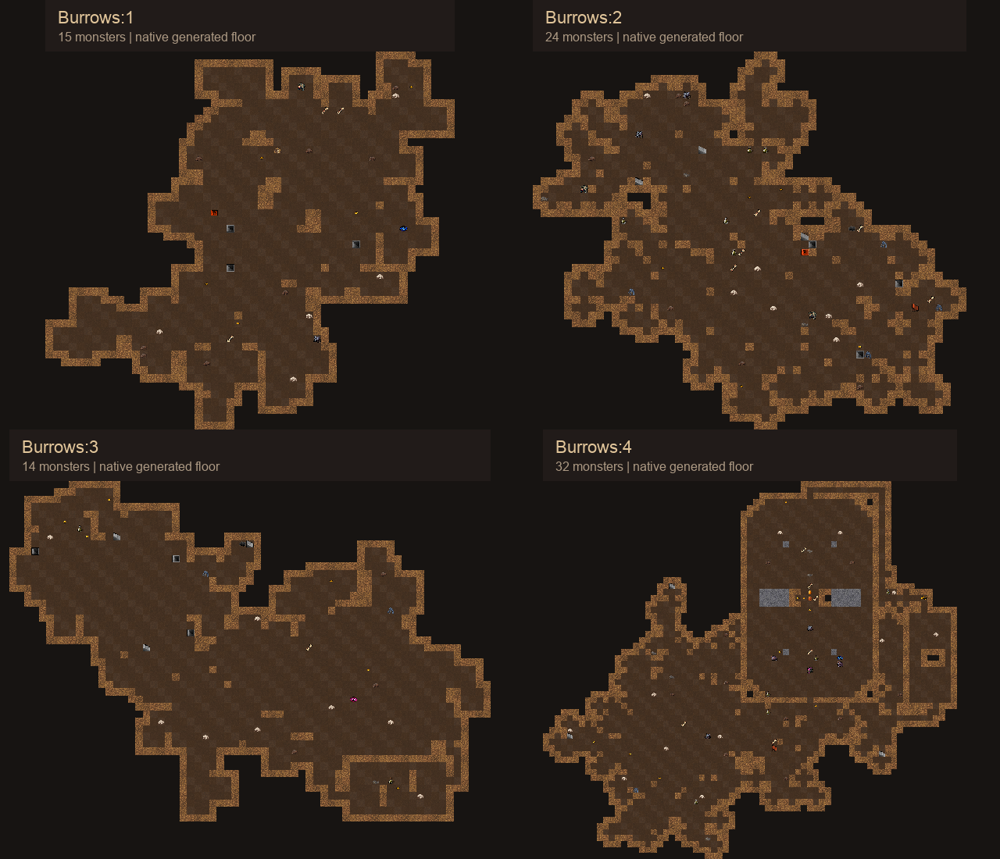
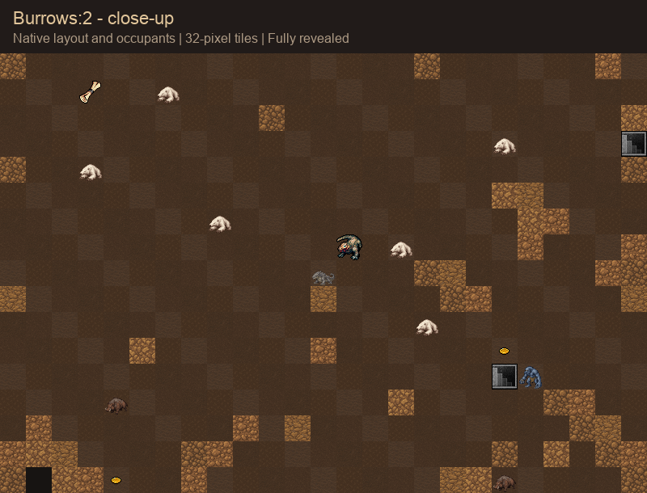

# Burrows generation previews

Current content revision: [twenty vaults per branch and fungal Wormlands](v6/README.md). Earlier results below remain historical.
Latest gallery: [nine complete floors with native monsters, loot, and vault ownership](full-floors/README.md).
The [revised generation](v2/README.md) replaces these open-cavern examples with
connected dens and winding passages, and adds ten small ordinary vaults.
The images below preserve the original comparison baseline.

Generated with the validated native art build using seed **20261023**. The
native RNG starts one sequence, generating Bur:1 through Bur:4 in order.
This run selected the Old Warren on Bur:4. Three additional native vault
placements show every rune ending separately.





[All rune endings](endings.png)

## Full-size images

- [Burrows:1](bur-1.png): 15 monsters; broad connected caves.
- [Burrows:2](bur-2.png): 24 monsters; animals, drakes, and delvers.
- [Burrows:3](bur-3.png): 14 monsters; includes an old hoard vault.
- [Burrows:4](bur-4.png): 32 monsters; Old Warren and winding tunnel vaults.
- [Worldworm's Den](worldworm.png)
- [Troll Cairn](troll_cairn.png)
- [Old Warren](old_warren.png)

## What the images show

These are fully revealed offline tile previews of real native geometry and
occupants, rather than client screenshots. `export.lua` asks the native engine
to generate the floors and place the ending vaults. It exports every feature,
monster, and item position. `raw/` preserves the seven native JSON exports.

`render.py` uses the matching native atlas metadata and pixels. Decorative
floor/wall variants are selected deterministically for the preview. It omits
unused solid rock away from the cave boundary and does not reproduce client
fog, shadows, targeting overlays, or monster behavior. Rune, gem, gold, scroll,
and potion icons are shown; other ordinary loot is omitted to keep the layout
readable. Rune/gem stacks take priority over other items.

The [generation manifest](generation.json) records the actual vault selection,
native binary hash, seed, and close-up bounds. Local ignored `validation/`
retains the pinned source, commands, logs, and host reservation closures.
Both native generation and image rendering passed, and their reservations
were released. The native game source and running services were unchanged.

To reproduce, copy `export.lua` to a matching build's
`test/burrows-preview.lua`, then run these inside the shared heavy-host gate:

```
./crawl -seed 20261023 -no-save -name BurrowsPreview -wizard -no-throttle -test burrows-preview
python3 render.py /absolute/path/to/native-build /absolute/path/to/preview-output
```
