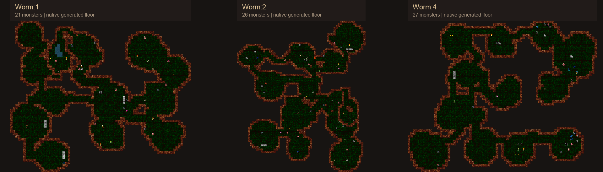
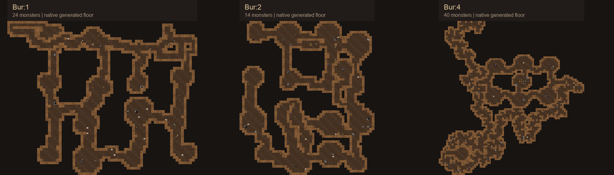
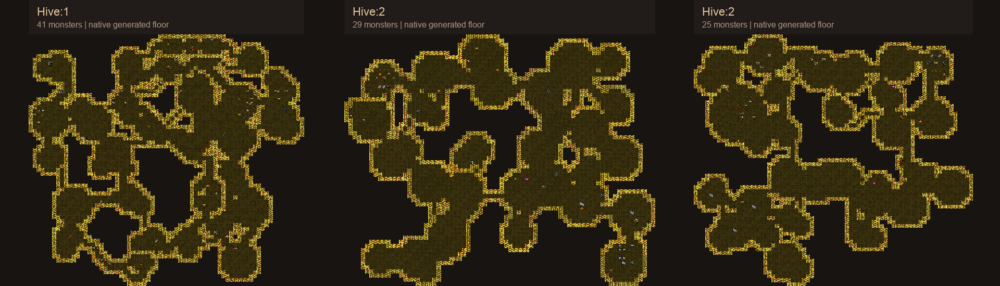

# Complete branch floors

Nine complete floors from the native engine: three each for Burrows, Wormlands,
and Hive, including branch endings, ordinary populations, vaults, and ground loot.
The interactive conversation view starts on Wormlands:2; select an occupant or
click a tile to inspect its native name, coordinates, terrain, and vault.

## Wormlands



These representative seeds were selected for fungal vault coverage from 23
normal Wormlands generations. Vaults were never forced. The full
[trial index](candidates/burrows-candidate-index.json) and every candidate export
are retained. Mushrooms share the floors with gallery, coil, and caustic worms,
delvers, and trolls; the Fungal Heart is a naturally selected bottom-floor ending.

| Full-size map | Seed | Monsters | Mushrooms / deathcaps | Ground item stacks | Authored vaults |
| --- | --- | --- | --- | --- | --- |
| [Wormlands:1](worm-1.png) | 2026102431 | 21 | 5 | 9 | Rootbound Pool |
| [Wormlands:2](worm-2.png) | 2026102490 | 26 | 5 | 24 | Rotten Pack |
| [Wormlands:4](worm-4.png) | 2026102539 | 27 | 4 | 6 | Fungal Heart ending |

## Burrows



| Full-size map | Seed | Monsters | Ground item stacks | Authored vaults |
| --- | --- | --- | --- | --- |
| [Burrows:1](bur-1.png) | 2026102401 | 24 | 15 | Old Crossing, Bent Gallery |
| [Burrows:2](bur-2.png) | 2026102402 | 14 | 23 | Hive entrance, Paired Dens, Beetle Burrow |
| [Burrows:4](bur-4.png) | 2026102403 | 40 | 28 | Old Warren ending, Troll Store |

## Hive



Hive is two floors deep, so the gallery includes two independent Hive:2 rolls.

| Full-size map | Seed | Monsters | Ground item stacks | Authored vaults |
| --- | --- | --- | --- | --- |
| [Hive:1](hive-1.png) | 2026102421 | 41 | 17 | Guard Line, Flight Lane, Abandoned Cells |
| [Hive:2 — Amber Brood](hive-2a.png) | 2026102422 | 29 | 6 | Amber Brood ending |
| [Hive:2 — Hollow Heart](hive-2b.png) | 2026102423 | 25 | 6 | Hollow Heart ending |

## Evidence and limits

All nine selected floors passed ground-connectivity and ordinary stair-count
checks. Burrows:2 has its Hive entrance, Burrows:4 its Wormlands entrance, and
Wormlands:4 its Depths connection. None contains the former clay rune.
The viewer passed floor switching, native occupant inspection, zoom, and
320-pixel layout checks in an owned headless Chrome session.

These are fully revealed offline renders of native level geometry and contents,
using the matching classic tile atlases. Decorative tile variants are stable
preview choices. Ordinary loot uses item-class icons; the inspector retains exact
native item names. Monster equipment overlays, client lighting, fog, and live
combat are not reproduced. Samples reset unique and vault history independently,
so this gallery does not represent one continuous playthrough or balance proof.

[Generation manifest](generation.json) contains per-floor rosters, loot classes,
native vault ownership, seeds, and binary hash. [Native JSON exports](raw/)
retain every feature, monster, ground item, and vault cell. See
[verification summary](verification.json) and [viewer checks](viewer-checks.json).
No deployment or gameplay source change was part of this preview work.

## Reproduction

Use a build matching the recorded native binary and content hashes. Copy
`dat/dlua/burrows_preview.lua` into its data tree and
`../full-floors.lua` into `test/burrows-full-floors.lua`. Within the shared host
reservation, run:

```sh
./crawl -seed 20261024 -no-save -name BurrowsFloors -wizard -no-throttle -test burrows-full-floors
python3 /absolute/path/to/full_floors.py /absolute/path/to/build /absolute/path/to/output /absolute/path/to/build /absolute/path/to/fragment.html
```

The literal fragment template and exporter are shared with the existing preview
renderer. The script writes full-size PNGs, branch contact sheets, native exports,
the generation manifest, and the inline inspection view from the same nine floors.
