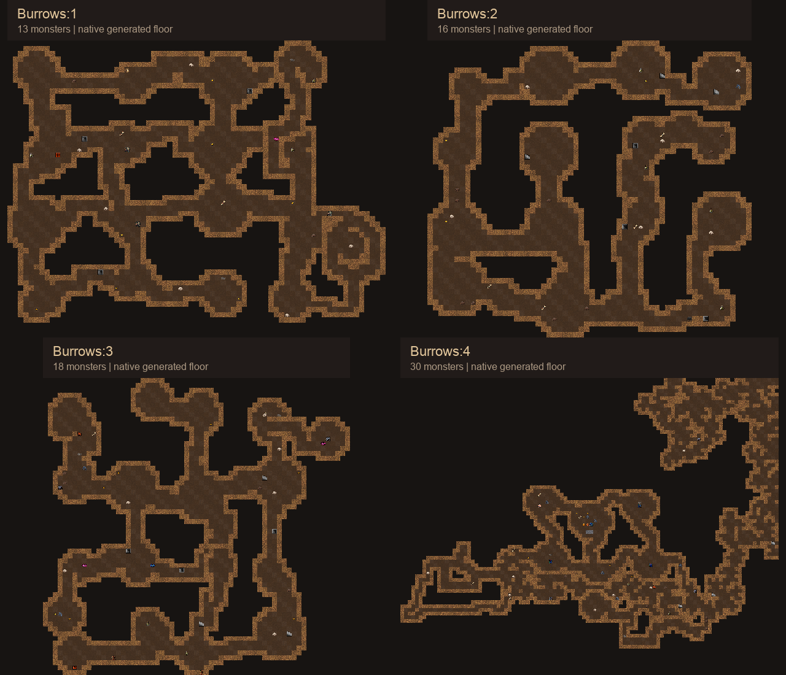
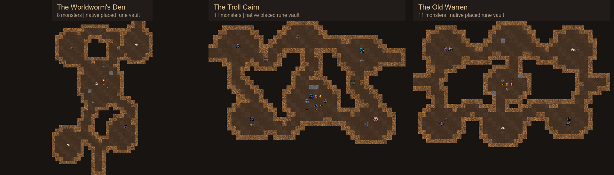

# Burrows: dens and winding passages

Current route revision: [rune-free Burrows, Wormlands and Hive](../v4/README.md). Earlier results below remain historical.
This revision replaces the original open-cavern generation. It uses small
rounded dens, mostly two- or three-cell passages, branching routes, and loops.
Ten new small vaults bring the ordinary pool to sixteen; the six original
ordinary maps and three rune endings also have new shapes.

[Original four-floor preview](../floors.png) · [Vault descriptions](../../burrows-vaults.md)

## Native generation

`layout_burrows.des` uses the existing native `make_circle` and `join_the_dots`
primitives for ordinary floors. On the rune floor, native `delve` grows narrow
passages from the already connected ending, preserving its partitions. The
existing disconnected-level veto rejects candidates with cut-off regions.

Small extra vaults use ordinary 25% placement chances. There is no fixed quota
or required encounter combination. Blank cells outside each rock rim let the
map fit the surrounding passages instead of replacing a solid rectangle.

The preview uses the same seed **20261023** as the original. It selected:

- Bur:1: bent gallery and split passage.
- Bur:2: the procedural den network.
- Bur:3: troll store, root pocket, and beetle burrow.
- Bur:4: Troll Cairn, old crossing, bone cache, and bent gallery.

The preview helper regenerates floors independently; it clears player/vault
history between floors. The ordinary game retains its normal vault uniqueness
rules. These are native geometry and occupant exports composed with matching
classic atlases, fully revealed. Decorative variants are deterministic; client
fog, shadows, combat behavior, and most ordinary loot are outside this preview.

## Full-size maps

[Bur:1](bur-1.png) · [Bur:2](bur-2.png) · [Bur:3](bur-3.png) · [Bur:4](bur-4.png)

[Worldworm's Den](worldworm.png) · [Troll Cairn](troll_cairn.png) · [Old Warren](old_warren.png)

## Validation

- Native WebTiles engine and Catch2 build passed with debug assertions.
- Native description and map database loading passed.
- Five Burrows C++ cases passed, with 552 assertions.
- All 21 non-dummy vaults placed three times: 63 placements.
- 48 complete floors across seeds 1, 7, 19, and 43 passed full-grid
  connectivity, layout/ending selection, stair, rune, and gem checks.
- The seven preview exports and native-atlas renders passed.

[generation.json](generation.json) records the seed, vault names, and native
binary hash. `raw/` preserves the actual native exports. Local ignored
`../validation/refine-4/` records the passing commands and exact reservation
closure. Earlier failed candidates and their previews remain in earlier
receipt directories. They exposed how an overlaid layout could be severed by
the rune vault's protected walls; growing from the existing vault resolved it.

No full-run balance or live client presentation claim is made. The shared
checkout's binary and running services were not replaced.
