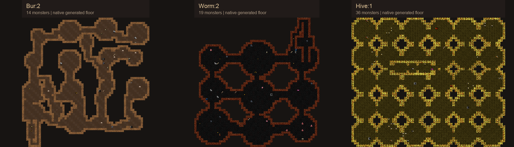

# Burrows, Wormlands and Hive: native route preview

Current generation: [organic Wormlands and Hive with expanded vaults](../v4/README.md). This page preserves the earlier room-grid revision.

The Burrows now always begin on Lair:5 and contain no rune. Burrows:4 descends
into four floors of Wormlands, ending at a reversible passage into Depths:1.
The original Dungeon:15 route remains. A two-floor Hive opens from Burrows:2.

[Design and character pressures](../../burrows.md) · [Vault catalogue](../../burrows-vaults.md)

## Generated floors

[Burrows](floors.png) · [Wormlands](wormlands.png) · [Hive](hive.png)

- Burrows: [1](bur-1.png), [2](bur-2.png), [3](bur-3.png), [4](bur-4.png).
- Wormlands: [1](worm-1.png), [2](worm-2.png), [3](worm-3.png), [4](worm-4.png).
- Hive: [1](hive-1.png), [2](hive-2.png).
- Connection floors: [Lair:5](lair-5.png), [Depths:1](depths-1.png).

Burrows uses rounded dens and winding passages. Wormlands uses much broader
chambers and longer exposed galleries, with stone pillars and guarding worms.
Hive uses short, interconnected combs with native wax tiles and flying packs.
All routes are walkable without special abilities. Guarded ordinary treasure
provides the optional reward; none of these branches supplies a rune.

[All six ending variants](endings.png) include the converted Burrows approaches,
two Wormlands exits, and the Hive's inner combs. The isolated ending placements
show authored guards only; the fully generated floors also have their normal
random populations. The existing ochre gem remains on Burrows:4.

## Evidence

- Native WebTiles engine and Catch2 build passed with debug assertions.
- Full native description and vault database loading passed.
- Eight C++ cases, 930 assertions: guaranteed branches, preserved rune choices,
  Descent routing, both connection directions, native attacks and stable IDs.
- All 34 non-dummy authored vaults placed three times: 102 placements.
- Eighty full branch floors across four seeds, plus eight Lair/Depths connection
  floors: 88 floor checks. Connectivity, stairs, entrances, no clay rune, gem
  placement and branch layouts passed.
- Eighteen native exports and all matching-atlas preview renders passed.

[generation.json](generation.json) records the native binary hash and selected
vaults. [validation-summary.json](validation-summary.json) and
[preview-manifest.json](preview-manifest.json) retain scoped results and hashes.
The exact local native receipt is `../validation/route-4/`; the final renderer
receipt is `../validation/route-5/`. Earlier failures remain preserved. A prepared
route-3 candidate was superseded before dispatch and was never run.

These are fully revealed compositions of actual native geometry and occupants,
using seed 20261023. Floors are regenerated independently with player/vault
history cleared; ordinary games retain normal vault uniqueness. Decorative
variants are deterministic. Client fog, lighting, combat, shop type, and most
ordinary item appearances are outside this preview.

The shared runtime binary, atlases and running services were not replaced.
The route is intended for new games; old generated floors are not rewritten.
Full player-run balance, live graphical gameplay and production deployment
remain separate. No complete-suite pass is claimed.
