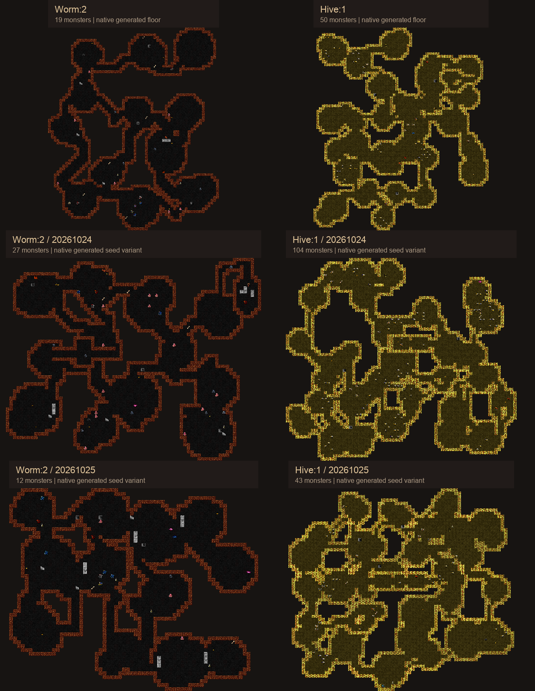

# Organic Wormlands and Hive

Fixed room rows and columns have been replaced by scattered chambers, bent
connections and local loops. The Burrows–Wormlands–Depths route and optional
two-floor Hive keep their existing placement and lengths.

## Distinct generation

Wormlands uses fewer, larger caverns with uneven lobes, winding galleries,
limited short loops and occasional stone outcrops. Hive uses denser irregular
comb clusters, short flight connections and occasional merged flight chambers.
Both use the same small chamber-graph helper with different native geometry
profiles. There is no fixed room lattice or jittered replacement lattice.

The helper uses existing native circles and passage drawing. A spanning tree
keeps the chambers connected, and short extra connections provide alternate
approaches. Protected ending maps use connected landmarks for their return
stairs, onward passage, guardians and ordinary treasure.

## Build checks

| Area | Pressure | Native responses |
| --- | --- | --- |
| Wormlands | Armour, bulk and regeneration test sustained damage; constrictors and ranged/support combinations test escape and target priority. Late shamans buff nearby allies. | Effective melee, spells or evocations; suitable control/translocations; separating support and keeping a retreat route. |
| Hive | Fast evasive packs test crowd handling; poison consumes recovery resources; spark wasps and smiting meliai prevent poison resistance from answering the whole branch. | Cleaving or area damage, reliable attacks or control; resistance/curing as available; priority kills and breaking line of sight. |

These are encounter pressures, with several viable answers. They introduce no
entry requirement, new status system or mandatory item. [The design](../../burrows.md)
explains the checks and their concrete monster pairings. They remain subject
to player-run balance assessment.

## Vault variety

Each new branch now has ten ordinary vaults. Wormlands has three endings and
Hive has two. This revision adds twelve ordinary vaults and two endings, using
normal depth limits, rotation, substitutions and optional extra placement.
Empty bends, abandoned combs and minor gold pockets remain in the pool.

[Vault catalogue](../../burrows-vaults.md) · [Eight ending variants](endings.png)

## Full maps

[Three-branch comparison](branches.png) · [Burrows](floors.png) ·
[Wormlands floors](wormlands.png) · [Hive floors](hive.png)

- Wormlands: [1](worm-1.png), [2](worm-2.png), [3](worm-3.png), [4](worm-4.png).
- Hive: [1](hive-1.png), [2](hive-2.png).
- New endings: [Coiled Galleries](coiled_galleries.png), [Hollow Heart](hollow_heart.png).

## Verification

The isolated native WebTiles build and full description/map database loading
passed. Eight C++ cases passed with 931 assertions. All 48 non-dummy vaults were
placed three times: 144 placements. The tests check the authored build-pressure
pairings, ending upstairs and hoards, full-grid connectivity and branch features.

Eighty branch-floor generations across seeds 1, 7, 19 and 43, plus eight
Lair/Depths connection floors, passed: 88 complete-floor checks. Twenty-four
native exports and their matching-atlas renders passed. Wormlands/Hive visual
samples use seeds 20261023, 20261024 and 20261025.

[generation.json](generation.json) records seeds, selected vaults and the native
binary hash. [validation-summary.json](validation-summary.json) and
[preview-manifest.json](preview-manifest.json) retain counts and source/artifact
hashes. The local exact-source receipt is `../validation/organic-1/`.

These are fully revealed compositions of actual native geometry and occupants.
Decorative variants are deterministic; client fog, lighting, combat and most
item appearances are outside the preview. The isolated ending placements show
authored guards; generated ending floors also have normal populations. The
preview regenerates floors independently, while ordinary play retains normal
vault uniqueness. The running shared game was not replaced.

[Previous grid-shaped revision](../v3/README.md) remains available for comparison.
