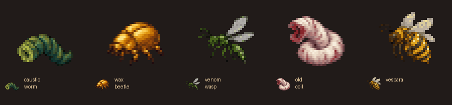

# Regional creatures, uniques and treasure

This revision adds three regular monsters, two optional uniques and eight
small encounter or treasure vaults to the organic Wormlands and Hive.

| Creature | Native encounter pressure |
| --- | --- |
| Caustic worm | Normal-speed acid spitter; makes waiting behind a constrictor costly. |
| Wax beetle | Durable, grounded blocker in the Hive's short flight lanes. |
| Venom wasp | Fast flying poison spitter; fragile if reached. |
| Old Coil | Optional vampiric constrictor; escape planning and sustained close combat. |
| Vespara | Optional queen; incites killer bees and meliai with the native queen-bee ability. |

The uniques use ordinary once-per-game placement, with no stair or kill gate.
Wormlands caches favor equipment and wands; Hive caches favor jewellery, books
and consumables. Two guarded optional unique vaults contain ordinary randarts.
Ending reward counts remain three item slots and three gold stacks.

[Enemy design](../../burrows-enemies.md) · [Vault catalogue](../../burrows-vaults.md) ·
[Eight new encounter/cache maps](content.png) · [Generated floors](branches.png) ·
[All eight ending variants](endings.png) · [Three visual seeds](variants.png)

The geometry, occupants and loot come from actual native exports. Images use
matching classic atlases, with deterministic decorative variants and generic
item-class icons. They are fully revealed offline compositions; they do not
show client fog, lighting or live combat. Independent preview floors reset
unique history. Normal games retain native once-per-game unique tracking.

The isolated native WebTiles build and description/map database loading passed.
Ten C++ cases passed with 972 assertions, including eight direct casts checking
queen bee and Vespara against killer bees, meliai, wasps and beetles.

All 56 authored non-dummy vaults passed three placements each: 168 placements.
Tests check required encounter pairs, reward classes and counts, optional
randarts, full-grid connectivity, ending stairs, route entrances, rune absence
and normal unique tracking, including rejection after a level is cleared.
Eighty branch-floor generations across four seeds and eight Lair/Depths
connection floors passed: 88 complete-floor checks.

Thirty-two native exports and matching-atlas renders passed. All five new
monster sprites match their actual atlas pixels, with five distinct native
corpse transforms. The reusable audit also rechecked all 21 original Burrows
tiles and their five corpses. [Native atlas samples](atlas-content/generated-atlas-preview.png)
show each new living creature followed by its corpse.

[generation.json](generation.json), [validation-summary.json](validation-summary.json)
and [preview-manifest.json](preview-manifest.json) record binary, source and
artifact hashes. The local receipts are `../validation/content-3/` for build,
database, contracts and exports, and `../validation/content-4/` for the final
Lua and atlas checks. Earlier test-fixture failures remain recorded.

Full-run balance, live graphical gameplay, deployment and a complete test-suite
pass are not established by these checks.

[Previous organic generation revision](../v4/README.md) is preserved.
