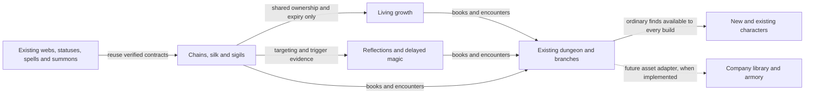

# Content slate: silk, growth and echoes

Planning draft, 21 October 2026; revised 22 October for the species-first direction. The user requested a connected slate and an implementation plan. This pass authors design documents only. Every new feature below is proposed; no gameplay, balance, save, build or deployment acceptance is implied.

The slate proposes **five species, four starting backgrounds and twelve spells**, grouped into three waves. Four books, three optional signature items and six encounter designs connect those player options to the existing dungeon. These are scope ceilings for this draft, not a requirement to ship every candidate. **Chain Devil is the next design focus**, replacing the Chainwarden background; its chain powers are innate species abilities.

## Read the plan

| Document | Decision it supports |
| --- | --- |
| [Species and backgrounds](roster.md) | What each character changes, starting kits, progression and overlap with existing choices |
| [Chain Devil proposal](chain-devil.md) | How the former Chainwarden concept becomes a species that plays differently across existing backgrounds |
| [Chain Devil mechanics](chain-devil-mechanics.md) | Exact tether, pull, pin, timing, escape and native reuse contracts |
| [Chain Devil assessment plan](chain-devil-plan.md) | Prototype sequence, source boundaries and decisive gameplay comparisons |
| [Spell catalogue](spells.md) | Twelve concrete spell proposals, costs, schools, counterplay and acquisition |
| [World integration](world.md) | Books, loot, enemies, branch encounters, gods and optional Company Campaign connections |
| [Mechanics and evidence](mechanics.md) | Existing native mechanisms, missing behavior, reusable boundaries and multiplayer rules |
| [Delivery plan](plan.md) | Sequenced work packages, first playable scope, acceptance and unresolved decisions |

## The three waves

| Wave | Player options | What changes in combat | Existing connections |
| --- | --- | --- | --- |
| **1. Chains, silk and sigils** | S5 Chain Devil first; S1 Araneid; B1 Runebinder as a starting-kit candidate | Hold an enemy with innate chains, lay a short-lived route, intercept an approach, pull or repel a threat | Native actor relationships, webs, Earth/Hexes/Translocations, existing backgrounds, Spider, Orc and Vaults |
| **2. Living growth** | S2 Myconid; B3 Druid | Invest in a contested patch of ground; choose when to spend its growth | Summoning/Alchemy/Earth, existing plants, fungi, Fedhas, Lair, Swamp and Forest |
| **3. Reflections and delayed magic** | S3 Glassborn; S4 Echoborn; B4 Illusionist; B5 Chronomancer | Retain or discharge protection; misdirect an enemy; predict a later position | Resistances, Hexes/Translocations/Conjurations, Dithmenos, phantom mirror, Elf, Vaults and Depths |

“Arachne” remains the existing unique monster. **Araneid** is the working player-species name. Codes and native identifiers remain unallocated; the existing deprecated Mayflytaur already uses `My`, so Myconid must not casually take that abbreviation.

## Design commitments

- Species carry most enduring diversity through anatomy, innate capabilities and development. Backgrounds are starting templates; their spells and items remain available to other characters under normal learning and equipment rules. A distinctive lasting mechanic is first assessed as a species capability, not an exclusive class progression.
- Each new option must work alone and contribute in co-op. Combinations create opportunities through ordinary positioning and effects. No party composition is mandatory, and no bonus triggers merely from two background names being present.
- Use existing schools, MP, HP, action time and evoker recharge. No new magic school, branch, god, crafting currency or campaign dependency is needed for the initial slate.
- Preparation expires and has an opportunity cost. Avoid optimal routines of coating every corridor, farming weak enemies for charges, refreshing buffs before every door or waiting for free resource growth.
- Necessary information is visible: owner, affected tiles, remaining time, trigger, resistance/immunity and collateral risk. Native state remains authoritative for both console and WebTiles.
- Frequent actions get direct hotbar entries. Target selection previews consequences and replacement; ordinary placement needs no additional confirmation. Destructive consequences retain native prompts.
- Use the existing content as a baseline. Adding a stronger version of Warper, Forgewright, Paladin or Blood Liturgist is not sufficient justification for another background.

## How the content connects

The arrows describe the proposed delivery relationships. A successful web experiment does not prove plant behavior, illusion AI or deferred damage.

## First playable package

Start by assessing **Chain Devil with existing Fighter, Hunter, Conjurer and Warper starts**. One useful innate chain action comes first; later Reel and Pin actions must earn their place through distinct choices. Include complete native character creation, art, descriptions, ability access, console fallback, demonic eligibility and save compatibility in a playable package. The working name and numerical profile remain proposals.

The earlier **Araneid + Runebinder** package remains the subsequent silk/sigil assessment: three spells, one book and two encounter layouts. Compare it with old species and backgrounds. Neither species depends on the other, and a new background is not required to demonstrate racial diversity.

The current [Company Campaign](../../content-map/company-campaign/README.md) remains a separate design track. These books and items can eventually become real archived knowledge and stored equipment. This slate neither replaces that plan nor assumes its custody and extraction systems exist.

## Status

| Work | State |
| --- | --- |
| Current source and existing design reconciliation | Inspected; important differences recorded in [mechanics](mechanics.md) |
| Roster, spells, encounters and delivery sequence | Authored planning draft |
| Numerical balance | Provisional hypotheses |
| Feature code, generated assets and native catalogue | Not authored by this pass |
| Native, browser, co-op and production validation | Not run for this slate |

Next planned work is P0/PC1 in the [delivery plan](plan.md): establish the demonic and actor-relationship contracts, then assess one Chain Devil tether before growing the kit. No gameplay phase was started by this planning revision.
