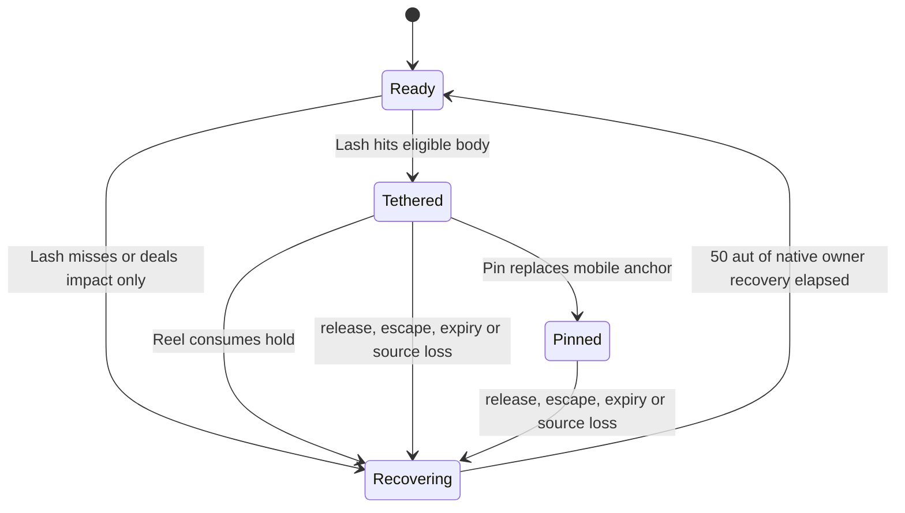

# Chain Devil: mechanics contract

[Species design](chain-devil.md) · [Assessment and implementation plan](chain-devil-plan.md)

Draft v0.3, 22 October 2026. Tuning update, 24 October: Lash reaches four tiles; tether and pin duration are doubled (80/120/160 aut and an 80-aut pin cap). All new behavior is proposed. This contract removes ambiguities from the prototype without claiming the native engine already supplies a leash. Small Lash impact damage is an agreed design direction; its values remain provisional.

## State and lifecycle

One devil owns at most one tether or pin. One target receives at most one active chain relationship, even from different devils. Lash is unavailable while the owner's chain is active or recovering. Reel only accepts a mobile tether. Pin only accepts a mobile tether, requires XL13, and cannot re-pin or extend an existing anchor.

Canceled targeting, out-of-range targets, known blocked paths and missing prerequisites do not consume an action or start recovery. A committed Lash resolves a normal hit/miss; it has no additional spell-failure roll. A miss or successful damage-only attack starts recovery. Attaching a hold delays owner recovery until that hold ends. Free Release starts exactly the same recovery and cannot be used to reset it.

Death of the target, source departure, body suppression and manual release all end the relation once. Source disconnection is not death or departure. Clear sight here means the source can currently see the target and no solid/transparent wall blocks the physical chain; an effect must not preserve hidden live target tracking through invisibility.

## Geometry

- Use native `grid_distance` for the leash radius, including diagonals. Record maximum separation at attachment: one, two, three or four tiles.
- The mobile anchor is the devil's current position. Approaching the target does not ratchet the recorded length smaller. The target may approach, retreat within reach, sidestep and attack.
- A voluntary target move crossing the boundary is ineligible. A committed physical owner move crossing it makes one Strength check: retention probability is `current_Str / (current_Str + 10 * extra_tiles)`. Success lengthens the same tether to the new separation; failure releases it and starts normal owner recovery and target respite. Neither result pulls the target or restores duration. Status reads, targeting previews and redraws never roll. Approaching the target does not tighten a previously lengthened chain.
- Any teleport breaks the chain, even if the destination happens to remain within radius. Forced physical movement uses the same Strength tension check; sight, body and other lifecycle conditions must remain valid afterward.
- A physical chain is not a wall. Other actors can cross its visual line; that does not snare them or change their allegiance. It grants no extra hit, attack of opportunity or movement tax.
- Pin's anchor is the target's current tile; it requires native solid-floor eligibility and permits radius-one movement. The source may then move while keeping same-floor, current sight and a maximum four-tile reach to the target. Pin is not remote indefinite control.
- Preserve stair and door access. Source stair travel releases before leaving the floor; target travel releases rather than trapping an actor in an invalid cross-floor relationship.

## Lash resolution

1. Validate owner ability, floor, recovery, clear target path and a visible hostile target. Allies, neutral actors and other human-controlled heroes are not valid quarries. An intervening actor blocks this deliberate one-target reach attack.
2. Resolve a physical bodily attack using native EV and appropriate block checks. Proposed attack input: `16 + XL`; damage `1d(5 + floor(XL / 3))` before AC. It is an extending appendage, not a reflectable projectile or an equipped-weapon attack.
3. A miss or block deals no impact and creates no chain. A landed hit uses ordinary damage, conduct and death attribution. No elemental damage, automatic weapon attack, bloodcraft rite, weapon brand or recurring constriction tick is added.
4. If the target survives and is eligible, attach regardless of whether AC reduced the impact to zero. A known ineligible target is clearly previewed as damage-only; no failed attachment is disguised as success.
5. Otherwise end the attack in recovery. A killed target is not retained by a reused actor slot.

First-pass attachment exclusions: active chain, active native constriction, net/web capture, bloodcraft binding, chain/bloodcraft recovery, and the native `res_constrict()` result. Current monster resistance includes insubstantial, amorphous and spiny bodies. This eligibility reuse is a conservative proposal; it does not give a chain native constriction behavior. Do not add a mind, blood, undead or demon restriction merely by analogy with Hexes.

Stationary actors cannot be reeled. They may take Lash impact, but the initial prototype should omit a pointless tether to a permanently stationary target. Large size alone is not a declared chain immunity; compare large mobile foes explicitly before choosing a size rule.

## Reel and Pin

**Reel:** validate a mobile tether, source XL7+, native dislodgement eligibility and at least one consecutive legal destination toward the source. Act directly on the current target for 10 aut and no MP/HP. There is no new accuracy or Willpower roll, and positive Lash damage is not a prerequisite: an attached chain whose impact was absorbed by AC is sufficient. Pull up to two cells along the same physical ray, stopping at adjacency or before any actor, solid cell, impassable feature or uninhabitable destination. Never skip a blocker, pass through the devil, move into its occupied tile or add collision damage. A partial one-cell pull is success. An adjacent target or visibly zero-cell pull is unavailable, preserving the hold and spending no action.

On a clear legal path, current range three produces a two-cell pull to adjacency; current range two produces a one-cell pull to adjacency; range four produces a two-cell pull ending two tiles away. Keep the source stationary. Reel supplies movement only: no damage, stun, automatic attack or delay of the target's next ordinarily scheduled action. Re-evaluate current positions at activation because Lash and Reel are separate actions; do not use the original attachment position as the pull destination preview.

When a valid pull commits, consume the relationship before dispatching movement effects, while retaining the information necessary to finish the pull. Start recovery and target respite once. Run native movement and finalization hooks so clouds, traps, existing effects, perception and positional state remain correct. If a later triggered event interrupts the path, stop at the last legal position; do not restore or duplicate the spent chain. No forced movement of a friendly hero is introduced.

**Pin:** validate a mobile tether, source XL13+, solid-floor anchor and at least 20 aut remaining before the action. Replace the same relationship with a fixed anchor at the target's current cell and lifetime `min(80, remaining_aut)`. The 10-aut activation cost then advances native time normally. No damage or fresh hit/Willpower roll is added; the original bodily grip already succeeded. Normal expiration, escape and recovery still apply.

Pin requires a useful remaining window rather than presenting a button whose effect immediately expires. It never restores spent lifetime. The fixed anchor remains on the floor even if the target steps within its one-tile allowance; the chain graphic and examination must show that distinction.

## Time and anti-stacking

| Value | Prototype | Meaning |
| --- | --- | --- |
| Normal activation | 10 aut | Lash, Reel, Pin and target strain each take one normal action |
| Lash life at XL1 / 7 / 13 | 80 / 120 / 160 aut | Includes activation time; no further duration growth above XL13 |
| Pin life | At most 80 aut and no more than remaining hold | No refresh on conversion |
| Owner recovery | 50 aut after relation ends; after a miss/impact-only attack | Follows the owner as a native timed status; no parallel cooldown while maintaining a hold |
| Target respite | 30 aut after any chain relation ends | Reject new chain attachment and Scarlet Fetters during respite |
| Target strain | Normal action plus 10 aut removed from remaining hold | Deterministic escape progress; no damage or status cleansing |

Live relationships age on their floor's actual simulation time, once per interval. Owner recovery follows the owner's native duration processing, including after floor travel. Target respite follows that target on its floor. Other floors and wall time do not age a paused actor/effect. Do not compare timestamps from different clocks or let two hero updates double-charge one elapsed interval.

The proposed chain/bloodcraft coordination is mutual: chains reject bloodcraft recovery and existing blood binds; Scarlet Fetters rejects an active chain and chain respite. Do not extend or refresh an existing bind. Other forms of control retain their rules unless testing establishes a specific new exploit requiring a separate design decision. The guarantee sought is that the new chain kit does not add an indefinite alternating chain/bloodcraft lock; no claim is made that every combination of native crowd control is prohibited.

Entering a form, ending one, gaining a level, dying/reviving, loading a save, rejoining a party or changing gods must never clear recovery as a free benefit. Any event that removes the anatomy ends the hold and preserves the resulting recovery.

## Enemy decisions

Tether range belongs in both prospective movement checks and authoritative movement validation. A check only in the final move command produces failed-action loops; a check only in normal pathfinding can be bypassed by confused movement or alternate AI paths.

An affected enemy can attack a reachable enemy, use a ranged/spell action, move to a useful legal position, or strain its chain. Strain spends ordinary action energy and removes 10 additional aut from the remaining relationship. It offers no extra attack or instantaneous free release. Prefer it when the enemy has no productive reachable action; do not make an armed caster abandon a useful spell just because it is tethered.

Confused and fleeing behavior still obeys the physical boundary but does not gain implausible tactical intelligence. Their blocked-movement handling needs a deliberate fallback, such as the same strain action, rather than repeatedly consuming invalid-path logic. Teleport-capable enemies may escape through normal abilities; the chain does not create dimensional anchoring.

## Source-backed mechanisms and limits

| Existing mechanism | Inspected source | What can be reused | What must not be assumed |
| --- | --- | --- | --- |
| Constriction ownership | [actor.cc](../../../crawl-ref/source/actor.cc), `start_constricting`, `has_invalid_constrictor`, `can_constrict` | Stable actor lookup, source-loss patterns, body eligibility concepts | Native constriction prevents ordinary movement, adds its own damage/escape behavior and may change combat state. It is not the proposed leash. |
| Native bodily pull | [beam.cc](../../../crawl-ref/source/beam.cc), `bolt::pull_actor`, `bolt::can_pull` | Ray regression, consecutive movement, passability, habitat, dislodgement and finalization | Current gate requires `SPELL_HARPOON_SHOT` and nonzero damage. Extract a bounded operation; do not spoof a spell ID or inherit collision behavior silently. |
| Beckoning | [spl-transloc.cc](../../../crawl-ref/source/spl-transloc.cc), `beckon` and `_beckon_destination` | Relevant eligibility and destination examples | It uses `MV_TRANSLOCATION` and scans destinations differently. A bodily Reel must not inherit teleport-like obstacle skipping. |
| Ability availability and cost | [ability.cc](../../../crawl-ref/source/ability.cc), `player_has_ability`, Hop/Shell entries | Mutation-granted abilities, target UI and native timed recovery patterns | A menu entry does not establish availability under confusion, berserk, silence, forms or restricted religions. |
| Movement and escape AI | [mon-act.cc](../../../crawl-ref/source/mon-act.cc), `mon_can_move_to_pos`, movement action and constriction escape paths | Existing candidate-move filtering and useful-action fallbacks | Calling the ordinary constriction-escape branch would introduce the wrong state/behavior. The leash needs its own precise movement predicate and strain response. |
| Restraint recovery | [bloodcraft.cc](../../../crawl-ref/source/bloodcraft.cc), [bloodcraft contract](../../bloodcraft.md) | Existing cross-caster blood-bind recovery | Chain/bloodcraft mutual admission is a proposed small extension requiring regression checks. |

## Representation and rendering

Use canonical actor/floor identities, durations, coordinate and movement types. A minimal relationship records source, target, floor, mobile/fixed anchor mode, maximum length or fixed origin, remaining life, and a terminal state sufficient to prevent repeated cleanup. Derive capabilities from innate mutation levels; no class ID appears in eligibility or power calculation.

Prefer a small typed actor-relationship module only after tracing existing ownership and serialization. Keep chain damage, progression, art and names in species/ability adapters. Tethers must not occupy the native constriction slot merely to avoid adding the correct representation. General actor relationships can later serve other consumers without granting this species' powers to them.

Project only what each client may see. Do not serialize an unseen target's live coordinates, remaining AI choice or remote position. Native examination supplies permitted target/anchor/recovery data; WebTiles draws it and offers the same actions as console. Show the current one-extra-tile Strength retention chance in the tether summary, Reel's exact stopping tile and Pin's one-tile region. Unavailable actions retain their hotbar positions with a concrete reason.

All of this is a proposed contract. No native, browser, save or multiplayer test has been run for Chain Devil.
