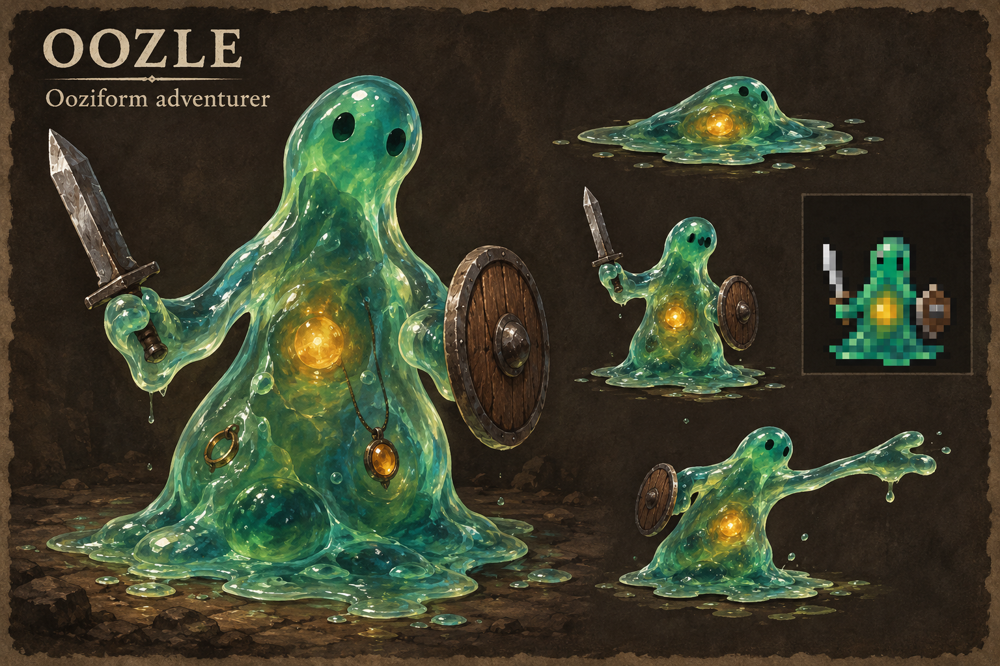

# Oozle: ooziform adventurer

The selected appearance is an expressive jade ooze with an amber nucleus and
temporary arms. Two dark eye spots, a continuous gel body and a broad puddle
base must remain readable at 32x32. There are no legs, hair, bones, ears or
blood. Weapons and shields sit in pseudopods; jewellery is suspended in gel.
The creature is alive and uses the ordinary potion, healing and magic systems.



## Species foundation

The Oozle is a medium, normal-speed, unarmoured hybrid with -10% HP. It can use
ordinary weapons, shields, two rings and one amulet, and wear hats and scarves.
It cannot wear body armour, hard helmets, gloves, boots or cloaks. Its gel provides +2 AC and +2 EV at XL1,
increasing to +3 AC and +3 EV at XL13. It resists poison and corrosion but is
vulnerable to fire (rF-).
Amorphous anatomy lets it slip through nets, webs and bolas and resist
constriction. It inherits the native Shatter interaction too: one damage die
instead of the ordinary three, unless a higher-priority condition such as
petrification applies. This is resistance to Shatter, not to all earth damage.

Starting species stats are 9 Strength, 9 Intelligence and 6 Dexterity before
background adjustments. Alchemy (+3), Stealth (+2), Unarmed Combat (+1),
Shapeshifting (+2) and Evocations (+1) are its strengths. Normal weapon and
shield aptitudes keep equipment choices open. These values are provisional
balance, not campaign-tested conclusions.

Natural unarmed attacks splash acid. Its central choice is how to replace armour: shield and weapon reliability,
Alchemy and positioning, or a talisman that trades the original gel anatomy
for another form. It has two ordinary ring slots, lower HP and innate acidic
unarmed attacks. It has no slime allegiance, swimming or special breathing
protection.

Five-turn Assimilation consumes chosen inventory equipment, including armour
this body cannot wear. It chooses a random unlocked empty memory slot, or
replaces the oldest memory when full. Equipment never assimilates passively.
One memory holds the item's whole supported property bundle. Numeric
application grows with Shapeshifting; slots grow with XL. [The current design](assimilation-design.md)
records the native item, ability, save, combat, UI and cooperative scheduling
adapters. [The native mechanism survey](digestion-design.md) supplies the earlier
source research. A matching native WebTiles build has passed the focused native
and character-creation checks. Two-client mechanics acceptance and the Linux
production build remain separate release requirements.

## Capability map

| Mechanism | Existing evidence | Oozle use and boundary |
| --- | --- | --- |
| Declarative species | `dat/species/*.yaml`, `util/species-gen.py` | Stats, aptitudes, progression, body flags and recommendations |
| Gel protection | `MUT_GELATINOUS_BODY`, `player.cc` AC and EV consumers | Existing +2/+3 AC and EV, suppressed by substance-changing forms |
| Armour restriction | `MUT_SOFT_EQUIPMENT`, `player-equip.cc` slot graph | Hats and scarves fit; weapons, shields and jewellery retain native rules |
| Resistances | `MUT_POISON_RESISTANCE`, `MUT_ACID_RESISTANCE` | Ordinary rPois and rCorr, not blanket immunity |
| Amorphous body | `actor::is_amorphous`, net/web, bolas, constriction and Shatter consumers | A reusable mutation supplies the existing actor capability; no species-specific trap or spell branches |
| Anatomy and forms | Mutation anatomy/substance flags | Body-changing or substance-changing forms suppress innate amorphousness; jelly/aqua keep their own native amorphousness |
| Art and selection | `dc-player.txt`, `dc-gui.txt`, native species tile mapping | One transparent 32x32 base shared by the dungeon doll and species menu |
| Character guide | `webserver/util/generate_character_catalog.py` | Publish only with a matching rebuilt native executable; no handwritten browser species rules |

These are source-backed compositions. Runtime results are recorded separately
below. The general combat and equipment mechanisms remain independent of the
Oozle name; only its definition, flavour and art mapping are species-specific.

The old no-armour consumers assumed Felid anatomy and also blocked shield
commands, shield acquirement and starting shield skill. Those consumers now
ask the native equipment/skill capability instead. An Oozle can keep its shield
through ordinary equip actions and receive shield offers, while a creature
with neither wearable armour nor grasping capability still has no armour use.

## Deliberate Assimilation

[Current mechanics](assimilation-design.md) define the shared FIFO memory pool,
full extracted property bundles, five-turn active work, and slots at XL 1/3/7/13/19/25.
Armour memories strengthen the body; weapon memories can improve natural unarmed
attacks. Shapeshifting scales numeric application. Manufactured-weapon aptitudes
are −2; Unarmed Combat remains +1. Worn weapons do not corrode or dissolve. All equipment effects now belong to the body, including polearm reach,
native passives, activated unique powers and scripted effects. Retention starts
at 35%, and Shapeshifting has +2 aptitude and remains trainable without forms.
The prior revision’s [body-absorption validation receipt](body-absorption-validation.json) records
40 passing native cases and 697 assertions, plus the separate sample-state
browser and icon-atlas checks. Those results predate random slots, removal of
passive assimilation and the weapon aptitude changes; they do not validate this revision.

[Open the player-display design preview](assimilation-preview.html) to explore
slot milestones, oldest-first replacement, work progress and transient item
properties using sample data.

## Integration and acceptance

Append species, mutation and ability IDs to preserve existing saves and bindings.
Generate species headers from YAML. Rebuild native tiles and the character
catalogue against the same executable before exposing Oozle in a live game.
Species flag generation is deterministic across Python hash seeds.

Current evidence is in `mechanics-validation.json`; `mechanics-source-inputs.json`
binds the latest mechanics source. `ready-phase.json` describes the prepared
native acceptance. `run_native_acceptance.py` runs native contracts, creation,
and `webserver/tests/oozle-gameplay-native.cjs` against a matching disposable
two-client runtime. Earlier source-validation and pending-binding files are
historical checkpoints. Rebind the whole checkout and capacity at dispatch,
follow the current shared-host policy and obtain its exact phase handoff before
reserving. Preserve other owners' reservations and prove closure before release.

Focused native acceptance covers the FIFO core, legal equipment, gel progression,
corrosive unarmed attacks, intrinsic extraction, item consumption, projected
stats, ownership, read-only inspection and cooperative delays. These cases are
executed: 30 cases and 466 assertions passed, along with all 35 legal Oozle
backgrounds, deterministic previews, companion ownership and matching catalog
generation. `native-checkpoint.json` records the binary identities and log hashes.
The first browser run proved distinct ownership and independent movement, then
stopped at a test fixture's invalid item specification before assimilation.
`prepare_browser_retry.py` binds a browser-only successor while retaining the
unchanged native evidence. Save/reload, assimilation scheduling and campaign
balance remain unverified until their respective gameplay checks pass.

A matching isolated build should exercise these payloads under the gate:

```
make -j1 WEBTILES=y STDFLAG=-std=c++17 crawl catch2-tests-executable
./catch2-tests-executable '[oozle],[cooperative-delay],[equipment-profile],[equipment-matrix]'
<project-python> webserver/tests/oozle-native.py --binary <matching-build>/crawl
<project-python> webserver/util/generate_character_catalog.py --binary <matching-build>/crawl
```

Paths are relative to `crawl-ref/source`. Browser acceptance follows in its
assigned phase against a disposable QA runtime and matching assets. Wait for
`#loader` readiness, then prove independent hero movement during Assimilation,
interruption without item loss, family bonuses on equipment, and save/resume.
