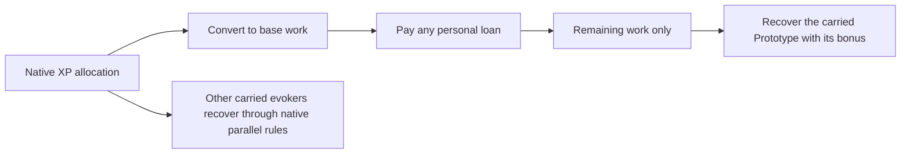

# Pakellas rework proposal

Pakellas the Inventive supports a dependable personal toolkit and rewards
deciding when to spend its future readiness for immediate power. A maintained
Prototype supplies a repeatable device effect; Overclock strengthens a device
activation; Breakthrough permits one activation on credit when the Prototype
is empty. Ordinary combat remains important while the workshop recovers.

This is a design specification. Gameplay implementation and balance validation
remain separate. All new costs and effect modifiers below are starting values.

## Progression and identity

| Devotion | Grant | Player decision |
| --- | --- | --- |
| Joining | Field Kit | Choose flame with six ordinary charges, iceblast with three, or paralysis with three. The offer states damage, targeting and resistance behavior. |
| One star | Prototype | Maintain one carried wand or XP evoker. Choose the effect that should remain a reliable part of the build. |
| Three stars | Overclock | Evoke a selected device with an enhancement in the same action, spending four piety and additional device capacity. |
| Five stars | Breakthrough | Overclock an empty Prototype for eight piety and a personal recharge loan. |

Intermediate stars improve ordinary divine standing without adding more
subsystems. Evocations improves native device effects and recovery; Invocations
is unnecessary. Spellcasting and normal MP regeneration remain available.
Device-specific MP or HP costs, such as MP-powered wands, still apply.

Piety follows native worthwhile-kill conduct, including its existing party
attribution. There is no device-tagging requirement, bonus for firing at trivial
enemies, or requirement to deliver the killing blow with an evoker. The finite
Field Kit is granted once per character, including across leaving and rejoining.

Pakellas's voice should emphasize curiosity and escalating commitment:
"The previous limit was provisional." Breakthrough is visibly controlled
overextension, with a known recovery cost.

## Prototype

One carried item is designated through the existing device list. Initial
designation costs one normal action. Replacing it costs one action and four
piety; cancelling the choice costs nothing. The designation panel shows the
new reserve, retained debt and recovery consequences before a replacement is
committed. It is an occasional build choice rather than a preparation step
before each fight.

The two existing device economies retain their own payment adapters:

- A **wand Prototype** gains a small workshop reserve alongside its ordinary
  finite charges. The reserve recharges through XP. A bonded wand survives at
  zero ordinary charges so its renewable function remains usable.
- A **miscellaneous Prototype** keeps its native charge capacity and debt.
  Its existing recharge receives 50 percent more work from eligible XP. It
  gains no second pool of charges and is never refilled merely by designation.

Both receive the same 50 percent workshop recovery bonus when no loan is
outstanding. Other miscellaneous evokers recharge at their normal native rate.
This replaces the current blanket Pakellas recharge bonus and nearby-party
bonus; equipment bonuses retain their native rules.

For a wand, the default Prototype action spends only workshop capacity. The
ordinary wand action spends ordinary charges. Both can be assigned directly
to the hotbar, and the item displays both counts. Exhausting the reserve does
not silently start consuming the finite stack. Retaining ordinary charges is
useful when the workshop is recovering.

### Initial wand recovery profiles

A work unit is the normalized recharge debt unit used by native XP evokers,
before the character's XP conversion. It is not one XP or one enemy. These
profiles need encounter testing alongside the existing evokers.

| Wand | Work per reserve activation | Maximum reserve uses |
| --- | ---: | ---: |
| Flame | 3 | 3 |
| Iceblast, acid, light, quicksilver | 8 | 2 |
| Mindburst, roots, warping | 10 | 2 |
| Paralysis, charming, polymorph | 12 | 1 |
| Digging | 6 | 2 |

The first wand designation seeds its reserve once. Later wand designations
preserve earned work without manufacturing it. If the old reserve has capacity
`C`, debt `D`, and the replacement has capacity `N`, all measured in work:

1. Retain `credit = min(max(C - D, 0), N)`.
2. Retain `overheat = max(D - C, 0)`.
3. Set replacement debt to `N - credit + overheat`.

The first seed flag and wand reserve persist while a miscellaneous item is
designated. The inactive wand reserve does not recover during that interval.
Miscellaneous debts always stay in their existing per-character, per-type
accounts. Changing a miscellaneous designation changes its future recovery
rate; it neither moves nor clears native debt.

For example, a full flame reserve contains nine work. Switching to acid yields
nine of sixteen work, enough for one use. Switching an empty flame reserve
yields zero acid uses. Repeated switching cannot add work. A six-work overheat
and any Breakthrough loan survive either switch.

## Overclock

Overclock selects and activates a device in one native evocation action. An
assigned action such as "Overclock acid Prototype" goes directly to aiming.
There is no timed preparation buff or second activation command.

The initial piety cost is four. Its capacity payment depends on the source:

| Source | Capacity payment |
| --- | --- |
| Ready wand Prototype reserve | `ceil(1.5 × work per use)` reserve debt |
| Ready miscellaneous evoker | `ceil(1.5 × native debt per use)` native debt |
| Ordinary finite wand charges | Two charges |

A ready XP device may overheat beyond its ordinary full-debt threshold. The
extra debt must be paid before readiness returns. Displayed charges are
clamped to zero, never a negative number. A one-charge ordinary wand cannot
pay the two-charge option; Prototype funding is a separate explicit source.

Piety payment is deterministic. Native aiming, hit rolls, willpower checks,
resistances, randomness and item failure behavior still apply. Cancellation,
invalid targeting and an aborted effect spend neither piety nor capacity. A
committed shot that misses or is resisted pays its displayed cost. An ordinary
native item failure that consumes an action also pays the Overclock premium;
the preview must distinguish this from an invalid action.

### Device enhancements

Each live device has an explicit enhancement adapter. These are proposed
effects rather than a claim about the current Device Surge implementation.

| Device | Overclock enhancement | Limits retained |
| --- | --- | --- |
| Flame, iceblast, acid, light, quicksilver, mindburst, warping | Multiply the activation's direct damage roll by 1.35 before defenses. | Native geometry, defenses, hit or willpower gates and secondary status rules. Mindburst still needs its native successful application. |
| Paralysis, charming, polymorph | Multiply the native application power by 1.5, respecting its power cap. | Immunities, target legality, resistance and the normal resulting effect; polymorph gains no form selection. |
| Roots | Extend the applied root duration by 35 percent. | Native application checks, duration caps and constriction rules. |
| Digging | No Overclock or Breakthrough enhancement. | Renewable Prototype digging remains available through its ordinary reserve action; terrain restrictions remain native. |
| Lightning rod | Multiply direct damage by 1.35. | Consecutive-use targeting and native charge capacity. |
| Phial of floods | Multiply direct wave damage by 1.35. | Native water, knockback, targeting and terrain behavior. |
| Tin of tremorstones | Multiply each explosion's damage roll by 1.35. | Native number of explosions, scatter, radius and ally warnings. |
| Condenser vane | Extend newly created cloud lifetimes by 35 percent. | Native cloud selection, placement and occupancy restrictions. |
| Gravitambourine | Multiply direct damage by 1.35. | Native displacement, application checks and legal destinations. |
| Box of beasts, sack of spiders, phantom mirror | Extend this activation's created summons' lifetimes by 35 percent. | Native creature selection, number, allegiance, mirror eligibility and summon limits. |
| Horn of Geryon | Extend this activation's summons' lifetimes by 35 percent. | Native summon count and hostility risk; hostile answers also last longer. |
| Aegis standard | Add two AC and two SH to this activation's ward. | Native recipients, duration caps and ward stacking rules. |
| Astral beacon | Increase ordinary healing by 35 percent; on revival add ten percentage points to restored HP, capped at 65 percent. | Native revival count, injury, MP recovery, cleansing and relocation restrictions. |
| Twin-spark conduit | Multiply direct arc damage by 1.35. | Native companion requirement, arc cells, resistance and one hit per victim. |
| Skald horn | Multiply direct damage by 1.35 and extend the applied ballad and swiftness by 35 percent. | Native silence, recipient, duration cap and movement restrictions. |

The enhanced damage roll is rounded down once, before native defenses. Timed
effects use native aut and round down once when established. Later ticks,
attacks by summons and unrelated player actions do not inherit a general
damage multiplier. Existing caps are applied after duration enhancement.

A preview that proves an enhancement has no possible benefit, such as a
capped hex-power calculation, disables paid Overclock with an explanation.
The ordinary action remains available. Random outcomes need a range or clear
effect summary rather than a guaranteed damage or duration claim.

Removed devices, baubles, artefact activations, quad damage and ziggurat
figurines retain their ordinary rules and are outside this recharge system.
Their exclusion is explicit in eligibility data. Every live XP evoker in the
current native catalogue has an enhancement entry above.

## Breakthrough and recovery

Breakthrough is an upgrade to the same Overclock action at five stars. It is
available only when the currently designated, carried Prototype has zero ready
reserve or native charges, supports Overclock, and its owner has no loan.
Partially ready multi-charge devices use the ordinary paid Overclock path.

It costs eight piety, produces the listed Overclock effect, and records a
personal loan equal to twice that device's normal per-use work. The borrowed
activation adds no second ordinary charge debit: the loan is its entire
capacity payment. Previously accumulated reserve debt or native device debt
remains unchanged.

No further Breakthrough is possible until the loan is fully repaid. The loan
retains its original work value through changing the Prototype, inventory
operations, religion changes, death recovery and save loading.

On each native XP award, convert the owner's existing XP allocation into base
recharge work once, with fractional work carried between awards. Apply the
work in this order:

1. Pay the personal loan at the base work rate, including applicable equipment
   modifiers but without the Prototype's 50 percent bonus.
2. Apply remaining work to the designated carried Prototype with its 50 percent
   bonus and any native device-specific enchantment modifier. With no remaining
   work, that Prototype makes no ordinary recovery. Device enchantments do not
   change the already quoted personal loan or its base repayment rate.
3. Other carried native evokers receive their normal independent recovery,
   preserving the existing parallel recharge convention.

Only the first two steps share an allocation; the third remains the native
parallel system. No portion that pays the loan also pays Prototype debt.
The proposed routing is:

Dropping the Prototype does not stop personal loan repayment through XP;
recovering or designating an item never supplies a second XP award. Time,
resting, stairs, potions of magic and device-generated temporary allies cannot
create recharge work. Only XP accepted by the native award path can do so.

This creates three distinct choices: ordinary use preserves piety and recovery;
Overclock buys stronger action now; Breakthrough buys an additional action
while delaying the return of the main tool.

### Worked recovery sequence

A Prototype phial uses its native ten work per ordinary charge. Overclocking
its ready charge adds fifteen work of native debt. With the phial empty,
Breakthrough can produce a second enhanced wave, adding a twenty-work personal
loan while leaving the existing fifteen-work phial debt unchanged.

With three base work earned per illustrative XP award and no equipment
modifier, six awards pay eighteen loan work. The seventh pays the last two;
the remaining one supplies 1.5 work toward phial recovery. Fractional carry
preserves the half. Across those seven awards, the twenty units used by the
loan have supplied zero ordinary phial recovery. The phial still needs 13.5
work. The assumed award size illustrates accounting, not a predicted number
of encounters.

## Ownership and religion changes

All workshop and loan state belongs to a native character, including in co-op.
Trading a device does not transfer a god privilege or erase the giver's debts.
The recipient uses their own existing native device account or their own
explicit Prototype designation. One physical item is never simultaneously the
designated carried Prototype of two characters.

Native party XP allocation may independently recharge each worshipper. Process
each owner's allocation once; spectators, duplicate client requests and hero
selection changes cannot issue XP or clear debt. Existing device effects keep
their recipient scope. An Overclocked standard can ward companions through
its native effect, while another hero's entire inventory gains no refill.

Losing a devotion threshold suspends its grant without discarding accounts.
At penance or abandonment, Prototype funding and Overclock are suspended;
ordinary wand charges and ordinary evoker effects remain available. Proposed
wrath halves the character's native evoker recovery until native XP penance
expires. Loan repayment also uses that reduced rate. There is no MP lockout.
Rejoining resumes the same accounts and never repeats Field Kit or reserve
seeding. A zero-charge former wand Prototype may remain an inert chassis; it
conveys no evokable effect to another owner without funded designation.

## Interaction and native execution

The item list, god panel and hotbar show the Prototype, separate ordinary wand
charges where relevant, next-use recovery cost, and loan progress. A borrowed
action reads, for example, "Breakthrough phial: 8 piety; 20 loan work; pauses
Prototype recovery." Its hotbar assignment follows the selected device through
inventory letter changes. Changing the Prototype updates its displayed name
and effect rather than silently firing the old item.

Targeting previews use the same enhancement and payment calculation as
execution. The native engine checks the owning character, carried item,
devotion, penance, device restrictions, funding and target again before one
atomic commit. Existing warnings for allies and consequential effects remain.
The cost appears before aiming; an additional generic confirmation is not
needed for a normal activation. A newly selected device or changed funding
source invalidates a stale targeting request.

No-artifice, berserk, silence where the item requires sound, still winds,
summoning restrictions, recipient availability and other native item limits
remain effective. Borrowing bypasses only the charge-readiness check. A
permanent inability to use artifice is explained before worship or gift choice.

## Reusable engine boundary

The reusable mechanism is a bounded recharge account with conserved work,
borrowing, explicit funding and a scoped evocation enhancement. Pakellas owns
devotion thresholds, gift options, prices, allowed device profiles and prose.

Reuse canonical item, player, spell, duration and result types. A native
evocation request should name its owning character, item, funding source and
enhancement. The result must distinguish abort, committed native failure and
success; a boolean is insufficient for consistent payment across all devices.
Preview and execution consume the same request and price calculation. Avoid
temporarily changing the player's Evocations skill or using a global buff that
can leak into companions, nested effects or subsequent actions.

The small account API should cover pricing, available capacity, debt payment,
borrow eligibility and credit-preserving reconfiguration. Device adapters keep
their native targeting and effects. The ownership, conservation and borrowing
rules can support other rechargeable equipment without depending on a god,
WebTiles, a concrete spell or a particular inventory layout.

### Existing source mechanisms

| Mechanism | Source | Integration consequence |
| --- | --- | --- |
| Native capacity and per-use debt | [xp-evoker-data.h](../../../crawl-ref/source/xp-evoker-data.h), [item-prop.cc](../../../crawl-ref/source/item-prop.cc) | Reuse existing miscellaneous profiles and player-owned subtype debt. Clamp readiness when extra debt exceeds capacity. |
| XP conversion and recovery | [player.cc](../../../crawl-ref/source/player.cc), [invent.cc](../../../crawl-ref/source/invent.cc) | Extract the current XL and Evocations conversion; preserve equipment modifiers, use fractional carry, and replace blanket Pakellas bonuses with the selected Prototype policy. |
| XP entitlement in co-op | [mon-death.cc](../../../crawl-ref/source/mon-death.cc) | Use each native character's awarded XP, without a second kill listener that grants workshop work. |
| Wand activation and destruction | [evoke.cc](../../../crawl-ref/source/evoke.cc) | Separate effect execution from finite-charge payment; preserve a bonded zero-charge chassis and all other native costs. |
| Evoker legality and distinct effects | [evoke.cc](../../../crawl-ref/source/evoke.cc) | Bypass only empty readiness for borrowed actions. Give each enhancement an adapter and preserve native restrictions. |
| Abilities and progression | [ability.cc](../../../crawl-ref/source/ability.cc), [religion.cc](../../../crawl-ref/source/religion.cc), [god-passive.cc](../../../crawl-ref/source/god-passive.cc) | Replace Quick Charge, Device Surge, MP-on-kill and the one-time capacitor storm coherently. |
| Religion visibility and descriptions | [lookup-help.cc](../../../crawl-ref/source/lookup-help.cc), [gods.txt](../../../crawl-ref/source/dat/descript/gods.txt), [ability.txt](../../../crawl-ref/source/dat/descript/ability.txt) | Remove stale disabled-god filtering and update identity, powers, costs and wrath together. |

These integration points are source-backed. The new account, funding choices
and enhancement adapters are proposed compositions requiring implementation.

Preserve existing god, ability, item and duration numeric IDs. Existing
Pakellas ability IDs may retain their bindings while receiving the new names
and behavior; the old one-time Supercharge bit must not become a loan or gift
flag. Store new versioned per-character state through native saved properties.
Legacy worshippers receive Prototype selection with a one-time migration
receipt, retain their items and old one-time history, and receive no duplicate
Field Kit. Clear a legacy Device Surge preparation duration without turning it
into a borrowed activation. Explain the changed powers on first load.

## Acceptance before implementation is considered complete

| Case | Required observation |
| --- | --- |
| First worship and rejoining | One finite gift, one wand reserve seed, clear Prototype selection and no duplicate grants. |
| Ordinary versus enhanced use | Identical native baseline when no enhancement is requested; only the documented adapter changes under Overclock. |
| Recovery units | With unchanged XL, Evocations and modifiers, equivalent XP awarded as one event or many small events supplies equivalent loan and Prototype work, including fractional remainders. Changes in those parameters use the native award order. |
| Recovery price | Normal use costs one unit price; ready Overclock costs 1.5 prices rounded up; borrowed use costs two prices entirely in the loan. |
| Readiness at boundaries | Zero, partial and excessive debt produce legal nonnegative counts with correct next-use progress. |
| Empty Prototype | One enhanced borrowed activation; no second ordinary debit; another loan is blocked until repayment. |
| Loan boundary crossed by an XP award | Work pays the loan first, and only the remainder recovers the Prototype. |
| Rebinding cheaper and more expensive wands | Credit never increases, excess debt persists, and repeating the cycle cannot create work. |
| Miscellaneous rebind and duplicate items | Native subtype debt persists, duplicate copies add no separate charge pool, and only the designated type gets the recovery bonus. |
| Finite wand exhausted | Prototype stays usable through its funded reserve, with no silent ordinary-charge spending or item duplication. |
| Cancellation, blocked effect, miss and committed failure | Aborts cost nothing; committed native outcomes spend exactly once according to the quoted funding source. |
| Caps and randomness | No paid provably inert enhancement; immunity, resistance, caps and random outcomes match the preview's limits. |
| Delayed clouds and summons | Only the activation's created effects receive duration enhancement; no extra damage multiplier leaks into later attacks. |
| Every live XP evoker | The full enhancement table works, including companion-only devices and native silence or recipient restrictions. |
| Trade, drop, death recovery and save loading | Ownership and debt persist; no other character inherits a ready workshop or loan reset. |
| Two worshippers and a spectator | Independent personal accounts and native XP allocations; the spectator cannot fund or activate a device. |
| Piety loss, penance, abandonment and migration | Grants suspend at the right thresholds; debts and seed flags persist; old numeric IDs and saves remain valid. |
| Hotbar and item menu | Direct assignment, one aiming flow, accurate funding labels and no stale item activation after a rebind. |

Start controlled playtests with flame, paralysis, acid, a phial and a beast
box to distinguish sustained use, resistance, burst, terrain and summons.
Extend coverage to every listed live device before claiming full integration.
Compare ordinary and enhanced encounters at low, middle and maximum Evocations,
including resistant or immune enemies, isolated strong enemies and groups.

The decisive balance question is whether ordinary use, Overclock and
Breakthrough each win in different plausible situations. Overclock being the
default on every activation means its premium is too low or its action value
too high. Breakthrough never being worth using means its recovery price or
piety cost is too severe. A Prototype solving whole encounters indefinitely
means its capacity or XP recovery is too generous. Run-level balance requires
mixed encounters and branch progression beyond the controlled scenes.
