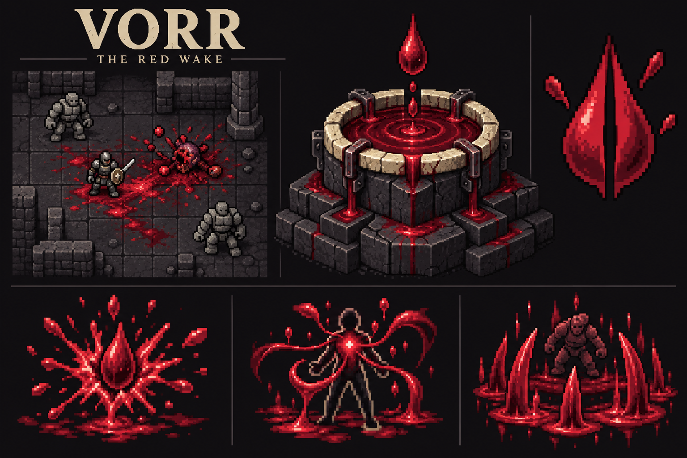

# Vorr the Red Wake design draft

Vorr rewards bursting blood-bearing enemies and spending their fresh blood on powerful rites. Slaughter establishes a temporary position of strength: fresh blood fuels invocations and, at sufficient piety, sustains the worshipper through regeneration and lifesteal. Bloodless opposition interrupts that economy.

The first native prototype is implemented locally, dated 18 October 2026. The working name is Vorr. Numerical values below are prototype starting points; ordinary-run balance testing and sprite polish remain open. See [implementation status and verification](implementation-status.md).

[Visual review](index.html) · [Art and asset specification](art-direction.md) · [Engine contracts and playtest cases](implementation-notes.md) · [Asset inventory](assets.json)

## Decisions carried forward

- Enemies without blood do not bleed, supply ritual blood, provide lifesteal, or produce bloody death bursts. There is no divine blood substitute.
- Blood Communion supplies passive regeneration and lifesteal at one piety milestone.
- Unlocks are sparse. There is no requirement to award a new bonus at every star.
- The initial kit contains three active rites: Rupture, Red Passage, and the Great Letting. Clothed in Carnage remains outside this version. Red Passage shares the three-star milestone with Blood Communion.
- Blood is a temporary resource on the battlefield. There is no collection command, inventory item, carried blood reserve, or corpse processing.

## Identity and worship

**Name:** Vorr the Red Wake. **Epithet:** Keeper of the Open Vein. **Symbol:** a blood drop split by a narrow cleft, with three outward spatters. **Altar:** a cracked collecting basin whose channels carry blood over its rim.

Vorr treats the body as a vessel and a violent death as an opening. The god's language concerns spilling, opening, gathering, and returning. The worshipper becomes the center of a circulation between enemy wounds, bloodied ground, and their own survival.

Worthy blood-bearing hostile kills earn piety, weighted using native reward conventions. Sacrificing items or bodies, injuring allies, self-harm, and farming summons do not. Bloodless kills supply neither blood nor blood-based piety. Eligibility for piety is distinct from whether external blood blades can physically injure a target.

Suggested altar description:

> A shallow stone basin is split by channels worn smooth. Blood hangs above it in a single trembling drop. The cracks below are wet.

Suggested religion description:

> Vorr delights in the opening of veins and the breaking of flesh. The faithful scatter their enemies across the dungeon, then gather the spilled blood into terrible rites. Amid fresh slaughter they drink deeply and endure. Where nothing bleeds, the Red Wake runs dry.

## Progression

| Devotion | Grant | Role |
| --- | --- | --- |
| Joining | Red Wake | Passive blood generation and bloody death bursts establish the resource loop immediately. |
| One star | Rupture | An inexpensive focused rite turns existing blood into a forceful finisher. |
| Three stars | Blood Communion and Red Passage | Passive regeneration and lifesteal, plus movement between fresh blood deposits. |
| Five stars | The Great Letting | A large rite converts several bloodied positions into a simultaneous attack. |

Two, four, and six stars grant no additional feature. Existing piety loss and penance still suppress powers according to native conventions. Invocations improves rite power and the Communion healing cap; extra stars do not need to introduce extra subsystems.

## Blood and the battlefield

Use two separate concepts: cosmetic blood and **fresh ritual blood**. Old dungeon stains, blood fountains, injuries to the player, and blood from allies are never fuel. Eligible new blood may be deposited over an old stain, but the old stain contributes nothing.

The initial fuel radius is four cells from the worshipper, on their current floor, with direct solid line of sight. A unit of blood is a small charge held by a visible deposit. A cell holds at most three units. Floors can support fuel; wall splashes are cosmetic. Water and lava hold no fuel. The liquid-terrain limitation needs branch testing before it becomes final.

Each deposit stays potent for 120 aut, equivalent to twelve ordinary 10-aut actions. The floor's native simulation clock owns expiry. Fast attacks, slow attacks, co-op turns, saving, and leaving the floor must not silently redefine a turn. Adding new blood does not rejuvenate older blood in the same cell.

For a standard worthy enemy, one unit is released the first time its HP crosses below half, and three on death. Particularly substantial enemies may have a six-unit lifetime budget, fixed before harvesting. Trivial enemies receive at most a small budget under native threat and reward rules. Healing, polymorph, revival, and repeated threshold crossings cannot refill a victim's budget.

Blood normally lands at the victim's position, then in nearby legal cells when that cell is saturated. A damaging burst can scatter it farther. Invalid terrain can reduce recoverable yield; the HUD previews available fuel rather than promising a fixed return from every kill.

### Red Wake

Every eligible direct kill makes the body burst. The normal damaging radius is one cell. A finishing hit whose resolved damage before the target's remaining-HP clamp is at least a quarter of the target's maximum HP produces a radius-two burst. A lethal Rupture always produces the larger burst. This rewards forceful finishing blows without making ordinary kills useless.

Initial burst damage is `1d(4 + min(victim HD, 16))` physical damage, reduced by armour. The outer ring of a larger burst takes half damage. These passive bursts strike hostile actors only, sparing the worshipper and allies. Walls block the spray. Explosions use native noise and hostile behavior rules; quieter ordinary combat and conspicuous ritual slaughter should remain different choices.

An enemy killed by a death burst releases its remaining blood but does not create another damaging burst. Direct attacks and active rites can start bursts. A single action therefore has a bounded secondary explosion phase rather than an unlimited recursive chain.

Blood already outside a bloodless enemy can strike it as physical matter. It cannot burst that enemy, draw blood from it, or heal the worshipper through lifesteal. An enemy crossing a puddle also does not become blood-bearing.

### Rupture

**Cost:** two nearby blood units. **Time:** one ordinary action. **Range:** five cells with native targeting visibility. **Target:** a hostile enemy that currently has blood.

Blood is driven into an existing wound and pulled sharply outward. Initial damage is `2d(8 + floor(Invocations / 2))`, using a physical damage path with armour. If it kills, the body produces the larger Red Wake burst. If the enemy survives, it still takes the attack and can release its one-time wound blood if the threshold is crossed.

Rupture does not execute enemies outright, create blood from its payment, bypass armour, or target a bloodless enemy. A dry opening is solved by ordinary attacks until they wound or kill a blood-bearing foe. There is no self-cutting button to refill the economy.

Payment automatically selects the nearest visible deposits, preferring the earliest expiry on ties. Targeting highlights the deposits that will be consumed. No valid target or insufficient fuel returns without spending blood, piety, or an action.

### Blood Communion

At three stars, both parts of Communion operate passively:

- **Drink the Spill:** while standing on potent ritual blood, regenerate one additional HP per 10 aut. This does not consume blood, rejuvenate it, or convert a dry stain into fuel. Moving away, expiry, or spending the last unit ends the regeneration.
- **Open Veins:** recover eight percent of actual qualifying HP removed from blood-bearing hostile targets. The aggregate cap is `3 + floor(Invocations / 6)` HP per 10 aut. Fractional healing carries forward within the accounting window so small hits are not discarded or rounded upward repeatedly.

Actual HP removed excludes overkill, absorbed damage, and damage to bloodless targets. Qualifying damage from attacks, spells, active rites, and their death bursts shares one cap for the worshipper. Damage over time retains source credit; summons and allies do not pass their attacks through the owner's lifesteal. Native restrictions on healing still apply. No healing can exceed missing HP.

Regeneration is finite because blood expires. Lifesteal is finite because enemies have finite HP and each time window has one cap. The passive creates no new blood. At full health the effect is quiet; it should not emit a message for every fractional heal.

### Red Passage

**Unlock:** three stars, alongside Blood Communion. **Cost:** two blood units, one at each endpoint. **Time:** one ordinary action. **Range:** six cells on the same floor, within native visibility and solid line of sight.

The worshipper sinks into fresh blood underfoot and emerges from another fresh deposit. The origin and destination must each hold at least one potent unit. Select a visible, unoccupied, traversable bloodied cell using native blink-style relocation rules. Show both consumed units before commitment; ordinary nearest-deposit payment does not substitute for either endpoint.

On arrival, external blood erupts in radius one for `1d(6 + floor(Invocations / 3))` physical damage. Resolve each nearby actor once and retain the native ally warning. Blood-bearing victims may yield lifesteal and ordinary Red Wake bursts under the shared limits. Bloodless victims can take physical impact, remain dry, and provide no return.

Consume both units atomically before movement. Invalid destinations, expired blood, relocation restrictions, or cancellation spend nothing and never leave the player between locations. The passage creates no free blood trail or fuel. If the destination's last unit is spent, standing there does not grant Communion regeneration; a richer pool or a new eligible kill can preserve a sustaining position.

### The Great Letting

**Cost:** eight blood units in the ritual area and five piety. **Time:** one ordinary action. **Range:** a visible center up to six cells away. **Area:** radius two around that center, within the worshipper's own solid line of sight.

Select eight units from the oldest deposits nearest the chosen center. The ritual area's fuel rule replaces the normal radius-four payment rule for this rite. Each selected deposit rises into a blade aimed inward. An enemy on or adjacent to a selected deposit is struck once, regardless of how many blades overlap it. Initial damage is `3d(10 + floor(Invocations / 2))` physical damage, reduced by armour.

The targeting preview shows the consumed deposits, affected cells, ally warnings, and bloodless targets that can be struck physically. It shows one total cost, without a power slider or an extra ritual confirmation. Native friendly-fire confirmation remains when another actor is at risk.

Resolve payment, the simultaneous strike, lifesteal, eligible deaths, then bounded death bursts and new deposits. New blood cannot pay for a second rite during the same action. Blood-bearing victims can furnish the next action; bloodless victims leave the field drier.

## Decisions in play

**Opening a pack:** ordinary attacks wound the front enemy and earn the first unit. A kill supplies enough for Rupture, which can finish a foe beside the back rank. The resulting larger spray creates more choices of where to stand and attack.

**Surviving the middle:** a wounded worshipper can hold a bloody tile for regeneration and keep attacking for lifesteal. Spending that tile on a rite might secure a kill but remove the position that was sustaining them.

**Using Red Passage:** a previous kill behind the enemy line can become an entrance, and a bloodied position behind the worshipper can become an escape. The move consumes both endpoints, so a one-unit landing pool provides mobility without also guaranteeing regeneration.

**Facing bloodless enemies:** a construct can take a Great Letting strike made from someone else's blood, but cannot be Ruptured or return fuel or lifesteal. A wholly bloodless room begins with ordinary combat unless the worshipper has access to nearby fresh blood from another fight. That weakness is intentional.

**Choosing a large rite:** a scattered field can hit several targets even when they are not tightly packed. Luring a fresh enemy onto useful ground costs time and risks expiry. A small safe corner may offer healing but insufficient coverage for a Great Letting.

## Interface and feedback

The existing god and ability surfaces own worship, invocation, and quickbar bindings. Show nearby fuel as `Blood 6` with an accessible tooltip explaining range and the first pending expiry. Indicate Communion with the existing status presentation; show regeneration as active only when the player is actually standing on potent fuel.

Fresh blood has a bright broken edge and a few sharp glints. Fading blood loses glints and breaks into a dull interrupted outline. Spent blood is matte and has no active edge. The distinction must survive grayscale and the existing targeting overlays. Examine text reports units and remaining potency. Map memory shows remembered stains but does not assert unseen live fuel.

Use native target selection and cancellation. Rupture reports `Bloodless target` before any payment; a disabled quick action explains `Need 2 nearby blood`. Red Passage highlights legal bloodied destinations, both endpoint payments, and the arrival impact; its disabled explanation is `Stand in fresh blood`. The Great Letting highlights only visible ritual cells. Both area rites keep existing warnings for friendly fire. No pick-up, harvesting, or ritual-preparation menu is added.

The portrait's existing faith plinth also receives a Vorr treatment: a collecting-trough pedestal, split-drop carvings, narrow red channels, and a small native altar centered in its setting. It follows native favor ranks, penance, and unavailable-state presentation. Decorative changes at ranks two, four, and six communicate favor without granting more powers. Temporary blood fuel never changes this favor ornamentation. See the [plinth contract](art-direction.md#portrait-faith-plinths).

## Voice and consequences

Suggested messages:

- Joining: `Vorr opens the way. Let the blood follow.`
- Rupture kill: `The orc bursts in a crimson spray!`
- Communion unlock: `The spilled blood answers your pulse.`
- Great Letting: `The blood rises. Vorr gathers the red wake!`
- Bloodless target: `There is no blood to call from that creature.`

Abandonment ends the powers and makes existing fuel inert for the former worshipper. Wrath may reopen wounds and call hostile rites from genuinely existing blood, but must never cause bloodless actors to bleed. Exact wrath frequency and the fork's god-politics relationships remain design work after the central combat loop is tested.

## First playable scope

Implement the resource accounting, Red Wake, Rupture, and bloodless exclusions together. Add Communion after actual-damage attribution and time-window caps are established. Add Red Passage with atomic endpoint payment and native relocation checks, then the Great Letting with single-hit-per-target ordering. Bring altar, plinth theme, and invocation tiles into their existing native surfaces after pixel cleanup and readability review.

The first playtest compares an ordinary blood-bearing pack, an isolated durable enemy, a mixed blood-bearing and bloodless encounter, a completely bloodless room, and a watery branch. The purpose is to decide whether generating, holding, and spending blood produces useful decisions before adding further rites.
