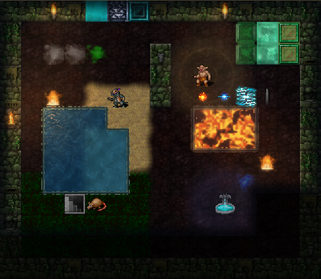
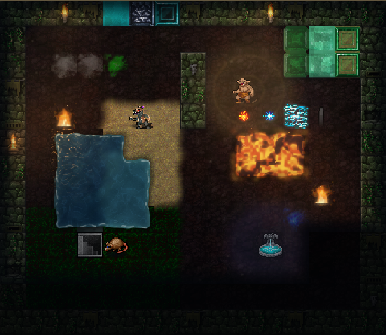
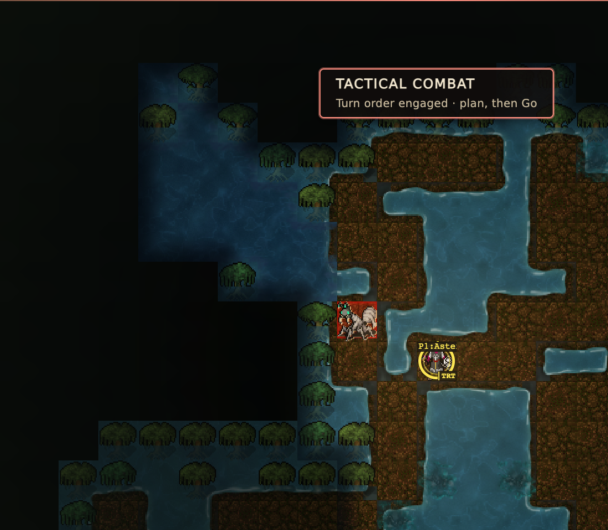

# Premium presence pass

Local source on `claude/premium-graphics-next`, cut from `master` ba65958f61. Nothing
here is committed, deployed or claimed as sustained gameplay FPS.

Premium terrain was already rich, but three gaps stood out in a baseline capture.
Pools were rectangles with a dashed outline, creatures sat flat and unlit on lit
terrain, and ordinary floors have almost no torches, so most of the lighting work
had nothing to light. This pass closes those gaps.

| Change | Where it lives | Switch |
| --- | --- | --- |
| Organic shorelines, rounded corners, lapping foam, cooled lava crust, soft deep/shallow water | `shore-field.js` | Terrain borders & blending |
| Mangroves joined to their pool, on Premium water | `premium-terrain.js`, `premium-terrain-model.js` | Water & lava shaders |
| Creature and item shadows, coloured rim light | `figure-shading.js`, `premium-figures.js` | Creature light & shadow (new) |
| Hero lantern pool with monsters kept legible | `lantern-pool.js`, `premium-lantern.js` | Hero lantern (new) |
| Altars, portals, glowing mould and fiery creatures emit light | `premium-terrain-model.js` | Any of the lighting switches |
| Creatures mirrored in the water below them | `figure-shading.js`, `premium-figures.js` | Creature light & shadow plus Reflections |
| Per-branch haze and drifting motes | `ambient-motes.js`, `premium-atmosphere.js` | Regional atmosphere (new) |

## Evidence

- `native-swamp.png` is a real local game at Swamp:2 on the QA server, reached with the
  wizard travel command. D:1 was captured the same way. All three layers were present,
  the mood followed the branch, and there were no browser errors.
- `tests/premium-presentation-browser.cjs` and `tests/environment-art-browser.cjs` pass.
  The first now checks that creature pixels change, empty terrain does not, the lantern
  clears shade around its bearer, Classic removes every new layer, and reduced motion
  leaves the mote layer empty.
- Node suites: 275 of 278 pass. The three failures (denizen, Lair and hydra catalog
  checks) also fail on a clean `master` export. Python: the 9 failures and 2 errors
  match that export, with no new names.
- Paired benchmark, three alternating runs of 16 frames, during another session's heavy
  build. These are medians in ms for `master` then this branch:

| Scenario | master | this branch |
| --- | --- | --- |
| Full repaint | 22.2 | 20.8 |
| Hover, one cell | 8.9 | 9.3 |
| Animation tick | 10.8 | 10.8 |
| Packet, 12 cells | 27.2 | 25.8 |
| Camera step | 20.0 | 20.0 |

An earlier quieter pair measured 13.9 to 14.9 ms on full repaint, so treat the
difference as under about a millisecond. p90 was too noisy under that load to compare.

The eight new modules are 43.4 KB of source and 14.1 KB when gzipped individually.

## Decisions

Dressed sprites are retained by content and light, in a 16 MiB bound. The first version
doubled frame cost on the dense benchmark scene. Retention removed nearly all of it.

Existing accounts must not lose the improvements, so a new switch can name `inherits`.
A saved choice that predates the switch follows its parent, in both
`graphics-settings-model.js` and `profile_graphics.py`. A saved Premium account stays on
the Premium preset, and any explicit later choice wins.

The bank stays inside the native liquid tile and the tile centre always stays liquid, so
a player can still read which cells are water. Unknown neighbours supply no shape, and
light is only added through a visible-cell mask.

## Not done

`prepare-assets.py` and its `--check` were not run because the shared heavy gate was
occupied. The Docker build performs them. No lava level was seen in a real game, so lava
shorelines have fixture proof only. Gehenna, Cocytus and similar moods were checked
against their tables and the fixture's Ice Cave scene, not in native play. Physical GPU
frame rate is unmeasured.
