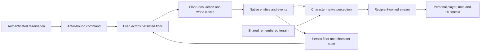

# Multiplayer mechanics

The multiplayer expedition has human characters only, fixed character ownership,
shared explored terrain, personal live perception, and independent floor clocks.
These mechanics are deployed in `20261018T035050Z-complete-multiplayer`.
See the [complete release verification](deployment-2026-10-18-complete.md) for
the production build, compatibility, smoke checks and recovery evidence.

## Rules

- At launch, include occupied authenticated player seats. Exclude companions and
  empty seats automatically; retain their configured builds for solo planning.
- Compact sparse lobby seats into native slots while preserving each account's
  reservation and each character's persistent identity.
- A player controls their reserved character throughout combat, travel,
  reconnects and save/resume. Inspecting or centering a teammate is a local view
  action and does not transfer control.
- Share remembered terrain. Derive live monsters, items, clouds, traps and
  detection through each character's native perception before network delivery.
  A teammate seeing an invisible monster does not grant that detection to others.
- Stairs and branch transitions move the acting character. They neither gather
  nor relocate teammates, and do not automatically revive them.
- Advance a floor only from actions processed there. Another floor's actions and
  elapsed wall time do not run its simulation or expire its effects.
- Keep disconnected reservations. A disconnected character remains a participant
  on its floor; its required combat action can pause that floor's initiative.
  Players on other floors retain their own initiative and simulation.
- Support two, three or four human players, including different occupied floors.
- In safety, accept any player's action without waiting for idle teammates.
  On a threatened floor, each living participant's recovery bounds world time.
- Yield repeats native waits in place until cancelled or personally threatened.
  Its toolbar button becomes Stop while automation is active. Ordinary native
  action input also cancels that character's automation.

## Cooperative automatic actions

| Activity | Native behavior | Completion / interruption |
| --- | --- | --- |
| Auto explore | Advance the owner's native travel delay one step at a time. Keep native paths, discovery stops and action costs. | Native completion, discovery, personal threat, Stop or manual action. |
| Auto rest | Advance the owner's native rest delay one step at a time. Preserve healing and magic regeneration. | Native recovery rules; starting fully rested retains the native finite 100-turn wait. Personal threat, Stop or manual action interrupts. |
| Yield | Repeat ordinary in-place waits using the owner's native action speed. | No fixed turn limit; stops on personal threat, Stop or manual action. |

The server rotates eligible automatic tasks across all four seats, including
tasks on different floors. It submits one native step at a time and waits for
that step's explicit native completion token. Buffered input-mode packets cannot
acknowledge a newer step. Manual commands received during that step take the next
command boundary before another automatic step. Manual commands retain their
own completion token through native macro buffering and prompts, so another
character's automatic step cannot change the actor of a buffered key. A Stop
request during a peer's native prompt is retained until that prompt releases the command boundary.

Automated actions obey the same floor clocks, initiative, personal sight and
ownership as direct input. A threatened teammate on the same floor activates
combat scheduling; another floor does not. Each character retains its own run,
rest and travel continuation. Peer network input does not count as a keypress
by an automated character. Disconnected tasks pause until their owner reconnects;
loading a native save does not resume a previous session's Yield intent.

## System map

One authoritative engine processes actions serially. Its existing native floor
packages preserve unloaded floors between actions. Since a floor advances only
when a player acts there, this supports independent occupied floors without a
background wall-time catch-up simulation. A retained browser image alone is not
the simulation boundary: returning to an occupied floor loads its saved native
entities, markers, clouds and time before processing the next action.

## Mechanisms and policy boundaries

| Mechanism | Implementation |
| --- | --- |
| Expedition membership | `party_roster.py` produces the launch membership used by the lobby and native creation specification. `PartyControl` reserves contiguous human seats for late joins, including queued joins awaiting a native acknowledgement. |
| Ownership | `PartyControl` binds authenticated accounts to characters. The native command adapter evaluates commands in the sender's context only at a command boundary. Switching and companion creation requests are rejected in multiplayer. |
| Floor scheduling | `party-session.cc` stores floor clocks and character recovery in native player properties. Eligibility considers living participants on that floor. Leaving a floor carries unpaid recovery; an earliest recovering participant cannot strand the remaining floor with no eligible actor. |
| Cooperative automation | `party-activity.cc` reuses native run/rest delays and wait behavior. `ActivityPump` rotates connected owners' eligible tasks and prioritizes retained manual input. Native completion tokens protect the handoff. Travel continuation globals are isolated per character. |
| Native time | `level-time.cc` provides floor time for native entities and events. `env.elapsed_time` persists it in each native floor package. Character timers retain character time. Exploration, initiative, monster actions and level events preserve their native action costs. |
| Floor lifecycle | Native save/load skips off-floor catch-up in multiplayer, preserves clouds, and reactivates the loaded floor's event listeners. Secondary heroes record their initial floor visit. Native validation checks the actual acting hero's identity. |
| Personal perception | `tileweb-party.cc` rebuilds native knowledge and tile memory for each hero on the loaded floor, using native sight and monster visibility. It restores shared simulation state afterward and uses the UI RNG domain. Hidden entities are absent from the projection. |
| Transport | `PlayerStreams` routes character/floor envelopes, retains reconnect snapshots, and resets map and camera baselines across native restarts. Pending view requests wait for a native command boundary, including watchers who arrive before the socket is ready. Union-map packets are discarded in multiplayer. |
| Messages and effects | Deferred native messages retain the character who observed them; private history retains that recipient through saves. Projectiles and clouds retain their actual caster identity when another hero acts later. |
| Client context | Native player identity, action data and maps stay personal. Camera centering changes only when the recipient moves or changes floors. Custom inspection remains open while another player acts. |
| Coordinates | Maps use stable world coordinates and an authoritative floor ID. Hover pointers and pings are checked and routed within that floor. A floor change clears stale local pointers and pings. |

These are reusable ownership, clock, projection and transport mechanisms. The
human-only roster, shared terrain, recovery rules and individual stair travel
are expedition policy layered on those mechanisms. The native renderer, action
execution, save packages and state-frame encoder remain shared implementations.

## Interaction and compatibility

Native modal interactions still execute on one engine call stack. Only the
initiating hero can answer its prompt, including text responses and menu
acknowledgements. Another player can keep their personal view and client-side
inspection; an overlapping native action receives a waiting result until the
current native interaction finishes. This is serialized native execution, not
independent simultaneous native menu stacks.

A late join claims an available character or appends exactly one reserved human
character. Anonymous watchers must log in before reserving a character so the
reservation survives reconnection. Saved membership updates preserve the room
configuration and existing game identity.

A legacy solo save with additional unclaimed companions is rejected before
joining would leave extra companions in multiplayer. Characters and equipment
are preserved. A two-character solo party can become multiplayer when the
joining human claims its only companion. Solo companion control and shared solo
vision remain supported.

Multiplayer message chunks include recipient metadata. Older unscoped message
history is treated as host history when loading it into multiplayer. Historical
unknown entity observations are not promoted into shared live information.

## Validation

The native probes use disposable local accounts and save packages. They do not
use an existing campaign or the hosted service.

- Backend contracts cover sparse membership, contiguous late joins, legacy save
  rejection, reservations, training ownership, private streams, deferred text,
  floor-scoped presence, duplicate suppression, restart baselines and early
  reconnect requests.
- Native C++ contracts cover independent clocks, recovery across travel,
  floor-local entity time, stable actor lookup, persistent downed state, and
  existing inventory/trade rules.
- `webserver/tests/multiplayer-native.cjs` drives two real browser sessions and
  the native engine: opaque-wall perception, independent ordinary stair travel,
  native monster AI on two occupied floors, unchanged unrelated streams,
  reconnects, native save/resume and return visits with a persistent cloud.
- `webserver/tests/party-control-native.cjs` checks keyboard/pointer actions,
  rejected control transfers, local camera actions and prompt ownership.
- `webserver/tests/multiplayer-activities-native.cjs` drives four authenticated
  browsers: arbitrary safe action order, repeated Yield for every seat, Stop
  during a peer's inventory prompt, personal threat interruption, a four-player
  combat round, finite rest completion, actual auto exploration, and Yield on
  a separate occupied floor without advancing the other three players' floor.

Native fixtures are set up through the disposable wizard game's own Lua
interpreter. Test completion requires actual native state, turns, floor clocks,
positions and packets. Production builds and deployment remain separate checks.

Verified locally on the final native build: 217 backend tests, 371 C++ assertions
in 14 contract cases, the four-browser automatic-action probe, the two-browser
perception/floor/persistence probe, eight direct control actions, solo companion
compatibility and the responsive training fixture. The four-player probe uses
the visible Yield and Stop buttons. The backend run excludes the separate
pytest-dependent auth/util modules because pytest is unavailable in this venv.
Native prompts remain serialized as described above; this is not hosted proof.

During final packaging, concurrent spell-library work added native changes to
`menu.h`, `spl-book.cc` and `tileweb.cc`. Those changes are preserved in the
workspace. The verification bundle records their differences and captures the
exact tested multiplayer binary and native sources; the concurrent additions
were not part of that tested binary.
